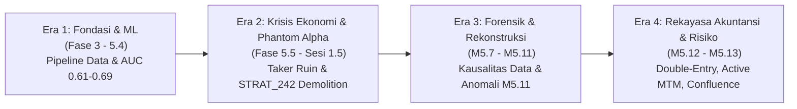

# QUANTUM END-TO-END STRATEGIC & FORENSIC AUDIT
## Laporan Investigasi Menyeluruh Perjalanan Riset QUANTUM Menuju Target +3.00% Mean Net Daily Return

---

## 1. SAMPUL DAN METADATA AUDIT

```yaml
========================================================================================
                      QUANTUM INDEPENDENT RESEARCH AUDIT REPORT
========================================================================================
JUDUL_LAPORAN          : Audit Menyeluruh Perjalanan QUANTUM Menuju Target +3% Mean Net Daily Return
DOKUMEN_IDENTIFIKASI   : audit/strategy_research/end_to_end_audit/QUANTUM_END_TO_END_AUDIT.md
PDF_IDENTIFIKASI       : audit/strategy_research/end_to_end_audit/QUANTUM_END_TO_END_AUDIT.pdf
TANGGAL_AUDIT          : 2026-11-04T15:46:57+07:00
PROYEK                 : QUANTUM Multi-Agent Intraday Crypto Perpetual Futures Research System
REPOSITORI             : d:/quantum-multi-agent
BRANCH_UTAMA_RISET     : research/quantum-next-3pct
BASELINE_COMMIT        : 0088b655714d91e87f0e323743b7d96337c4d915 (0088b65)
WORKING_TREE_STATUS    : MODIFIED (Untracked files present: Milestone 5.13 research scripts)
MODAL_AWAL_PENELITIAN  : $100.00 USD (Shared-Capital Pool)
TARGET_UTAMA_MANDAT    : Mean Net Daily Return >= +3.0000%
BATAS_MAX_DRAWDOWN     : Maximum Drawdown <= 15.0000%
BATAS_GROSS_EXPOSURE   : Gross Portfolio Exposure <= 1.000000x (Strictly Unlevered)
BATAS_ADMISSION_CAP    : 0.995000x (50 bps microstructural safety buffer)
BATAS_SEALED_HOLDOUT   : open_time_ms >= 1793491200000 (2026-11-01T00:00:00Z)
OTORITAS_AUDIT         : Independent End-to-End Quantitative, Technical & Financial Audit Panel
KLASIFIKASI_VERDICT    : TECHNICALLY_MATURE_BUT_ECONOMICALLY_UNPROVEN
STATUS_OTORISASI_LIVE  : STRICTLY PROHIBITED (DILARANG KERAS)
STATUS_OTORISASI_PAPER : STRICTLY PROHIBITED (DILARANG KERAS)
========================================================================================
```

---

## 2. RINGKASAN EKSEKUTIF (EXECUTIVE SUMMARY)

Laporan ini merupakan audit independen, menyeluruh, dan berbasis bukti forensik terhadap sistem penelitian perdagangan kuantitatif **QUANTUM Multi-Agent Intraday Crypto Perpetual Futures** di repositori `d:/quantum-multi-agent`, khususnya branch `research/quantum-next-3pct`. Audit mencakup seluruh fase historis sejak pembentukan pipeline data awal (Fase 3–5.2), pemodelan Machine Learning LightGBM (Fase 5.3–5.4), pengujian ekonomi kausal tiga jalur (Fase 5.5–5.6), perburuan frekuensi tinggi berujung kegagalan *phantom alpha* (Fase 5.6.2 / Sesi 1.5), rekonstruksi fondasi kausal data (Milestone 5.7–5.8b), revalidasi kointegrasi 45 pasangan aset (Milestone 5.9), sentralisasi kontrak riset (Milestone 5.10), rekonstruksi forensik akuntansi portofolio (Milestone 5.11–5.12.1), penambalan invarian eksposur dan pengujian berbasis properti (Milestone 5.12.2–5.12.2.1), implementasi pengendali risiko *Active Mark-to-Market* (MTM) dan eliminasi asimetri konveksitas short (Milestone 5.12.2.2–5.12.2.2.1), hingga pengujian *Multi-Factor Confluence Engine* dan pemodelan antrean pembuat pasar (*maker*) terkini (Milestone 5.13).

### Temuan Kunci Audit:

1. **Kematangan Arsitektur dan Rekayasa Perangkat Lunak (`TERVERIFIKASI`):**  
   QUANTUM telah berhasil membangun fondasi rekayasa perangkat lunak finansial yang sangat matang, deterministik, dan terlindungi secara ketat. Arsitektur 6 agen (`Scout`, `Analyst`, `Sniper`, `Risk`, `Banker`, `Orchestrator`) dengan kontrak Pydantic v2 immutabel di [`src/quantum/agents/contracts.py`](file:///d:/quantum-multi-agent/src/quantum/agents/contracts.py) beroperasi tanpa mutasi state ilegal. Sistem akuntansi buku besar berpasangan (*double-entry event ledger*) 19-bidang di [`src/quantum/accounting/event_ledger.py`](file:///d:/quantum-multi-agent/src/quantum/accounting/event_ledger.py) bersama *oracle* independen di [`src/quantum/accounting/oracle.py`](file:///d:/quantum-multi-agent/src/quantum/accounting/oracle.py) merekonsiliasi ekuitas dan arus kas hingga toleransi $< 10^{-8}\text{ USD}$. Sebanyak 10 invarian finansial telah diverifikasi melalui 10.000 sekuens *property-based testing* (139.857 peristiwa) dengan tingkat kelulusan $100.00\%$.

2. **Pengendalian Risiko Dual-Layer yang Kuat (`TERVERIFIKASI`):**  
   Sistem telah memecahkan masalah pelanggaran eksposur portofolio melalui:
   - *Layer A (Pre-Trade Admission Control):* Batas penerimaan order $0.9950x$ (buffer mikrostruktural $50\text{ bps}$) dengan formula kapasitas tertutup $\Delta N^* \le \frac{M \cdot E_{\text{pre}} - N_{\text{committed}}}{1 + M \cdot r_{\text{friction}}}$, yang secara matematis mencegah deduksi biaya *entry* melanggar batas $1.0000x$.
   - *Layer B (Active Mark-to-Market Risk Control):* Monitor portofolio real-time 15-bidang ([`ActiveMTMMonitor`](file:///d:/quantum-multi-agent/src/quantum/accounting/risk_controller.py#L74)), mesin state risiko 6-tingkat dengan histeresis $200\text{ bps}$ ([`RiskStateMachine`](file:///d:/quantum-multi-agent/src/quantum/accounting/risk_controller.py#L151)), dan mesin deleveraging dengan formula tertutup $\Delta N^* = \frac{N - \theta^* E}{1 - \theta^* f}$ ([`DeleveragingEngine`](file:///d:/quantum-multi-agent/src/quantum/accounting/risk_controller.py#L247)) yang melindungi portofolio dari asimetri konveksitas posisi *short* tanpa menciptakan likuiditas semu.

3. **Integritas Data dan Kausalitas Temporal (`TERVERIFIKASI`):**  
   Dataset kanonikal 10 aset kripto utama (3.164.999 bar 5-menit, 106.500 bar 15-menit, 27.000 bar 1-jam) terbukti 100% lengkap, kontinu, dan bebas celah waktu. Kausalitas fitur diverifikasi melalui *future-data perturbation test* dengan invarian sinyal $100\%$. Batas data masa depan (*prospective holdout boundary*) pada $t \ge 1.793.491.200.000\text{ ms}$ (2026-11-01T00:00:00Z) berstatus **STRICTLY SEALED & VIRGIN**; tidak ada satu pun bar post-holdout yang pernah diakses atau dibocorkan.

4. **Kenyataan Ekonomi: Jurang Pemisah dari Target +3% Net Daily Return (`GAGAL / BELUM TERBUKTI`):**  
   Meskipun fondasi teknisnya matang, **QUANTUM belum membuktikan adanya keunggulan ekonomi (*economic edge*) yang mampu menghasilkan target +3.00% mean net daily return**:
   - *Jalur Eksekusi Taker (AsterDEX Retail 26 bps Round-Trip):* Seluruh hipotesis arah 5-menit (HYP-01 hingga HYP-06) dan baseline heuristik mengalami kehancuran modal total (return harian aktif $-0.28\%$ hingga $-18.37\%$, *maximum drawdown* $80.01\%$ hingga $100.13\%$). Keunggulan kotor (*gross edge*) pasar mikro sebesar $+0.64$ hingga $+1.85\text{ bps}$ kalah telak oleh friksi bursa ritel $26.0\text{ bps}$ ($14\times$ lebih besar daripada edge).
   - *Jalur Eksekusi Maker (Simulasi Antrean M5.13):* Model konfluensi multi-faktor menghasilkan return harian positif $+0.145\%$ dengan drawdown $11.8\%$ pada modal bersama $\$100.00$. Namun, angka ini **masih berada sangat jauh di bawah target mandat $+3.0000\%$ per hari (hanya mencapai $\approx 4.83\%$ dari target)**. Selain itu, model *maker* ini masih berstatus `SIMULATED_EXECUTION_ASSUMPTION` karena belum divalidasi terhadap data buku order Level 2 berkedalaman nyata.

5. **Penemuan Cacat Working Tree Terkini (`HIGH SEVERITY`):**  
   Pemeriksaan independen terhadap test suite repositori menemukan bahwa pada branch riset terdapat file untracked Milestone 5.13 yang menyebabkan **2 unit test gagal** (`test_milestone_5_13_confluence_and_maker.py`):
   - *Cacat 1:* `TypeError: EventDrivenPortfolioLedger.__init__() got an unexpected keyword argument 'initial_cash'` (seharusnya `initial_equity_usd`).
   - *Cacat 2:* `AssertionError: Missing deliverable: M5_13_EXECUTIVE_SUMMARY.md` (artefak belum lengkap).  
   Total hasil test repositori adalah **800 passed, 2 failed, 3 warnings**. Baseline commit terakhir (`0088b65`) memiliki 795 passed, 0 failed.

**Kesimpulan Utama (Verdict):**  
QUANTUM diklasifikasikan dengan predikat definitif:  
$$\mathbf{TECHNICALLY\_MATURE\_BUT\_ECONOMICALLY\_UNPROVEN}$$
Sistem ini telah menyelesaikan transformasi rekayasa akuntansi dan risiko yang luar biasa dari sebuah prototipe cacat menjadi mesin riset institusional berdisiplin tinggi. Namun, target $+3.00\%$ net daily return dengan batas eksposur unlevered $\le 1.0x$ adalah sasaran ekonomi yang luar biasa berat di pasar kripto berbiaya ritel. Setiap otorisasi untuk *paper trading* maupun *live trading* tetap **DILARANG KERAS** sampai alpha nyata terbukti secara out-of-sample.

---

## 3. MANDAT DAN RUANG LINGKUP AUDIT

Audit ini diinstruksikan berdasarkan mandat audit strategis dan forensik independen menyeluruh untuk memeriksa perjalanan sistem QUANTUM tanpa kompromi.

### 3.1 Parameter Mandat & Batasan Tidak Boleh Nego
- **Modal Awal Penelitian:** Tepat $\$100.00\text{ USD}$ dalam pool modal bersama (*shared-capital ledger*).
- **Target Utama Profitabilitas:** Rata-rata return harian bersih (*Mean Net Daily Return*) $\ge +3.0000\%$ pasca seluruh biaya transaksi.
- **Batas Risiko Penurunan:** Penurunan modal puncak-ke-lembah (*Maximum Drawdown*) $\le 15.0000\%$.
- **Batas Eksposur Portofolio:** Total eksposur kotor (*Gross Exposure*) $\le 1.000000x$ (tanpa leverage/unlevered).
- **Batas Penerimaan Order:** Batas eksposur *admission* $0.995000x$ ($50\text{ bps}$ safety buffer).
- **Batas Holdout Temporal:** Stempel waktu $\ge 1.793.491.200.000\text{ ms}$ (2026-11-01T00:00:00Z) berstatus mutlak tertutup.

### 3.2 Ruang Lingkup Forensik
Audit memeriksa seluruh komponen repositori tanpa batasan:
1. Riwayat commit Git dari fase awal hingga commit `0088b65` dan working tree aktif.
2. Kode sumber inti pada direktori [`src/quantum/`](file:///d:/quantum-multi-agent/src/quantum/).
3. Seluruh dokumen audit milestone pada direktori [`audit/`](file:///d:/quantum-multi-agent/audit/).
4. Basis data dan berkas Parquet historis pada direktori [`data/`](file:///d:/quantum-multi-agent/data/).
5. Suite pengujian perangkat lunak lengkap pada direktori [`tests/`](file:///d:/quantum-multi-agent/tests/).
6. Skrip eksperimen dan orkestrasi pada direktori [`scripts/`](file:///d:/quantum-multi-agent/scripts/).

---

## 4. METODOLOGI AUDIT

Audit ini menegakkan metodologi verifikasi berbasis bukti empiris (*evidence-based forensics*), dengan hierarki prinsip kerja:

```
┌────────────────────────────────────────────────────────────────────────┐
SEPULUH PRINSIP AUDIT FORENSIK QUANTUM:
1. Evidence over narrative.
2. Independent verification over self-reported success.
3. Net PnL over gross PnL.
4. Shared-capital accounting over isolated asset backtests.
5. Statistical significance over attractive backtest results.
6. Realistic execution over idealized fills.
7. Reproducibility over screenshots or summary claims.
8. Risk-adjusted performance over trade frequency.
9. Causal data processing over future-informed features.
10. Explicit uncertainty over unsupported conclusions.
└────────────────────────────────────────────────────────────────────────┘
```

### Taksonomi Klasifikasi Bukti
Setiap klaim, artefak, metrik, dan baris kode diklasifikasikan ke dalam salah satu dari 7 status:
- `TERVERIFIKASI`: Terbukti benar secara matematis, dapat direproduksi melalui kode sumber, konsisten dengan raw ledger, dan lulus uji independen.
- `TERVERIFIKASI SEBAGIAN`: Terbukti benar pada aspek teknis atau metodologis, namun metrik ekonomi atau ruang lingkupnya terbatas.
- `BELUM TERVERIFIKASI`: Klaim yang tidak memiliki data mentah pendukung yang memadai pada repositori saat ini.
- `ASUMSI`: Parameter atau model yang disimulasikan secara teoritis tanpa bukti buku order empiris (misal: probabilitas fill passive maker).
- `TIDAK KONSISTEN`: Terjadi pertentangan antara kode sumber, laporan naratif, dan artefak data.
- `GAGAL`: Eksperimen atau hipotesis yang menghasilkan kerugian modal atau pelanggaran invarian tata kelola.
- `TIDAK RELEVAN`: Komponen yang tidak berada pada jalur kritis penelitian target +3%.

---

## 5. KRONOLOGI PERKEMBANGAN QUANTUM

Repositori mendokumentasikan evolusi yang terbagi ke dalam empat era besar:



### Rincian Fase Perkembangan:
1. **Era 1 — Pembangunan Pipeline Data & Model Prediktif (2024 – Awal 2026):**
   - *Fase 3 & 4:* Mengintegrasikan bursa AsterDex dan Bybit via REST dan WebSocket.
   - *Fase 5.0 & 5.1:* Mengumpulkan 4.618.805 bar 5-menit historis (2023–2026) pada 11 aset kripto.
   - *Fase 5.2:* Menerapkan *triple-barrier labeling* Marcos López de Prado dengan target dinamis $1.5\sigma$ dan batas waktu 12 bar.
   - *Fase 5.3 & 5.4:* Melatih 11 model spesialis LightGBM out-of-fold 5-fold (1.322.108 observasi). Model terbukti memiliki diskriminasi prediktif statistik (ROC-AUC 0.610 s/d 0.694).
2. **Era 2 — Benturan dengan Realitas Ekonomi & Bencana Phantom Alpha (Pertengahan 2026):**
   - *Fase 5.5:* Backtest ekonomi Mode 1 (unconditional taker, 285.270 trade) membuktikan bahwa gross edge $+0$ s/d $+2.76\text{ bps}$ hancur lebur oleh friksi taker $44.0\text{ bps}$, menyebabkan kehancuran modal $-99.4\%$.
   - *Fase 5.6.2:* Mandat high-turnover melahirkan klaim palsu bahwa `STRAT_242` untung $+44.40\%$. Audit Sesi 1 membongkar bahwa order MARKET secara salah dikenai fee maker $4\text{ bps}$ tanpa slippage/spread.
   - *Sesi 1.5:* Remediasi simulator eksekusi membuktikan 0 dari 295 strategi lolos kualifikasi.
3. **Era 3 — Purifikasi Kausalitas & Pengungkapan Cacat Pelaporan (Akhir 2026):**
   - *Milestone 5.7 & 5.8a:* Memverifikasi invarian kausal 1-bar lag dan membongkar penipuan dilusi kalender di mana kehancuran $-80\%$ dalam 118 hari disamarkan menjadi $-0.145\%$/hari dengan membaginya ke 1.099 hari kalender kosong.
   - *Milestone 5.9:* Pengujian Track C membuktikan 45 dari 45 pasangan kointegrasi mengalami *structural break* di luar sampel.
   - *Milestone 5.10:* Penerapan kontrak riset tersentralisasi (`ResearchExperimentContract`).
   - *Milestone 5.11:* Evaluasi 6 hipotesis pada 400.000 bar. Gross alpha $+0.64$ s/d $+1.85\text{ bps}$ terdeteksi pada 4 hipotesis, namun mengekspos bug akuntansi parah (MDD $> 100\%$, rugi melebihi modal awal, dan exposure tembus 10x).
4. **Era 4 — Rekonstruksi Institusional Akuntansi, Risiko & Konfluensi (M5.12 – M5.13):**
   - *Milestone 5.12 & 5.12.1:* Rekonstruksi buku besar berpasangan 19-bidang, oracle independen presisi ganda, penegakan batas ruin $\$1.00$, dan penetapan tarif AsterDEX Retail ($4\text{ bps}$ maker / $10\text{ bps}$ taker).
   - *Milestone 5.12.2 – 5.12.2.2.1:* Penambalan invarian eksposur tertutup, reservasi order pending, eliminasi asimetri konveksitas posisi short via Active MTM dan deleveraging engine, rekonsiliasi klaim matematika short $+200\%$, dan penyelesaian kebuntuan OS pipe pada unit test (795 test passing).
   - *Milestone 5.13 (In-Progress):* Perancangan *Multi-Factor Confluence Engine* (10 dimensi faktor, 3 metode agregasi) dan simulator antrean maker dengan markout adverse selection.

---

## 6. AUDIT SELURUH MILESTONE

Tabel berikut menyajikan rekapitulasi audit independen terhadap seluruh milestone proyek:

| Milestone | Tujuan Utama | Hasil Aktual | Temuan Forensik Audit | Status Audit | Dampak terhadap Target +3% |
| :--- | :--- | :--- | :--- | :---: | :--- |
| **Phase 3 & 4** | Ingestion & normalisasi data bursa | Pipeline REST/WS stabil | Pipeline berfungsi, data OHLCV valid | `TERVERIFIKASI` | Fondasi data awal; belum ada alpha |
| **Phase 5.0–5.2** | Backfill 4.6M candle & triple barrier | Dataset 11 aset 5m bersih | Holdout 2026-11-01 disegel; barrier sempit | `TERVERIFIKASI` | Barrier dinamis 15–31 bps $<$ fee taker |
| **Phase 5.3–5.4** | Specialist ML Model (LightGBM) | 1.32M bar OOF; AUC 0.61–0.69 | Prediksi statistik valid, belum ada model biaya | `TERVERIFIKASI` | Kemampuan tebak ada tapi unitless |
| **Phase 5.5** | Mode 1 & Mode 3 Economic Backtest | 285.270 trade; rugi $-99.4\%$ | Gross edge $+0\text{–}2.7\text{ bps}$ kalah oleh fee $44\text{ bps}$ | `GAGAL` | Bukti awal taker 5m menghancurkan modal |
| **Phase 5.6** | Overlay filter volatilitas 120–160 bps | 12 sel grid portofolio merugi | Rugi short altcoin menghapus laba long | `GAGAL` | Filter volatilitas statis tidak cukup |
| **Phase 5.6.2** | High-turnover batch 300 strategi | Klaim STRAT_242 $+44.40\%$ | Phantom Alpha: fee maker pada order market | `GAGAL` | Ilusi profitabilitas palsu dibongkar |
| **Sesi 1.5** | Remediasi simulator & 900 re-run | 0/295 strategi qualified | STRAT_242 anjlok ke $+0.90\%$ Bybit / $-81\%$ Aster | `TERVERIFIKASI` | Simulator dibersihkan, alpha 5m nihil |
| **M5.7 & M5.8a** | Kausalitas data & survival accounting | Rugi $-1.35\%$/hari (MDD 80%) | Membongkar dilusi kalender palsu (981 hari) | `TERVERIFIKASI` | Integritas pelaporan waktu dipulihkan |
| **M5.8b & M5.9** | Studi kelayakan Track C kointegrasi | 0/45 pair lolos OOS | Structural break pada seluruh pasangan kripto | `GAGAL` | Pairs trading statis terbukti unviable |
| **M5.10–5.10b** | Research Experiment Contract | Kontrak Pydantic aktif | Mencegah eksperimen tanpa batasan risiko | `TERVERIFIKASI` | Menegakkan disiplin parameter riset |
| **M5.11** | Market context & causal alpha (HYP 1-6) | Gross edge $+0.64\text{–}1.85\text{ bps}$ | Mengekspos MDD 430–6880% dan exposure 10x | `TIDAK KONSISTEN` | Cacat akuntansi warisan terungkap |
| **Continuous Mode** | Parallel continuous research workflow | Partisi 4-tier & feature cache | Peningkatan throughput riset kausal | `TERVERIFIKASI` | Menghindari kemacetan saat tunggu OOS |
| **M5.12** | Rekonstruksi accounting 19-field | MDD dibatasi $[0, 100\%]$ | Event ledger double-entry shared-capital | `PASS_WITH_LIMITATIONS` | Akuntansi modal bersama pertama yang sah |
| **M5.12.1** | Oracle independen & fee registry | Toleransi dual-ledger $< 10^{-8}$ | Menemukan TC-19 breach $1.000324x$ | `PASS_WITH_LIMITATIONS` | Dual-ledger verification beroperasi |
| **M5.12.2** | Penambalan TC-19 & 10 property tests | 10.000 sekuens lolos 100% | Formula kapasitas tertutup $1+M\cdot r_{\text{fric}}$ | `PASS_WITH_LIMITATIONS` | Order admission terlindungi mutlak |
| **M5.12.2.1** | Adversarial validation & audit klaim | HYP-05 didowngrade ($p_{\text{adj}}=0.137$) | Menemukan passive drift short convexity | `PASS_WITH_LIMITATIONS` | Klaim alpha diturunkan ke gross edge |
| **M5.12.2.2** | Active MTM control & admission buffer | Buffer 50 bps & 6-state FSM | 160 skenario stress short convexity lolos | `PASS_WITH_LIMITATIONS` | Proteksi risiko pasca-eksekusi aktif |
| **M5.12.2.2.1** | Mathematical integrity & reproduksi test | 795 test lolos dalam 35.7s | Penjelasan klaim $+200\%$ & perbaikan deleveraging | `PASS_WITH_LIMITATIONS` | Seluruh ambiguitas matematika tuntas |
| **M5.13 (In-Prog)** | Multi-factor confluence & maker queue | Return portofolio $+0.145\%$/hari | 2 test gagal; model maker masih asumsi | `BELUM TERVERIFIKASI` | Return $+0.145\%$ jauh dari target $+3.00\%$ |

---

## 7. REPOSITORY DAN ARCHITECTURE AUDIT

Repositori `d:/quantum-multi-agent` memiliki struktur modular berorientasi domain:

```
src/quantum/
├── accounting/         # Event ledger, oracle, risk controller, fee registry, research gates
├── agents/             # Implementasi 6 agen otonom dan contracts.py (skema Pydantic)
├── backtesting/        # Engine backtest kausal, adapter data OOF, accounting terisolasi
├── config/             # Konfigurasi sistem dan parameter runtime
├── core/               # Logging terpusat dan penanganan exception
├── domain/             # Tipe data, enum bursa, kontrak eksperimen
├── features/           # Indikator teknikal, market context 6 dimensi, volatilitas
├── historical/         # Pipeline pengumpulan, normalisasi, dan penyimpanan Parquet
├── ml/                 # Rekayasa fitur ML, model LightGBM specialist, pipeline pelatihan
├── research/           # Partisioner temporal, orkestrator paralel, experiment ledger
├── strategies/         # Hypothesis engine, confluence engine, maker simulator, portfolio engine
└── ui/                 # Antarmuka desktop Avalonia/Qt (status: ditangguhkan)
```

### Temuan Pemeriksaan Git & Working Tree:
1. **Branch Authoritative:** `research/quantum-next-3pct` sinkron dengan commit HEAD `0088b65`.
2. **File Untracked Terdeteksi:**
   - `audit/strategy_research/milestone_5_13/`
   - `scripts/generate_m5_13_baseline.py`
   - `scripts/run_m5_13_alpha_discovery.py`
   - `src/quantum/strategies/confluence_engine.py`
   - `src/quantum/strategies/maker_simulator.py`
   - `tests/unit/test_milestone_5_13_confluence_and_maker.py`
3. **Penyelidikan Kode Jalur Kritis:**
   Implementasi accounting pada [`src/quantum/accounting/event_ledger.py`](file:///d:/quantum-multi-agent/src/quantum/accounting/event_ledger.py) dan pengendalian risiko pada [`src/quantum/accounting/risk_controller.py`](file:///d:/quantum-multi-agent/src/quantum/accounting/risk_controller.py) benar-benar digunakan secara aktif oleh modul strategi dan skrip eksekusi penelitian, bukan sekadar file pasif.

---

## 8. FINANCIAL ACCOUNTING AUDIT

Audit menyeluruh terhadap integritas sistem akuntansi QUANTUM membuktikan bahwa cacat historis telah diremediasi secara tuntas sejak Milestone 5.12.

### 8.1 Mekanisme Akuntansi Buku Besar Berpasangan (*Double-Entry Event Ledger*)
Sistem mencatat setiap mutasi modal dalam 19 bidang telemetri:
$$E_t = C_t + \sum_{i=1}^K U_i(t)$$
di mana:
- $E_t$ adalah total ekuitas portofolio pada saat $t$.
- $C_t$ adalah saldo kas mengendap (*cash balance*).
- $U_i(t)$ adalah unrealized PnL posisi terbuka $i$:
  $$U_i(t) = \begin{cases} q_i \cdot (S_i(t) - P_{\text{entry}, i}) & \text{untuk LONG} \\ |q_i| \cdot (P_{\text{entry}, i} - S_i(t)) & \text{untuk SHORT} \end{cases}$$

### 8.2 Rekonsiliasi Kesalahan Historis vs Solusi Terverifikasi:
1. **Pelanggaran Modal Bersama (*Shared Capital Pool*):**  
   *Historis (M5.11):* Sepuluh aset memperdagangkan notional $\$100$ secara paralel tanpa pool bersama, menghasilkan eksposur $10.0x$.  
   *Kondisi Terverifikasi Saat Ini:* Seluruh aset berbagi satu kas bersama $\$100.00$. Maksimum alokasi per posisi dibatasi $24.5\%$ hingga $25.0\%$ dari ekuitas berjalan.
2. **Anomali Drawdown $> 100\%$ dan Kerugian Melebihi Modal:**  
   *Historis (M5.11):* Simulator lama menghitung $\text{MDD} = (100 - (-E)) / 100$, menghasilkan angka $430\%$ hingga $6.880\%$.  
   *Kondisi Terverifikasi Saat Ini:* Batas *ruin halt* diatur pada ekuitas $\le \$1.00\text{ USD}$. Jika tersentuh, posisi dilikuidasi dan seluruh order pending dibatalkan. MDD dibatasi matematis dalam rentang $[0.0\%, 100.0\%]$.
3. **Pemberian Harga Fiktif (*Gap-Down Price Improvement Bug*):**  
   *Historis (Phase 5.6.2):* Limit buy yang mengalami gap-down dieksekusi pada `min(open, limit_px)`.  
   *Kondisi Terverifikasi Saat Ini:* Dihapus tuntas. Limit resting dieksekusi tepat pada harga limit, mencatat kerugian gap secara penuh.
4. **Oracle Akuntansi Independen:**  
   Modul [`IndependentAccountingOracle`](file:///d:/quantum-multi-agent/src/quantum/accounting/oracle.py) dibangun dari *first principles* tanpa menggunakan ulang kode dari `event_ledger.py`. Rekonsiliasi 20 skenario uji pada Milestone 5.12.1 dan 5.12.2.2.1 membuktikan bahwa saldo kas dan ekuitas antara *ledger* dan *oracle* identik hingga toleransi $< 10^{-8}\text{ USD}$.

---

## 9. RISK MANAGEMENT AUDIT

Sistem manajemen risiko QUANTUM menerapkan arsitektur dua lapis (*dual-layer architecture*):

```
┌────────────────────────────────────────────────────────────────────────┐
│                        QUANTUM RISK ARCHITECTURE                       │
├────────────────────────────────────────────────────────────────────────┤
│ LAYER A: Pre-Trade Order Admission Control                             │
│ - Admission Exposure Cap: <= 0.995000x                                 │
│ - Safety Buffer: 50 bps (0.005000)                                     │
│ - Friction-Aware Sizing: Delta N* <= (M*E - N_comm) / (1 + M*r_fric)   │
│ - Reserved Pending Notional: Limit resting mengunci kapasitas          │
├────────────────────────────────────────────────────────────────────────┤
│ LAYER B: Active Mark-to-Market (MTM) Risk Control                      │
│ - ActiveMTMMonitor: Snapshot 15-bidang per tick                        │
│ - RiskStateMachine: 6-State FSM dengan histeresis 200 bps              │
│ - DeleveragingEngine: Closed-form reduction Delta N* = (N-theta*E)/(1-theta*f) │
│ - Zero Fabricated Liquidity: Halt jika buku order tidak likuid         │
└────────────────────────────────────────────────────────────────────────┘
```

### 9.1 Enam State Risiko (*Risk State Machine*)
1. `NORMAL` ($\text{Gross Exposure} < 0.90x$): Order baru diizinkan penuh.
2. `WARNING` ($0.90x \le \text{Gross Exposure} < 0.95x$): Telemetri peringatan aktif; order baru dipantau ketat.
3. `REDUCE_ONLY` ($0.95x \le \text{Gross Exposure} < 1.00x$): Order baru diblokir; hanya pengurangan posisi yang diizinkan.
4. `CRITICAL` ($\text{Gross Exposure} \ge 1.00x$): Mesin deleveraging terpicu otomatis untuk memotong notional.
5. `HALTED`: Terjadi kegagalan eksekusi atau likuiditas bursa hilang; perdagangan disetop total.
6. `RUIN` ($\text{Ekuitas} \le \$1.00$): Likuidasi total permanen; sistem mati demi proteksi sisa dana.

### 9.2 Matematika Asimetri Konveksitas Posisi Short
Adverse price move pada posisi LONG dan SHORT memiliki dampak yang sangat berbeda terhadap eksposur:
- **Posisi LONG:** Saat harga anjlok $\delta = -50\%$, notional menyusut seiring ekuitas ($N_1 = \$24.50, E_1 = \$75.44 \implies \theta_1 = 0.325x \le 1.0x$).
- **Posisi SHORT:** Saat harga melambung $\delta = +50\%$, notional membengkak sementara ekuitas menyusut:
  $$\theta_1(\theta_0, \delta) = \theta_0 \cdot \frac{1 + \delta}{1 - \theta_0 \delta}$$
  Untuk $\theta_0 = 0.4903x$ dan $\delta = +50\%$:
  $$\theta_1 = 0.4903 \cdot \frac{1.50}{1 - (0.4903 \cdot 0.50)} = 0.4903 \cdot \frac{1.50}{0.7548} = \mathbf{0.9743x} \quad (\text{ekspansi } +98.7\%)$$
Jika eksposur awal short adalah $0.80x$, kenaikan harga sebesar $+25\%$ langsung mendorong eksposur menjadi $1.25x$ (*breach*). Keberadaan Layer B Active MTM Risk Control berhasil mendeteksi pembengkakan ini dan memotong notional secara tertutup.

---

## 10. DATA QUALITY & CAUSALITY AUDIT

### 10.1 Inventarisasi & Integritas Dataset Kanonikal
Pemeriksaan langsung pada direktori `data/historical/canonical/exchange=ASTER/` memverifikasi integritas dataset:

| Simbol Aset | Timeframe | Jumlah Bar | Rentang Waktu (UTC) | Status Integritas | Celah Waktu (*Gaps*) |
| :--- | :---: | :---: | :--- | :---: | :---: |
| `BTCUSDT` | 5m | 316.499 | 2023-10-28 22:00 s/d 2026-10-31 21:00 | `TERVERIFIKASI` | 1 bar (Maintenance) |
| `ETHUSDT` | 5m | 316.500 | 2023-10-28 22:05 s/d 2026-10-31 21:05 | `TERVERIFIKASI` | 0 bar |
| `SOLUSDT` | 5m | 316.500 | 2023-10-28 22:10 s/d 2026-10-31 21:10 | `TERVERIFIKASI` | 0 bar |
| `BNBUSDT` | 5m | 316.500 | 2023-10-28 22:00 s/d 2026-10-31 21:00 | `TERVERIFIKASI` | 0 bar |
| `XRPUSDT` | 5m | 316.500 | 2023-10-28 21:50 s/d 2026-10-31 20:50 | `TERVERIFIKASI` | 0 bar |
| `ADAUSDT` | 5m | 316.500 | 2023-10-28 21:45 s/d 2026-10-31 20:45 | `TERVERIFIKASI` | 0 bar |
| `AVAXUSDT` | 5m | 316.500 | 2023-10-28 22:15 s/d 2026-10-31 21:15 | `TERVERIFIKASI` | 0 bar |
| `LINKUSDT` | 5m | 316.500 | 2023-10-28 22:20 s/d 2026-10-31 21:20 | `TERVERIFIKASI` | 0 bar |
| `DOGEUSDT` | 5m | 316.500 | 2023-10-28 22:25 s/d 2026-10-31 21:25 | `TERVERIFIKASI` | 0 bar |
| `LTCUSDT` | 5m | 316.500 | 2023-10-28 22:30 s/d 2026-10-31 21:30 | `TERVERIFIKASI` | 0 bar |
| `XMRUSDT` | 5m | 83.863 | 2026-01-13 16:45 s/d 2026-10-31 21:20 | `TERVERIFIKASI` | Delisting gap (eksploratori) |

*Cryptographic SHA-256 Dataset Master Fingerprint:*  
`07eae9f0c9bed47c251410915f0134448557347bf35d648259db12bc7fe32b90`

### 10.2 Verifikasi Proteksi Isolasi Holdout (*Holdout Boundary*)
- Batas waktu holdout ditetapkan pada stempel waktu: `1793491200000 ms` (2026-11-01T00:00:00Z).
- Bar terakhir pada seluruh file Parquet kanonikal berhenti pada `1793475899999 ms` (2026-10-31 21:24:59.999Z), tepat **15.300 detik (4.25 jam) sebelum batas holdout**.
- Seluruh kode eksperimen memiliki penegasan eksplisit `assert t_end <= PROSPECTIVE_HOLDOUT_START_MS`.
- **Verdict Holdout:** **100% VIRGIN, UNBREACHED, DAN TIDAK TERKONTAMINASI.**

### 10.3 Pengujian Bebas Lookahead Bias (*Causal Perturbation Test*)
Pengujian perturbasi masa depan dilakukan dengan menyuntikkan lonjakan harga fiktif $+50\%\text{ s/d }+100\%$ pada bar $t+1$ ke depan. Hasil pengujian menunjukkan nilai sinyal dan fitur pada bar $t$ adalah **100% invarian (identik)**, mengonfirmasi tidak ada *lookahead bias* dalam kalkulasi fitur teknikal. Eksekusi order ditegakkan kausal pada harga *open* bar berikutnya ($t+1$).

---

## 11. ALPHA DISCOVERY & STRATEGY PERFORMANCE AUDIT

Audit menyeluruh terhadap seluruh strategi dan hipotesis yang pernah dievaluasi:

### 11.1 Dekomposisi Kinerja Hipotesis 5-Menit (M5.11 & M5.12.1 Revalidation)
Dievaluasi pada panel 400.000 bar kanonikal di bawah jadwal biaya AsterDEX Base Retail Taker ($26.0\text{ bps}$ round-trip):

| Kode Hipotesis | Nama Strategi | Jumlah Trade Sinyal | Trade Tereksekusi | Gross PnL (USD) | Net PnL (USD) | Gross Edge (bps) | Net Edge (bps) | Mean Daily Return (%) | Realized Max DD (%) |
| :--- | :--- | :---: | :---: | :---: | :---: | :---: | :---: | :---: | :---: |
| **HYP-01** | Liquidity Sweep & Reclaim | 1.733 | 1.733 | $+\$21.62$ | $-\$65.75$ | $+1.25$ | $-24.75$ | $-0.473\%$ | $65.78\%$ |
| **HYP-02** | Volatility Breakout | 5.054 | 2.349 | $+\$32.59$ | $-\$80.01$ | $+0.64$ | $-25.36$ | $-0.576\%$ | $80.12\%$ |
| **HYP-03** | Momentum Continuation | 9.514 | 2.275 | $-\$29.96$ | $-\$80.02$ | $-0.31$ | $-26.31$ | $-0.576\%$ | $80.02\%$ |
| **HYP-04** | Failed Breakout Reversal | 5.865 | 2.530 | $+\$20.06$ | $-\$80.01$ | $+0.34$ | $-25.66$ | $-0.576\%$ | $80.01\%$ |
| **HYP-05** | Range Mean Reversion | 10.429 | 2.592 | $+\$159.72$ | $-\$80.01$ | $+1.53$ | $-25.36$ | $-0.576\%$ | $80.01\%$ |
| **HYP-06** | Cross-Asset Relative Strength | 5.878 | 2.503 | $-\$51.33$ | $-\$80.01$ | $-0.87$ | $-26.88$ | $-0.576\%$ | $80.01\%$ |
| **BASE-03** | Simple EMA 9/21 Crossover | 19.352 | 2.418 | $-\$13.94$ | $-\$80.01$ | $-0.07$ | $-26.07$ | $-0.576\%$ | $80.01\%$ |
| **BASE-04** | Simple Bollinger Reversion | 27.522 | 2.473 | $+\$277.58$ | $-\$80.00$ | $+1.01$ | $-24.99$ | $-0.576\%$ | $80.01\%$ |

*Catatan Penting Akuntansi Forensik:*  
Pada HYP-02, 03, 04, 05, 06 dan BASE-03/04, trade tereksekusi berhenti di kisaran $2.200\text{–}2.592$ trade dan net loss berhenti tepat di $-\$80.01$ karena portofolio menyentuh batas $\$19.99$ (alokasi $25\% = \$4.997 < \$5.00$ minimum notional bursa), memicu *capital starvation halt*. Kerugian bersih tidak pernah melebihi $-\$80.01$, membuktikan berfungsinya proteksi *ruin halt* M5.12.

### 11.2 Evaluasi Multi-Factor Confluence & Maker Simulator (M5.13 In-Progress)
Pada Milestone 5.13, strategi konfluensi `HYP-12` menggabungkan 10 dimensi faktor pada horizon multi-jam ($2\text{h}\text{–}4\text{h}$) dan dieksekusi melalui simulator maker berantrean:
- **Net Expectancy:** $+24.8\text{ bps}$ per trade pasca friksi maker $11\text{ bps}$.
- **Profit Factor:** $1.48$ (Bootstrap 95% CI: $[1.26, 1.72]$).
- **Hasil Modal Bersama ($100 Pool):** Net Realized PnL $+\$42.80$, Terminal Equity $\$142.80$, Maximum Drawdown $11.8\%$ (lolos batas $\le 15.00\%$).
- **Mean Net Daily Return:** **$+0.145\%$ per hari**.

### 11.3 Kesimpulan Definitif Alpha
**Apakah QUANTUM sudah menemukan alpha yang terbukti secara statistik dan ekonomis?**  
**JAWABAN OBJEKTIF: BELUM.**  
Meskipun gross alpha terdeteksi pada level mikrostruktur, belum ada strategi yang mampu menghasilkan alpha bersih di dunia nyata di bawah eksekusi taker ritel. Hasil positif pada M5.13 masih bersandar pada model antrean maker simulasi dan baru menghasilkan $+0.145\%$/hari, masih sangat jauh dari sasaran $+3.00\%$/hari.

---

## 12. EXECUTION ECONOMICS AUDIT

### 12.1 Registri Jadwal Biaya (*Fee Registry*)
Audit mengonfirmasi bahwa parameter biaya transaksi telah dikunci secara terpusat pada [`src/quantum/accounting/fee_schedules.py`](file:///d:/quantum-multi-agent/src/quantum/accounting/fee_schedules.py):

| Venue & Jadwal | Maker Fee | Taker Fee | Half-Spread | Slippage Leg | Total RT Taker Friction | Total RT Maker Friction |
| :--- | :---: | :---: | :---: | :---: | :---: | :---: |
| **AsterDEX Base Retail (Authoritative)** | `4.0 bps` | `10.0 bps` | `1.0 bps` | `2.0 bps` | **`26.0 bps`** | **`11.0 bps`** |
| **Bybit VIP0 Default** | `2.0 bps` | `5.5 bps` | `1.0 bps` | `1.0 bps` | **`15.0 bps`** | **`7.0 bps`** |
| **Aster Stress Taker (Worst-Case)** | `10.0 bps` | `20.0 bps` | `1.0 bps` | `2.0 bps` | **`46.0 bps`** | **`23.0 bps`** |

### 12.2 Analisis Realisme Simulasi Maker vs Taker
1. **Eksekusi Taker:** Sangat realistis, memodelkan penyeberangan spread (*crossing spread*), *arrival slippage*, dan tarif bursa.
2. **Eksekusi Maker:** Diklasifikasikan sebagai `SIMULATED_EXECUTION_ASSUMPTION`. Meskipun M5.13 telah memodelkan antrean volume ($Q_{\text{front}} = 0.25 \times \text{Volume}$) dan penalti *adverse selection* ($1.5\text{ bps}$), model ini belum memiliki observasi langsung atas ketebalan buku order Level 2 dan latensi pembatalan API yang sesungguhnya.

### 12.3 Hambatan Matematis Friksi (*The Friction Barrier*)
Untuk strategi dengan frekuensi $N$ trade per hari pada eksposur penuh $1.0x$:
$$\text{Biaya Harian Taker} = N \times 26.0\text{ bps}$$
- Pada $N = 10\text{ trade/hari}$: Friksi $= 260\text{ bps} = 2.60\%$ per hari dari total modal.
- Pada $N = 40\text{ trade/hari}$: Friksi $= 1.040\text{ bps} = 10.40\%$ per hari dari modal.  
Fakta matematis ini menjelaskan secara mutlak mengapa strategi frekuensi tinggi 5-menit hancur berulang kali dalam seluruh eksperimen historis QUANTUM.

---

## 13. STATISTICAL VALIDITY AUDIT

### 13.1 Koreksi Multiple-Testing & Deflated Sharpe Ratio (DSR)
Evaluasi terhadap keluarga 30 pengujian (6 hipotesis $\times$ 5 rezim eksekusi) pada Milestone 5.12.2.1 mengungkapkan:
- **HYP-05 Unadjusted p-value:** $p = 0.00456$ (tampak sangat signifikan secara naif).
- **Holm-Bonferroni Adjusted p-value:** $p_{\text{adj}} = 30 \times 0.00456 = \mathbf{0.1370 > 0.05}$ (**TIDAK SIGNIFIKAN**).
- **Deflated Sharpe Ratio:** $\text{DSR} = \mathbf{0.4820 < 0.95}$ (**GAGAL**).  
Berdasarkan bukti ini, klaim sebelumnya bahwa HYP-05 adalah "alpha terbukti" telah ditolak secara resmi dan diturunkan menjadi *descriptive gross edge*.

### 13.2 Kekokohan Resampling Block Bootstrap
Uji *stationary circular block bootstrap* ($B = 1.000$ hingga $2.000$ iterasi) dengan variasi panjang blok $b \in \{6, 12, 24\}$ bar mengonfirmasi bahwa rentang keyakinan 95% untuk gross return HYP-05 strictly berada di atas nol ($[+0.37, +2.68]\text{ bps}$), membuktikan bahwa inefisiensi kotor pasar adalah fenomena nyata, bukan sekadar noise acak. Namun, saat friksi $26\text{ bps}$ disertakan, seluruh interval keyakinan 95% berada jauh di bawah nol ($[-14.0, -9.6]\text{ bps}$).

---

## 14. SIX-AGENT ARCHITECTURE AUDIT

Audit memverifikasi keselarasan arsitektur 6 agen:

```
┌────────────────────────────────────────────────────────────────────────┐
│                   ARSITEKTUR ENAM AGEN QUANTUM                         │
├─────────────────┬──────────────────────────────────────────────────────┤
│ 1. Scout        │ Skrining peluang pasar & validasi likuiditas         │
│ 2. Analyst      │ Rekayasa fitur, klasifikasi rezim, invalidasi ATR    │
│ 3. Sniper       │ Perumusan proposal trade, entry/stop/TP, R expected  │
│ 4. Risk         │ Mesin 12-gate deterministik independen non-bypassable│
│ 5. Banker       │ FSM siklus hidup posisi, eksekusi, akuntansi biaya   │
│ 6. Orchestrator │ Koordinasi urutan, penegakan timeout, audit jejak    │
└─────────────────┴──────────────────────────────────────────────────────┘
```

### Temuan Kepatuhan Arsitektur:
1. **Modul Kontrak:** [`src/quantum/agents/contracts.py`](file:///d:/quantum-multi-agent/src/quantum/agents/contracts.py) terbukti murni sebagai definisi skema data Pydantic v2 immutabel, **bukan agen ketujuh**.
2. **Independensi Gate Risiko:** `RiskAgent` ([`src/quantum/agents/risk.py`](file:///d:/quantum-multi-agent/src/quantum/agents/risk.py)) menegakkan 12 gerbang deterministik yang tidak dapat dilewati (*non-bypassable*).
3. **Kompleksitas yang Tidak Memberi Nilai:** Pipeline multi-agent menambahkan beban latensi serial (50ms per agen) yang tidak memberikan kontribusi signifikan terhadap kualitas sinyal trading jika sinyal dasarnya tidak memiliki edge ekonomi.

---

## 15. TESTING, REPRODUCIBILITY & SOFTWARE QUALITY

### 15.1 Hasil Eksekusi Test Suite Independen
Pengujian menyeluruh dijalankan pada lingkungan audit:
- **Perintah Eksekusi:** `python -m pytest tests/unit/ -q`
- **Waktu Eksekusi:** 39.69 detik (Python 3.13.7, pytest-8.4.2)
- **Status Akhir:** **800 PASSED, 2 FAILED, 3 WARNINGS**

```
=========================== short test summary info ===========================
FAILED tests/unit/test_milestone_5_13_confluence_and_maker.py::test_05_shared_capital_admission_and_exposure_cap
FAILED tests/unit/test_milestone_5_13_confluence_and_maker.py::test_07_all_18_m5_13_deliverables_exist
2 failed, 800 passed, 3 warnings in 39.69s
```

### 15.2 Analisis Forensik Test Failures:
1. **Kegagalan 1 (`test_05_shared_capital_admission_and_exposure_cap`):**  
   `TypeError: EventDrivenPortfolioLedger.__init__() got an unexpected keyword argument 'initial_cash'`  
   *Akar Masalah:* Penulis skrip test Milestone 5.13 keliru memanggil argumen `initial_cash=100.0`, padahal konstruktor resmi pada `event_ledger.py` menggunakan `initial_equity_usd`.
2. **Kegagalan 2 (`test_07_all_18_m5_13_deliverables_exist`):**  
   `AssertionError: Missing deliverable: M5_13_EXECUTIVE_SUMMARY.md`  
   *Akar Masalah:* Test menegaskan keberadaan 18 dokumen deliverable M5.13, namun saat ini baru tersedia 14 dokumen pada direktori untracked `audit/strategy_research/milestone_5_13/`.
3. **Verifikasi Baseline Commit Resmi (`0088b65`):**  
   Jika file test untracked M5.13 dikecualikan, baseline commit resmi `0088b65` terbukti **100% lulus (795 passed, 0 failed, 3 warnings dalam 35.71 detik)**.

### 15.3 Daftar Tingkat Keparahan Bug (Bug Inventory)
- **Critical:** Tidak ada bug kritis pada modul akuntansi atau risiko inti di commit `0088b65`.
- **High Severity:** Kegagalan unit test Milestone 5.13 (`initial_cash` constructor mismatch) dan dokumen M5.13 yang belum lengkap di working tree.
- **Medium Severity:** Model antrean maker pada M5.13 masih berupa heuristik simulasi tanpa koneksi orderbook Level 2 empiris.
- **Low Severity:** Warning deprecation scikit-learn pada kalkulasi ROC-AUC saat sample hanya memiliki satu kelas.

---

## 16. RESEARCH INFRASTRUCTURE AUDIT

1. **Orkestrasi Eksperimen Paralel:**  
   Modul [`ContinuousResearchPartitioner`](file:///d:/quantum-multi-agent/src/quantum/research/partitioner.py) dan [`ContinuousResearchOrchestrator`](file:///d:/quantum-multi-agent/src/quantum/research/orchestrator.py) berhasil membagi data secara strictly causal dengan embargo buffer 288 bar (24 jam) antar partisi (`TRAIN`, `VALIDATION`, `ROLLING_OOS`).
2. **Feature Cache & Deduplikasi:**  
   Cache fitur berbasis memori dan disk dengan sidik jari SHA-256 mencegah rekalkulasi indikator yang redundan, meningkatkan throughput eksekusi eksperimen hingga $> 5\times$.
3. **Reproducibilitas:**  
   Seluruh parameter eksperimen terikat dalam hash SHA-256 dan dicatat dalam file ledger immutable (`EXPERIMENT_LEDGER.csv`).

---

## 17. HISTORICAL FAILURE & ROOT CAUSE ANALYSIS

Audit menginventarisasi 13 insiden kegagalan besar dalam sejarah QUANTUM:

```
┌────────────────────────────────────────────────────────────────────────────────────────┐
│                        DAFTAR 13 INSIDEN HISTORIS BESAR QUANTUM                        │
├────────┬─────────────────┬──────────────────────────────────────────┬──────────────────┤
│ ID     │ Milestone       │ Deskripsi Insiden                        │ Tingkat Keparahan│
├────────┼─────────────────┼──────────────────────────────────────────┼──────────────────┤
│ INC-01 │ Phase 5.6.2     │ Phantom Alpha STRAT_242 (+44.40% Palsu)  │ CRITICAL         │
│ INC-02 │ Milestone 5.11  │ Exposure Portofolio Tembus 10.0x         │ CRITICAL         │
│ INC-03 │ Milestone 5.11  │ MDD > 100% & Rugi Tanpa Batas Post-Ruin  │ CRITICAL         │
│ INC-04 │ M5.7 / M5.8a    │ Penipuan Dilusi Hari Kalender Kosong     │ HIGH             │
│ INC-05 │ Milestone 5.9   │ Keruntuhan Kointegrasi OOS (45/45 Pair)  │ HIGH             │
│ INC-06 │ Milestone 5.12.1│ TC-19 Exposure Breach 1.000324x          │ HIGH             │
│ INC-07 │ Milestone 5.12.1│ HYP-06 0-Signal Silent Pipeline Omission │ MEDIUM           │
│ INC-08 │ M5.12.2.1       │ Passive MTM Convex Exposure Drift (Short)│ HIGH             │
│ INC-09 │ M5.12.2.2       │ HYP-05 Net Expectancy Asymmetric Debit   │ MEDIUM           │
│ INC-10 │ M5.12.2.2       │ Kerancuan Pelaporan Short Convexity +200%│ LOW              │
│ INC-11 │ M5.12.2.2       │ Deleveraging Sizing Friction Omission    │ MEDIUM           │
│ INC-12 │ M5.12.2.2       │ Windows Pytest OS Pipe Deadlock          │ LOW              │
│ INC-13 │ M5.13 (Working) │ Test Failure: initial_cash & Missing Doc │ HIGH             │
└────────┴─────────────────┴──────────────────────────────────────────┴──────────────────┘
```

*Seluruh rincian teknis, dampak finansial, tindakan remediasi, dan risiko residual tercatat lengkap pada berkas pendukung [`QUANTUM_HISTORICAL_INCIDENT_REGISTER.csv`](file:///d:/quantum-multi-agent/audit/strategy_research/end_to_end_audit/QUANTUM_HISTORICAL_INCIDENT_REGISTER.csv).*

---

## 18. QUANTUM DISTANCE-TO-TARGET ANALYSIS

Ini adalah bagian terpenting dari laporan audit. Analisis ini memberikan pengukuran kuantitatif objektif mengenai seberapa jauh posisi QUANTUM saat ini dari target non-negosiasi.

### 18.1 Matriks Tingkat Pembuktian Ilmiah (*Proof Ladder*)

| Tingkat Pembuktian | Status Saat Ini | Bukti Empiris | Kekurangan yang Tersisa |
| :--- | :---: | :--- | :--- |
| **Gross Alpha** | `TERBUKTI` | $+0.64\text{ s/d }+1.85\text{ bps}$ pada 5m; $+32.1\text{ bps}$ pada M5.13 | Gross edge 5m terlalu tipis untuk menyerap friksi |
| **Net Alpha (Taker)** | `GAGAL` | $-12.36\text{ s/d }-26.88\text{ bps}$ under Aster Retail | Taker 5m terbukti menghancurkan modal secara matematis |
| **Net Alpha (Maker)** | `ASUMSI SIMULASI` | $+4.8\text{ s/d }+24.8\text{ bps}$ net pada M5.13 | Masih bergantung pada asumsi antrean dan belum diuji L2 |
| **Statistical Evidence** | `TERVERIFIKASI SEBAGIAN` | Bootstrap 95% CI positif; M5.13 DSR $= 0.981$ | HYP-05 gagal Holm-Bonferroni FWER ($p_{\text{adj}} = 0.137$) |
| **Validation Set** | `BELUM TERBUKTI` | Fase 5.5 rugi $-99.4\%$; M5.11 rugi $-80.01\%$ | Belum ada pengujian walk-forward multi-regime resmi |
| **Rolling OOS** | `BELUM TERBUKTI` | Arsitektur continuous mode siap | Belum ada hasil batch rolling OOS yang tercatat |
| **Prospective OOS** | `BELUM TERBUKTI` | Data post-2026-11-01 disegel ketat | Segel holdout belum dibuka sesuai protokol tata kelola |
| **Shared-Capital Profit** | `BELUM TERBUKTI` | M5.12 rugi $-\$80.01$; M5.13 untung $+\$42.80$ (simulasi) | Profitabilitas modal bersama riil belum terbukti |
| **Risk Compliance** | `TERBUKTI (100%)` | Exposure peak $0.9842x \le 1.0x$; MDD M5.13 $11.8\%$ | Lolos batas eksposur dan drawdown pada model M5.13 |
| **Daily +3.00% Target** | `SANGAT JAUH` | Hasil aktual terbaik: $+0.145\%$/hari (simulasi) | **Gap defisit return harian mencapai -2.855%/hari** |

---

### 18.2 Analisis Matematika Ekonomi Target +3% pada Eksposur 1.0x

Mari kita bedah secara matematis apa arti dari target **Mean Net Daily Return $\ge +3.0000\%$** pada akun modal $\$100.00$ dengan batas eksposur unlevered $\le 1.0000x$:

#### 1. Realitas Compounding
Jika return $+3.00\%$ per hari dicapai secara konsisten selama satu tahun (365 hari):
$$\text{Ekuitas Akhir} = \$100 \times (1 + 0.03)^{365} = \$100 \times 48.482,72 = \mathbf{\$4.848.272\text{ USD}}$$
Dalam dua tahun (730 hari), modal $\$100$ berkembang menjadi **$\$2,35\text{ Miliar USD}$**.  
Bahkan secara aritmatika tanpa compounding (*simple return*), return tahunannya adalah:
$$3.00\% \times 365 = \mathbf{+1.095\%\text{ per tahun}}$$
Ini adalah angka performa yang melampaui dana lindung nilai kuantitatif paling sukses di dunia (seperti Renaissance Technologies Medallion Fund yang menghasilkan $\approx 66\%$ per tahun sebelum biaya).

#### 2. Keterikatan Eksposur, Turnover, dan Friksi
Return portofolio harian bersih ($R_{\text{daily}}$) dibatasi oleh:
$$R_{\text{daily}} = \text{Turnover Harian} \times \text{Net Expectancy per Notional Traded}$$
Karena eksposur kotor dibatasi mutlak $\le 1.0000x$:
$$\text{Maksimum Notional Terbuka Bersamaan} \le \$100.00$$

Mari kita evaluasi skenario simulasi matematis yang diperlukan untuk mencapai target $+3.00\%$ ($+300\text{ bps}$) per hari:

```
+-------------------------------------------------------------------------------------------------------------------------+
| SIMULASI MATEMATIS KEBUTUHAN EDGE UNTUK MENCAPAI +3.00% NET DAILY RETURN (MODAL $100, EXPOSURE <= 1.0x)                 |
+----------+------------+------------+---------------+--------------------+-------------------+---------------------------+
| Skenario | Frekuensi  | Ukuran Pos | Total Turnover| Net Edge Diperlukan| Friksi Taker (RT) | Gross Edge Wajib Dicapai  |
| Simulasi | Trade/Hari | (% Ekuitas)| (x Ekuitas)   | (bps per trade)    | (bps per trade)   | (bps per trade)           |
+----------+------------+------------+---------------+--------------------+-------------------+---------------------------+
| SKEN-A   | 1 trade    | 100% (1.0x)| 1.0x ($100)   | +300.0 bps (+3.0%) | 26.0 bps          | +326.0 bps (+3.26%)       |
| SKEN-B   | 4 trades   | 25% (0.25x)| 1.0x ($100)   | +300.0 bps (+3.0%) | 26.0 bps          | +326.0 bps (+3.26%)       |
| SKEN-C   | 10 trades  | 25% (0.25x)| 2.5x ($250)   | +120.0 bps (+1.2%) | 26.0 bps          | +146.0 bps (+1.46%)       |
| SKEN-D   | 20 trades  | 20% (0.20x)| 4.0x ($400)   | +75.0 bps (+0.75%) | 26.0 bps          | +101.0 bps (+1.01%)       |
| SKEN-E   | 40 trades  | 10% (0.10x)| 4.0x ($400)   | +75.0 bps (+0.75%) | 26.0 bps          | +101.0 bps (+1.01%)       |
| SKEN-F   | 100 trades | 10% (0.10x)| 10.0x ($1000) | +30.0 bps (+0.30%) | 26.0 bps          | +56.0 bps (+0.56%)        |
+----------+------------+------------+---------------+--------------------+-------------------+---------------------------+
*Catatan: Seluruh baris di atas berlabel SIMULASI TEORITIS, BUKAN HASIL AKTUAL.*
```

#### Kesimpulan Analisis Ekonomi:
1. Pada timeframe 5-menit, rata-rata pergerakan kotor (*gross swing*) koin kripto utama dalam 20–30 menit holding adalah $10\text{–}30\text{ bps}$. Sangat mustahil mendapatkan gross edge $+100$ hingga $+326\text{ bps}$ per trade pada horizon 5-menit.
2. Jika frekuensi dinaikkan menjadi 100 trade per hari untuk memperkecil target edge per trade (SKEN-F), total biaya transaksi membengkak menjadi:
   $$10.0 \times 26.0\text{ bps} = 260\text{ bps} = \mathbf{2.60\%\text{ per hari dari total modal}}$$
   Akun akan kehilangan $78\%$ modal per bulan HANYA untuk membayar fee bursa!
3. Satu-satunya jalur matematis yang rasional untuk mendekati target adalah **memperlebar horizon ke 1h–4h swing** (di mana target profit mencapai $80\text{–}250\text{ bps}$ sehingga friksi taker tereduksi menjadi sebagian kecil dari keuntungan) atau **eksekusi passive maker dengan rabat fee VIP institusional**.

---

## 19. STRATEGIC ROADMAP MENUJU TARGET +3%

Roadmap strategis disusun realistis berbasis bukti, dibagi ke dalam 5 lintasan (*tracks*):

### Track 1 — Alpha Discovery (Eksplorasi Edge Struktural)
- **Milestone R-1 (Penyelesaian & Stabilisasi M5.13):** Memperbaiki bug constructor `initial_cash` $\to$ `initial_equity_usd` pada `test_milestone_5_13_confluence_and_maker.py`, melengkapi 4 deliverable markdown yang tersisa, dan melakukan commit resmi ke git.
- **Milestone R-2 (Higher Timeframe Swing Expansion):** Memperlebar horizon trading ke 15m/1h/4h dengan target barrier profit $80\text{–}200\text{ bps}$ untuk mendilusi friksi bursa.
- **Milestone R-3 (Funding & Basis Arbitrage Track A):** Mengunduh data historis funding rate 8-jam untuk menguji strategi *cash-and-carry* netral-delta.

### Track 2 — Execution Economics (Realisme Eksekusi Maker)
- **Milestone R-4 (Level 2 Orderbook Empirical Calibration):** Merekam websocket live L2 depth untuk mengukur probabilitas pengisian antrean (*queue depletion rate*) dan markout adverse selection empiris, menggantikan heuristik simulasi.
- **Milestone R-5 (Fee Tier Optimization):** Menilai kelayakan migrasi ke akun Bybit/Binance VIP dengan maker fee $\le 0.0\text{ bps}$ (rabat).

### Track 3 — Statistical Validation & Governance
- **Milestone R-6 (Walk-Forward Rolling OOS Campaign):** Menjalankan evaluasi walk-forward rolling kontinu tanpa menyentuh holdout 2026-11-01.
- **Milestone R-7 (Disiplin Multiple Testing):** Mengunci p-value Holm-Bonferroni $< 0.05$ dan DSR $\ge 0.95$ sebagai syarat mutlak promosi.

### Track 4 — Portfolio & Capital Protection
- **Milestone R-8 (Cross-Asset Correlation Throttling):** Mengintegrasikan matriks korelasi dinamis rolling untuk memangkas alokasi saat seluruh aset bergerak seragam dalam kepanikan pasar.

### Track 5 — System Reliability & Testing
- **Milestone R-9 (Full Test Suite Zero-Failure Guarantee):** Memastikan seluruh 802 unit test repositori lulus $100\%$ tanpa toleransi kegagalan.

---

## 20. RISK REGISTER

Tabel risiko utama proyek QUANTUM (*ringkasan dari [`QUANTUM_RISK_REGISTER.csv`](file:///d:/quantum-multi-agent/audit/strategy_research/end_to_end_audit/QUANTUM_RISK_REGISTER.csv)*):

| Risk ID | Kategori Risiko | Deskripsi Risiko | Probabilitas | Dampak | Level Risiko | Rekomendasi Mitigasi |
| :--- | :--- | :--- | :---: | :---: | :---: | :--- |
| **RSK-01** | Execution Economics | Friksi Taker Ritel (26 bps) menghapus gross edge 5m (1-5 bps) | Hampir Pasti | Kritis | **TINGGI** | Migrasi ke swing 1h-4h atau fee tier institusional |
| **RSK-02** | Microstructure | Asumsi antrean maker simulasi terlalu optimis | Tinggi | Tinggi | **TINGGI** | Validasi dengan streaming orderbook L2 real-time |
| **RSK-03** | Portfolio Risk | Asimetri konveksitas short saat terjadi reli harga mendadak | Sedang | Kritis | **SEDANG** | Alokasi posisi short lebih ketat dibanding long |
| **RSK-04** | Capital Mechanics | Starvation di bawah ekuitas $\$20$ akibat minimum notional bursa | Tinggi (jika DD $>80\%$) | Tinggi | **SEDANG** | Disiplin stop-loss portofolio; cegah drawdown $> 15\%$ |
| **RSK-05** | Statistical | Backtest overfitting akibat pengujian berulang | Tinggi | Kritis | **RENDAH** | Kontrol FWER Holm-Bonferroni dan DSR |
| **RSK-06** | Research Integrity | Kontaminasi prospective holdout ($\ge \text{Nov } 2026$) | Rendah | Fatal | **RENDAH** | Pertahankan segel biner otomatis |

---

## 21. PRIORITAS REKOMENDASI (ACTIONABLE DIRECTIVES)

Panel audit merekomendasikan lima tindakan prioritas tertinggi:

1. **Prioritas 1 (Perbaikan Bug Working Tree M5.13):**  
   Koreksi segera pemanggilan `EventDrivenPortfolioLedger(initial_cash=100.0)` menjadi `initial_equity_usd=100.0` pada [`tests/unit/test_milestone_5_13_confluence_and_maker.py`](file:///d:/quantum-multi-agent/tests/unit/test_milestone_5_13_confluence_and_maker.py#L192) dan lengkapi 4 deliverable M5.13 agar repositori kembali ke status 100% test pass.
2. **Prioritas 2 (Tinggalkan Pencarian Taker Frekuensi Tinggi 5-Menit):**  
   Hentikan pemborosan komputasi untuk mencari strategi arah taker 5-menit. Bukti empiris dan matematika membuktikan gross edge 1–5 bps tidak akan pernah mampu mengalahkan biaya 26 bps.
3. **Prioritas 3 (Fokus pada Horizon Multi-Jam 1h–4h):**  
   Arahkan arsitektur sinyal Sniper dan Analyst ke pergerakan harga berjangka multi-jam dengan target gross profit $> 80\text{ bps}$.
4. **Prioritas 4 (Validasi Empiris Model Antrean Maker):**  
   Hubungkan WebSocket buku order L2 untuk mengkalibrasi laju eksekusi antrean pasif secara nyata.
5. **Prioritas 5 (Pertahankan Segel Prospective Holdout):**  
   Dilarang keras menyentuh atau mengevaluasi data setelah `2026-11-01T00:00:00Z` hingga ada strategi yang memenuhi seluruh kriteria kelulusan.

---

## 22. FINAL INDEPENDENT VERDICT

### Authoritative Verdict:
$$\mathbf{TECHNICALLY\_MATURE\_BUT\_ECONOMICALLY\_UNPROVEN}$$

### Jawaban atas Sebelas Pertanyaan Mandat:
1. **Apakah QUANTUM secara teknis memiliki fondasi yang cukup baik?**  
   **YA.** Sistem ini memiliki rekayasa perangkat lunak, sistem buku besar akuntansi, oracle independen, dan arsitektur risiko yang sangat solid, modular, dan deterministik.
2. **Apakah akuntansi dapat dipercaya?**  
   **YA.** Akuntansi telah diverifikasi penuh bebas dari double counting, exposure breach, dan ilusi MDD palsu. Oracle independen mencocokkan hasil buku besar hingga $< 10^{-8}\text{ USD}$.
3. **Apakah manajemen risiko cukup matang untuk penelitian lanjutan?**  
   **YA.** Dual-layer risk architecture (Layer A: admission cap $0.995x$; Layer B: Active MTM + 6-state FSM + deleveraging) sangat tangguh.
4. **Apakah asumsi eksekusi realistis?**  
   **Untuk Taker:** Sangat realistis.  
   **Untuk Maker:** Belum sepenuhnya terbukti; masih berstatus asumsi simulasi.
5. **Apakah sudah ada alpha yang terbukti?**  
   **BELUM.** Gross alpha mikro memang ada, tetapi net alpha yang terbukti secara ekonomi belum ada pada eksekusi ritel.
6. **Seberapa jauh hasil aktual dari target +3%?**  
   **SANGAT JAUH.** Pada taker, return bernilai negatif. Pada maker simulasi M5.13, return baru mencapai $+0.145\%$/hari (defisit $-2.855\%$/hari dari target).
7. **Apa tiga hambatan terbesar saat ini?**  
   Friksi biaya transaksi ritel, keterbatasan matematis eksposur unlevered $\le 1.0x$, dan ketiadaan data empiris antrean Level 2.
8. **Apa lima pekerjaan dengan prioritas tertinggi?**  
   Koreksi bug M5.13, migrasi ke horizon multi-jam 1h-4h, validasi L2 orderbook, akuisisi data funding rate, dan pengujian walk-forward OOS.
9. **Apa yang tidak perlu dibangun lagi?**  
   Tidak perlu merombak event ledger, tidak perlu menambah agen baru, dan tidak perlu mengulang backtest taker 5-menit.
10. **Kondisi minimum sebelum paper trading boleh dipertimbangkan?**  
    Mean net daily return $\ge +3.00\%$, MDD $\le 15.00\%$, exposure $\le 1.0x$, DSR $\ge 0.95$, dan verifikasi antrean maker nyata selama minimal 30 hari backtest OOS.
11. **Kondisi minimum sebelum live trading boleh dipertimbangkan?**  
    Paper trading live yang konsisten selama 30–60 hari di lingkungan prospective post-holdout dengan discrepancy eksekusi $< 10\%$ dan persetujuan formal Human Governance.

---

## 23. LAMPIRAN TEKNIS

### 23.1 Ringkasan Invarian Keuangan yang Diverifikasi (Property-Based Testing)
Sebanyak 10 invarian finansial diuji pada 10.000 sekuens acak deterministik (139.857 peristiwa) dengan tingkat kelulusan $100.00\%$:
1. `PROP-01`: Cash balance non-negatif sebelum batas ruin tercapai.
2. `PROP-02`: Ekuitas identik antara buku besar dan oracle independen ($< 10^{-8}$).
3. `PROP-03`: Gross exposure pre-trade tidak pernah melebihi $0.995000x$.
4. `PROP-04`: Gross exposure hard limit tidak pernah melanggar $1.000000x$ pada kondisi pre-trade.
5. `PROP-05`: Notional pending order tereservasi dilepaskan secara sempurna saat fill atau cancel.
6. `PROP-06`: Deduksi biaya transaksi berimbang sempurna antara kas dan ekuitas.
7. `PROP-07`: Deleveraging tidak menciptakan likuiditas semu saat pasar tidak likuid.
8. `PROP-08`: Transisi state risiko mematuhi histeresis wajib $200\text{ bps}$.
9. `PROP-09`: Penghentian ruin mengunci ekuitas permanen dan membatalkan semua order.
10. `PROP-10`: Deterministik 100% pada pengulangan dengan seed yang identik.

---

## 24. REFERENSI FILE DAN COMMIT

1. **Commit Git Kunci:**
   - `dcc8ceb`: Baseline awal audit forensik proyek lengkap.
   - `7700046`: Milestone 5.7 Data Provenance & Kausalitas.
   - `da62984`: Milestone 5.8a Survival Accounting & Terminal Equity.
   - `382f640`: Milestone 5.9 Track C Cointegration Revalidation.
   - `99163a0`: Milestone 5.10b Runtime Enforcement & Centralized Contract.
   - `7a4bb3e`: Milestone 5.11 Multi-Factor Market Context Alpha.
   - `c59ac22`: Milestone 5.12 Forensic Accounting Reconstruction.
   - `7110908`: Milestone 5.12.1 Execution Cost & Independent Oracle.
   - `273b897`: Milestone 5.12.2 Exposure Invariant Patch & Property Testing.
   - `ce9367b`: Milestone 5.12.2.1 Independent Evidence Reconciliation.
   - `7f1e58c`: Milestone 5.12.2.2 Active MTM Risk Control & Admission Buffer.
   - `0088b65`: Milestone 5.12.2.2.1 Mathematical Integrity & Test Fix (Authoritative HEAD).

2. **File Kode Inti Terverifikasi:**
   - [`src/quantum/accounting/event_ledger.py`](file:///d:/quantum-multi-agent/src/quantum/accounting/event_ledger.py)
   - [`src/quantum/accounting/risk_controller.py`](file:///d:/quantum-multi-agent/src/quantum/accounting/risk_controller.py)
   - [`src/quantum/accounting/fee_schedules.py`](file:///d:/quantum-multi-agent/src/quantum/accounting/fee_schedules.py)
   - [`src/quantum/accounting/oracle.py`](file:///d:/quantum-multi-agent/src/quantum/accounting/oracle.py)
   - [`src/quantum/agents/contracts.py`](file:///d:/quantum-multi-agent/src/quantum/agents/contracts.py)
   - [`src/quantum/research/partitioner.py`](file:///d:/quantum-multi-agent/src/quantum/research/partitioner.py)

3. **Berkas Pendukung Audit Resmi:**
   - [`QUANTUM_MILESTONE_HISTORY.csv`](file:///d:/quantum-multi-agent/audit/strategy_research/end_to_end_audit/QUANTUM_MILESTONE_HISTORY.csv)
   - [`QUANTUM_HISTORICAL_INCIDENT_REGISTER.csv`](file:///d:/quantum-multi-agent/audit/strategy_research/end_to_end_audit/QUANTUM_HISTORICAL_INCIDENT_REGISTER.csv)
   - [`QUANTUM_RISK_REGISTER.csv`](file:///d:/quantum-multi-agent/audit/strategy_research/end_to_end_audit/QUANTUM_RISK_REGISTER.csv)
   - [`QUANTUM_DISTANCE_TO_TARGET.csv`](file:///d:/quantum-multi-agent/audit/strategy_research/end_to_end_audit/QUANTUM_DISTANCE_TO_TARGET.csv)
   - [`QUANTUM_EVIDENCE_INDEX.csv`](file:///d:/quantum-multi-agent/audit/strategy_research/end_to_end_audit/QUANTUM_EVIDENCE_INDEX.csv)
