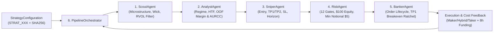

# QUANTUM — Strategy Discovery & Collaborative Agent Architecture

**Document Identifier:** `audit/architecture/QUANTUM_STRATEGY_DISCOVERY_ARCHITECTURE.md`  
**Version:** `1.0.0`  
**Timestamp:** 2026-11-03T02:22:00+07:00  
**Git Commit Baseline:** `dcc8ceb54d80b1b9685d92236f48b0994610522a`  
**Scope:** Architectural specification for `src/quantum/strategies/`, 6-agent integration, `$100 USD` capital modeling, iterative multi-batch search, and dual-directory synchronization (`audit/` $\leftrightarrow$ `data_backtest/`).

---

## 1. Strategy Library Package Structure (`src/quantum/strategies/`)

```text
src/quantum/strategies/
├── __init__.py          # Public API exports
├── schemas.py           # StrategyConfiguration, StrategyFamily, ExperimentManifest, deterministic SHA-256 hashing
├── generator.py         # Evidence-driven batch generators (Batch 001: 001-100, Batch 002: 101-200, Batch 003: 201-300)
├── agent_bridge.py      # Collaborative 6-agent integration (Scout -> Analyst -> Sniper -> Risk -> Banker -> Orchestrator)
├── evaluator.py         # $100 USD multi-asset portfolio backtest engine & statistical validator
└── synchronizer.py      # Automatic 10-rule synchronization verifier between audit/ and data_backtest/
```

---

## 2. Declarative Strategy Configuration Schema & Deterministic Hashing

Every strategy configuration is an immutable Pydantic v2 model (`StrategyConfiguration`) with a deterministic SHA-256 `config_hash` computed over its canonical JSON representation (excluding transient metadata).

### Schema Fields (`StrategyConfiguration`)
- **Identity & Provenance:**
  - `strategy_id`: Unique identifier (`"STRAT_001"` through `"STRAT_300"`).
  - `version`: Semantic version (`"1.0.0"`).
  - `batch_id`: Batch identifier (`"batch_001"`, `"batch_002"`, `"batch_003"`).
  - `family`: One of the 7 research families (`StrategyFamily` enum).
  - `hypothesis`: Explicit, falsifiable quantitative hypothesis.
  - `parent_strategy_id`: Optional reference to parent strategy for Batch 002/003 refinements.
- **Universe & Inputs:**
  - `applicable_assets`: Tuple of symbols from the 10-asset primary universe (`BTCUSDT`, `ETHUSDT`, `BNBUSDT`, `XRPUSDT`, `ADAUSDT`, `SOLUSDT`, `AVAXUSDT`, `LINKUSDT`, `DOGEUSDT`, `LTCUSDT`).
  - `timeframe`: `"5m"` (with causal multi-timeframe features over `15m`, `1h`, `4h`).
  - `required_inputs`: List of required data/model streams (`oof_probabilities`, `candles_5m`, `orderflow_taker_buy`, `cross_asset_btc`).
- **Entry Logic (`entry`):**
  - `direction_mode`: `"BOTH"`, `"LONG_ONLY"`, `"SHORT_ONLY"`, `"HTF_TREND_ALIGNED"`, or `"ABSORPTION_REVERSAL"`.
  - `prob_margin_min`: Minimum OOF directional margin $\max(p_{+1}, p_{-1}) - p_0$.
  - `p0_neutral_max`: Maximum neutral probability $p_0$ (AURCC selective abstention filter).
  - `vol_quantile_min` / `vol_quantile_max`: Rolling 20-bar volatility quantile window.
  - `vol_expansion_ratio_min`: Ratio of 20-bar volatility to 96-bar volatility ($\sigma_{20} / \sigma_{96}$).
  - `rvol_min`: Minimum 20-bar relative volume surge.
  - `taker_buy_ratio_min` / `taker_buy_ratio_max`: Order-flow imbalance bounds (`taker_buy_volume / volume`).
  - `wick_rejection_min`: Minimum lower/upper wick ratio for liquidity sweep setups.
  - `htf_lookback_bars`: Higher-timeframe lookback (`6`, `12`, `24`, `48` bars).
  - `htf_return_min_bps` / `htf_return_max_bps`: Conditioning bounds on prior HTF return (e.g., `<= -50 bps` for liquidity flush absorption; `>= +30 bps` for momentum breakout).
  - `btc_lead_lookback_bars` / `btc_lead_min_bps`: Cross-asset BTC impulse filter.
  - `order_type`: `"MARKET"` or `"LIMIT"` (`limit_offset_sigma`, `order_timeout_bars`).
  - `cooldown_bars`: Inter-trade cooldown per symbol.
- **Exit & Barrier Logic (`exit`):**
  - `tp1_multiplier` / `tp2_multiplier`: Take-profit distances in units of $\sigma_t$.
  - `tp1_close_pct`: Partial close fraction at TP1 (`0.0` for single-stage, `0.50` for Banker Option A 50/50 split).
  - `sl_multiplier`: Stop-loss distance in units of $\sigma_t$.
  - `breakeven_ratchet_on_tp1`: Enables `BankerAgent` Option A stop ratchet to entry upon TP1 fill.
  - `trailing_stop_distance_sigma`: Optional trailing stop distance in $\sigma_t$.
  - `horizon_bars`: Maximum holding horizon (`6` to `48` bars).
- **Risk & `$100 USD` Execution Assumptions (`risk`):**
  - `initial_equity_usd`: `100.0` (`$100 USD`).
  - `risk_per_trade_pct`: Equity risk budget per trade (`0.005` to `0.030`).
  - `max_symbol_exposure_pct`: Single-asset notional ceiling relative to equity (`0.15` to `0.60`).
  - `max_total_exposure_pct`: Total portfolio gross notional ceiling (`0.30` to `1.80`).
  - `max_leverage`: Maximum effective leverage (`1.0x` to `3.0x`).
  - `max_concurrent_positions`: Maximum simultaneous open positions (`1` to `6`).
  - `min_notional_usdt`: Exchange minimum order notional (`5.0` USDT).
  - `fee_tier`: `"maker_passive"` (`8.0 bps` RT), `"hybrid_tier"` (`15.0 bps` RT), or `"baseline_taker"` (`44.0 bps` RT).

---

## 3. Initial 100 Strategy Families (Batch 001 Allocation)

| Family ID | Strategy Family | Batch 001 Count | Strategy IDs | Core Quantitative Hypotheses Explored |
| :---: | :--- | :---: | :---: | :--- |
| **F1** | `LIQUIDITY_MICROSTRUCTURE` | **20** | `STRAT_001`–`STRAT_020` | Order-flow buyer absorption (`taker_buy_ratio`), wick sweep reclaim after 1h liquidity flushes (`htf_ret_12 < -50 bps`), high RVOL displacement. |
| **F2** | `MARKET_REGIME_TRANSITIONS` | **15** | `STRAT_021`–`STRAT_035` | Multi-timeframe trend alignment (`1h`/`4h` regime filters), compression-to-expansion transitions, chop avoidance (`p_0` ceiling). |
| **F3** | `DIRECTIONAL_PREDICTION` | **15** | `STRAT_036`–`STRAT_050` | High-conviction LightGBM OOF probability margins, AURCC selective abstention (`p_0 <= 0.25`), long-only vs bidirectional specialist subsets. |
| **F4** | `VOLATILITY_DYNAMICS` | **15** | `STRAT_051`–`STRAT_065` | Volatility ratio breakouts ($\sigma_{20}/\sigma_{96} > 1.2$), tail-volatility gating ($q \in [0.85, 0.96]$), volatility-scaled holding horizons. |
| **F5** | `CROSS_ASSET_RELATIONSHIPS` | **15** | `STRAT_066`–`STRAT_080` | BTC lead-lag impulse propagation to high-beta altcoins (`SOL`, `DOGE`, `AVAX`, `LINK`), altcoin-BTC relative strength divergence. |
| **F6** | `MEAN_REVERSION_BREAKOUT` | **10** | `STRAT_081`–`STRAT_090` | Overextended 1h/4h rally exhaustion fades (shorting extreme rallies with upper wick rejection) vs momentum breakout continuation. |
| **F7** | `ADAPTIVE_ENTRY_EXECUTION` | **10** | `STRAT_091`–`STRAT_100` | Banker Option A two-stage partial exits (`50%` at `TP1` + breakeven ratchet + `50%` runner to `TP2`), passive limit offsets vs market entries. |

---

## 4. Six-Agent Collaborative Integration

All strategy evaluations preserve the exact roles of the six agents in `src/quantum/agents/`:



1. **Scout (`ScoutAgent`):** Evaluates asset eligibility, `rvol_min`, `wick_rejection_min`, and `taker_buy_ratio` bounds defined in `StrategyConfiguration.entry`.
2. **Analyst (`AnalystAgent`):** Evaluates OOF probability margin (`prob_margin_min`), neutral abstention (`p0_neutral_max`), volatility regime (`vol_quantile_min/max`), and HTF/BTC regime conditions, producing `invalidation_price`.
3. **Sniper (`SniperAgent`):** Constructs the `TradeProposal` using `tp1_multiplier`, `tp2_multiplier`, `tp1_close_pct`, `sl_multiplier`, `order_type`, and `horizon_bars`.
4. **Risk (`RiskAgent`):** Independently validates the proposal against all 12 safety gates on the live `$100 USD` portfolio state, enforcing `min_notional_usdt = $5.00`, lot-step rounding, single-asset exposure cap, total exposure cap, and liquidation buffer.
5. **Banker (`BankerAgent`):** Executes order fills, applies `Option A` breakeven stop ratcheting when `TP1` fills (`tp1_close_pct > 0`), manages trailing stops and time expirations, and computes exact two-legged fees, slippage, and 8-hour funding.
6. **Orchestrator (`PipelineOrchestrator`):** Coordinates the pipeline, resolves concurrent multi-asset signals in timestamp order, and records execution provenance.

---

## 5. Iterative Multi-Batch Discovery & Plateau Criteria

The discovery engine operates across sequential batches of 100 strategies:
- **Batch 001 (`STRAT_001`–`STRAT_100`):** Broad exploration across all 7 families. Ranks candidates by confirmatory Folds 1–4 mean net daily portfolio return and identifies the failure mechanisms of losing strategies.
- **Batch 002 (`STRAT_101`–`STRAT_200`):** Evidence-driven exploitation + exploration:
  - *Exploitation (60 candidates):* Systematic refinement around Batch 001's top-performing families (combining F1 liquidity-flush absorption `htf_ret_12 < 0` with F3 high-AUC asset subsets `DOGE`, `SOL`, `ADA`, `XRP`, `LINK`, `AVAX` and F7 Banker Option A breakeven ratchets).
  - *Exploration (40 candidates):* New hypotheses combining cross-asset BTC impulse filters, volatility compression-expansion gates, and asymmetric exhaustion shorts.
- **Batch 003 (`STRAT_201`–`STRAT_300`):** Fine-grained neighborhood sensitivity search around Batch 002's global best (testing horizon stability, risk-budget scaling under `$100 USD` capital, fee-tier resilience across Maker/Hybrid/Taker, and walk-forward fold consistency).
- **Stopping & Plateau Criterion (Part 6):**
  - **State A (Improvement Found):** Global best mean net daily return improves by $\ge +0.02\%/\text{day}$ while satisfying $\text{MDD} \le 30.0\%$ and 4/4 positive walk-forward folds.
  - **State C (Optimization Plateau):** When a subsequent batch of 100 configurations improves the qualified global best by $< +0.005\%/\text{day}$ across the tested feature and parameter space, the search records an **Optimization Plateau** and reports the Pareto frontier to the Project Owner.
