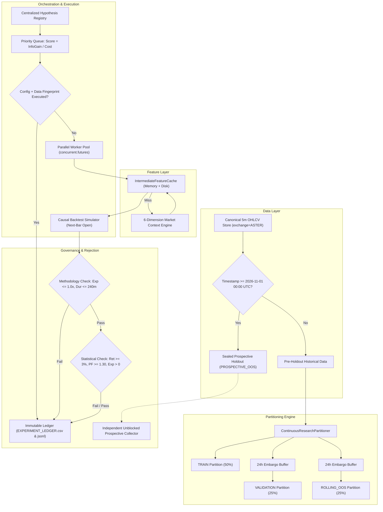

# QUANTUM — CONTINUOUS RESEARCH MODE ADDENDUM
## PARALLELIZED ALPHA DISCOVERY ARCHITECTURE & SYSTEM BLUEPRINT

---

### 1. EXECUTIVE SUMMARY & RESEARCH MANDATE

- **Addendum Designation:** Continuous Research Mode Addendum
- **Git Branch:** `research/quantum-next-3pct`
- **Location:** `audit/strategy_research/continuous_research_orchestration/CONTINUOUS_RESEARCH_ARCHITECTURE.md`
- **Mandate:** Replace sequential, milestone-dependent research with a continuous, parallelized alpha discovery workflow. QUANTUM must not pause or block legitimate research experiments while waiting for prospective out-of-sample (OOS) observation windows to mature.
- **Key Architectural Pillars:**
  1. **Asynchronous Experiment Orchestration:** Decoupled execution engine that queues, prioritizes, and executes independent hypotheses in parallel.
  2. **Strict Evidence Separation:** Formal partitioning into `TRAIN`, `VALIDATION`, `ROLLING_OOS`, and `PROSPECTIVE_OOS` with 24-hour embargo buffers.
  3. **Reproducible Feature Caching:** High-speed intermediate feature cache preventing redundant indicator calculations across multi-hypothesis evaluations.
  4. **Cryptographic Provenance & Deduplication:** Deterministic SHA-256 fingerprinting of datasets and experiment configurations, eliminating duplicate computations.
  5. **Automated Multi-Tier Rejection Gates:** Instantaneous rejection on methodological failures (exposure breaches, horizon violations, leakage) and statistical failures (sub-3.00% return, PF < 1.30, negative expectancy).
  6. **Zero Survivorship Bias:** Permanent recording of every experiment, including failed and rejected candidates, in immutable CSV and JSONL ledgers.

---

### 2. SYSTEM ARCHITECTURE & WORKFLOW

The diagram below illustrates the continuous research lifecycle and evidence flow:



---

### 3. INTEGRATION WITH THE SIX-AGENT ARCHITECTURE

The continuous research engine preserves the canonical roles of the six core agents while accelerating their interaction loop:

```
+---------------------------------------------------------------------------------------------------------------+
| AGENT RESPONSIBILITY MATRIX IN CONTINUOUS RESEARCH MODE                                                       |
+--------------+------------------------------------------------------------------------------------------------+
| Agent Name   | Continuous Research Function                                                                   |
+--------------+------------------------------------------------------------------------------------------------+
| Scout        | Continuously monitors market anomalies, scans multi-asset regimes, and proposes candidate      |
|              | structural hypotheses into the Centralized Hypothesis Registry.                               |
+--------------+------------------------------------------------------------------------------------------------+
| Analyst      | Formulates mathematical hypothesis specifications, verifies feature orthogonality, and sets    |
|              | invalidation conditions and expected information gain scores.                                  |
+--------------+------------------------------------------------------------------------------------------------+
| Sniper       | Executes causal backtest simulations strictly on next-bar open; evaluates fills under AsterDEX|
|              | Base Retail friction without lookahead bias.                                                   |
+--------------+------------------------------------------------------------------------------------------------+
| Risk         | Enforces hard methodological gates: 1.0000x unlevered exposure cap, 15.0% maximum drawdown,   |
|              | 240m holding horizon boundary, and embargo isolation.                                         |
+--------------+------------------------------------------------------------------------------------------------+
| Banker       | Enforces accounting integrity, calculates gross vs fee attribution, computes fee drag, and     |
|              | records all experiment outcomes into immutable ledgers.                                        |
+--------------+------------------------------------------------------------------------------------------------+
| Orchestrator | Prioritizes research queue, dispatches parallel workers, manages intermediate feature caching, |
|              | suppresses redundant runs, and maintains independent prospective OOS collection.               |
+--------------+------------------------------------------------------------------------------------------------+
```

---

### 4. PRIORITY SCHEDULING & RESOURCE ALLOCATION

To avoid unproductive brute-force grid searches and accelerate research velocity, experiments are prioritized dynamically according to information-theoretic efficiency:

$$\text{Priority Score} = \frac{\mathcal{I}(\text{Hypothesis})}{\mathcal{C}(\text{Computation}) + \epsilon}$$

Where:
- $\mathcal{I}(\text{Hypothesis}) \in [0.0, 1.0]$: Expected information gain assigned by the Analyst based on hypothesis novelty, economic grounding, and cross-asset applicability.
- $\mathcal{C}(\text{Computation})$: Normalized computational cost proportional to the number of bars, assets, and feature transformations required.
- $\epsilon = 10^{-6}$: Regularizer preventing division by zero.

Experiments evaluating novel alpha families on `TRAIN` partitions are granted top priority ($\mathcal{I} \approx 0.9$), followed by confirmation on `VALIDATION` partitions ($\mathcal{I} \approx 0.7$), and rolling out-of-sample validation ($\mathcal{I} \approx 0.5$).

---

### 5. CRYPTOGRAPHIC PROVENANCE & DEDUPLICATION

To guarantee mathematical reproducibility across parallel workers:
1. **Dataset Fingerprinting:** Every dataset partition is cryptographically hashed via SHA-256 over its exact numerical bytes (`open_time_ms`, `close_time_ms`, `open`, `high`, `low`, `close`, `volume`).
2. **Configuration Fingerprinting:** Every experiment configuration (parameters, indicators, execution timeframe, contract bounds, exchange fees) is serialized into canonical JSON and hashed via SHA-256.
3. **Automatic Deduplication:** Prior to launching any simulation, the orchestrator checks whether `(config_fingerprint, dataset_fingerprint)` exists in the persistent ledger. If present, the experiment is skipped in $0.001\text{s}$ and marked as `REDUNDANT_CONFIGURATION`.

---

### 6. INDEPENDENT PROSPECTIVE OOS COLLECTION

- **Decoupled Architecture:** Prospective OOS data collection runs independently as an unblocked observer background task.
- **Zero Research Gating:** The system never pauses retrospective alpha research or backtesting while waiting for prospective data windows to accrue.
- **Strict One-Way Boundary:** Prospective OOS data can never be accessed by the training or validation engines.
