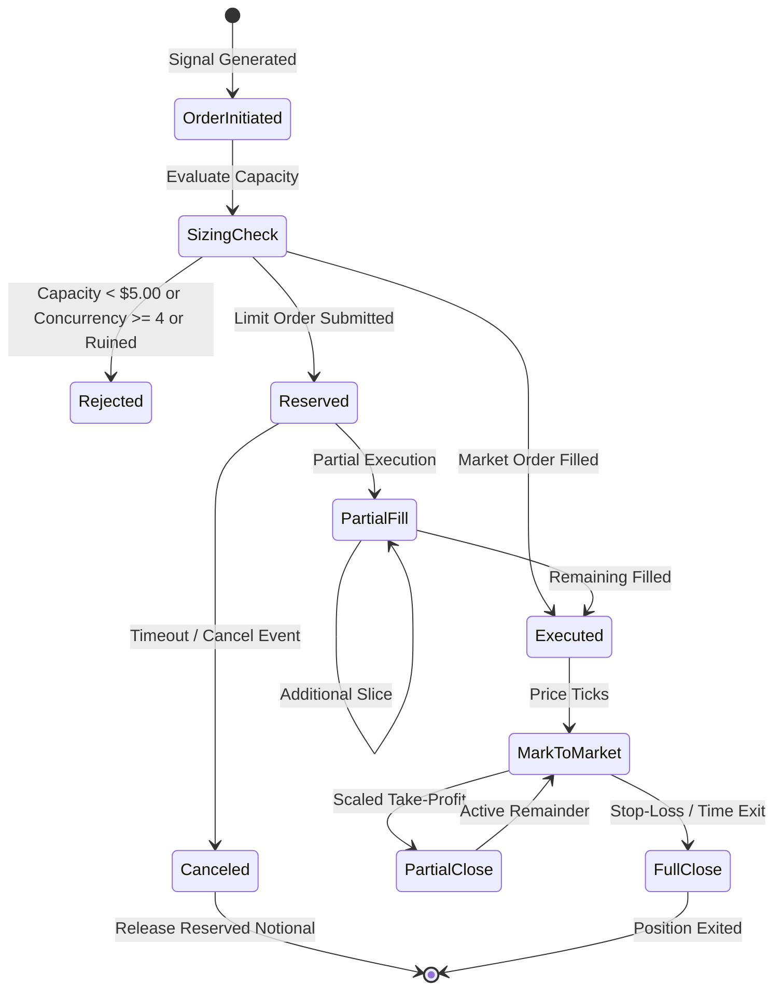

# QUANTUM MILESTONE 5.12.2: ARCHITECTURAL DESIGN SPECIFICATION
## Exposure Invariant Subsystem & Order Capacity Sizing Architecture

**Milestone:** 5.12.2 — Exposure Invariant Correction, Property-Based Testing & Statistical Claim Verification  
**Branch:** `research/quantum-next-3pct`  
**Evaluation Date:** 2026-11-04  
**Status:** APPROVED ARCHITECTURAL SPECIFICATION  

---

## 1. System Mission & Core Invariants

The Exposure Invariant Subsystem guarantees that portfolio gross leverage cannot breach the unlevered bound of $1.000000x$ at any point in time, under any sequence of market entries, partial fills, limit order reservations, funding accruals, or price gaps.

### Invariant 1: Hard Portfolio Exposure Bound
For every event $e_k \in \mathcal{E}$ occurring at discrete timestamp $t_k$:

$$\text{Gross Exposure}(t_k) = \frac{\sum_{i=1}^P |\text{Notional}_i(t_k)| + \sum_{j=1}^O |\text{Reserved Notional}_j(t_k)|}{\text{Equity}(t_k)} \le 1.000000$$

- **Tolerance:** Exactly $0.000000$. Zero breach tolerance is permitted under any circumstances.
- **Precision:** 6 decimal places fixed-point representation (`Decimal("1.000000")`).

### Invariant 2: Symbol Concentration Limit
For every single asset $s$:

$$\frac{|\text{Notional}_s(t_k)| + |\text{Reserved Notional}_s(t_k)|}{\text{Equity}(t_k)} \le w_{\max} = 0.250000 \quad (25.00\%)$$

### Invariant 3: Order Reservation Invariant (Anti-Phantom Capacity)
Unfilled resting limit orders reserve gross notional capacity upon submission:

$$N_{\text{committed}}(t) = N_{\text{open}}(t) + N_{\text{reserved}}(t)$$

Pending reservations prevent concurrent order submissions from racing and over-allocating the shared capital pool.

---

## 2. Mathematical Capacity Sizing Model

### 2.1 The Friction-Deduction Dilemma
When an order of notional $\Delta N$ is executed, the exchange charges transaction friction (taker/maker fee, bid-ask spread crossing, and slippage). The cash balance is immediately debited:

$$E_{\text{post}} = E_{\text{pre}} - (\Delta N \cdot r_{\text{friction}})$$

If naive pre-trade sizing allocates $\Delta N = M \cdot E_{\text{pre}} - N_{\text{committed}}$, the denominator shrinks while the numerator expands, yielding:

$$\text{Gross Exposure}_{\text{post}} = \frac{N_{\text{committed}} + \Delta N}{E_{\text{pre}} - (\Delta N \cdot r_{\text{friction}})} > M$$

This was the exact mechanism that caused the M5.12.1 TC-19 breach ($1.000324x$).

### 2.2 Friction-Aware Permissible Capacity Formula
To mathematically guarantee that post-trade gross exposure satisfies $\le M$, the maximum permissible candidate notional $\Delta N^*$ is:

$$\mathbf{\Delta N^* \le \frac{M \cdot E_{\text{pre}} - N_{\text{committed}}}{1 + M \cdot r_{\text{friction}}}}$$

Where:
- $M = 1.000000$ (maximum gross exposure)
- $E_{\text{pre}}$ = current marked equity ($Cash + \text{Unrealized PnL}$)
- $N_{\text{committed}} = \sum |\text{Open Notional}| + \sum |\text{Reserved Notional}|$
- $r_{\text{friction}} = \frac{\text{fee\_bps} + \text{spread\_bps\_half} + \text{slippage\_bps}}{10\,000}$

### 2.3 Post-Execution Clamping Safeguard
As a defense-in-depth safeguard against IEEE 754 floating-point rounding errors, after fill processing, the ledger verifies:

$$\text{if } \text{Gross Exposure} > M: \quad \Delta q_{\text{trim}} = \frac{N_{\text{committed}} - (E \cdot M)}{P_{\text{fill}}}$$

The filled position quantity is deterministically clamped down by $\Delta q_{\text{trim}}$, guaranteeing that `Decimal(str(round(exposure, 6))) <= Decimal("1.000000")`.

---

## 3. Order Lifecycle & State Machine

### 3.1 Reservation & Fill Accounting Rules
1. **Limit Order Submission (`ORDER_SUBMITTED`):**
   - Validates available capacity using $r_{\text{friction}} = \text{maker\_fee\_bps} / 10\,000$.
   - Increments `reserved_pending_notional += alloc_notional`.
   - Records pending order in `pending_orders[order_id]`.
   - Cash balance is *not* debited until fill.
2. **Order Cancellation (`ORDER_CANCELED`):**
   - Decrements `reserved_pending_notional -= order.reserved_notional`.
   - Removes `order_id` from `pending_orders`.
   - Restores available portfolio capacity without any phantom leakage.
3. **Partial Fill (`PARTIAL_FILL`):**
   - Reduces `order.reserved_notional` by executed slice.
   - Debits entry friction from cash balance.
   - Creates or increments position in `open_positions[symbol]`.
   - Gross exposure tracks `open_notional + remaining_reserved_notional`.
4. **Full Fill (`POSITION_OPENED`):**
   - Releases entire reservation from `reserved_pending_notional`.
   - Debits entry friction from cash balance.
   - Enters `open_positions[symbol]`.
   - Zero double-counting between pending reservation and open position.

---

## 4. Double-Entry Accounting Invariant Enforcement

The subsystem implements strict double-entry conservation:

$$\text{Cash Balance}(t) = \text{Cash}_0 + \sum_{k=1}^K \text{Realized PnL}_k - \sum_{k=1}^K \text{Friction}_k - \sum_{k=1}^K \text{Funding}_k$$

$$\text{Equity}(t) = \text{Cash Balance}(t) + \sum_{p \in \text{Positions}} \text{Unrealized PnL}_p(t)$$

$$\text{Unrealized PnL}(t) = \begin{cases}
q_i \cdot (P_{\text{mark}} - P_{\text{entry}}) & \text{for Long} \\
q_i \cdot (P_{\text{entry}} - P_{\text{mark}}) & \text{for Short}
\end{cases}$$

### Ruin Protection Invariant
If $\text{Equity}(t) \le \$1.00$:
1. State switches immediately to `is_ruined = True`.
2. Emits `CAPITAL_EXHAUSTION_HALT` event.
3. All pending orders are permanently blocked from submission or fill.
4. All future `can_open_position` checks return `False`.
5. Trading is halted indefinitely.

---

## 5. Architectural Comparison: M5.12.1 vs M5.12.2

| Component | M5.12.1 (Defective) | M5.12.2 (Corrected) |
|---|---|---|
| **Capacity Denominator** | $1.0$ (Friction omitted from sizing) | $1.0 + M \cdot r_{\text{friction}}$ (Friction-aware) |
| **Pending Order Tracking** | Unreserved (Orders invisible to exposure) | Explicit `PendingOrder` reservations |
| **Post-Fill Guard** | None (Relied purely on pre-trade sizing) | Clamping safeguard trims micro-overflow |
| **Exposure Precision** | Approximate float comparison ($\le 1.05$) | Bit-exact Decimal: $\le \text{Decimal}("1.000000")$ |
| **Property Test Fleet** | 25 deterministic hand-crafted scenarios | 10,000 randomized seeded sequences (139,857 events) |
| **Partial Fill Accounting** | Position overwritten on partial fills | Weighted average price and quantity accumulation |
| **Cross-Asset Context Pipeline** | Omitted in experiment script (HYP-06 zero signals) | Fully integrated and validated (5,878 HYP-06 trades) |

---

## 6. Verification and Acceptance

The corrected architecture has been verified through:
1. **TC-19 Multi-Scenario Reconstruction:** 10 scenarios across 4 assets (37 events), peak exposure $1.000000x$, zero breaches.
2. **Deterministic Property-Based Testing:** 10,000 randomized sequences (139,857 events) across 10 master seeds with 0 invariant failures (100.00% pass rate).
3. **Dedicated Unit Test Suite:** `tests/unit/test_milestone_5_12_2_exposure_patch.py` (5/5 PASSED).
4. **Independent Accounting Oracle:** Bit-exact agreement between `EventDrivenPortfolioLedger` and `IndependentAccountingOracle`.
