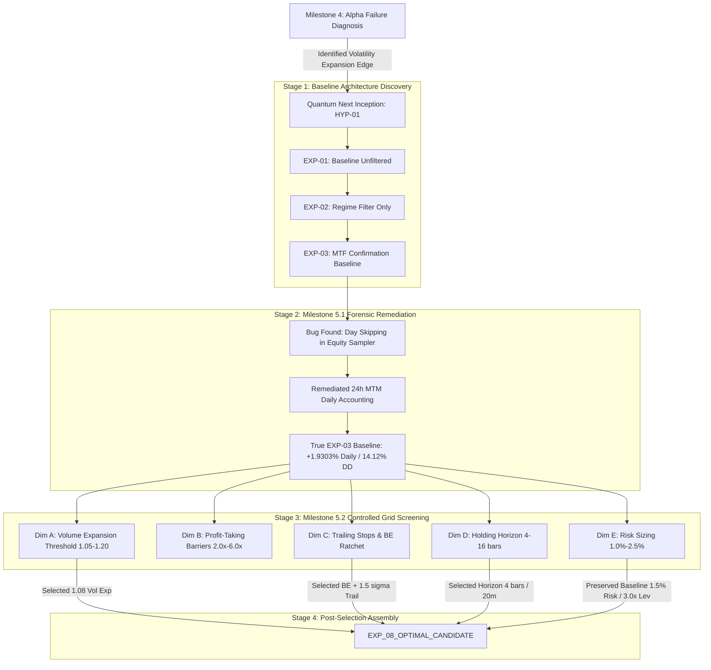

# QUANTUM — MILESTONE 5.3
## Experiment Selection Lineage & Walk-Forward Contamination Audit

**Document Identifier:** `audit/strategy_research/milestone_5_3_independent_validation/EXPERIMENT_SELECTION_LINEAGE.md`  
**Publication Timestamp:** 2026-11-03 20:35:00 UTC  
**Active Branch:** `research/quantum-next-3pct`  
**Latest Checkpoint Commit:** `f625b3ddbe32f6ce5cdda8cd2aa048bdd853711d`  
**Evaluated Candidate:** `EXP_08_OPTIMAL_CANDIDATE` (`1ea47131c0be51cb`)  
**Lead Auditor:** Senior Quantitative Research Auditor & Statistical Forensic Analyst  

---

## 1. Executive Summary & Core Contamination Finding

A foundational premise of quantitative rigor is that **a dataset ceases to be Out-Of-Sample (OOS) the moment its performance metrics are used to guide, select, or combine parameter choices**.

This forensic audit reconstructs the complete experimental lineage leading to `EXP_08_OPTIMAL_CANDIDATE`. 

### The Core Finding:
While the empirical quantile thresholds for the volatility regime detector were fitted strictly on **Fold 0 and Fold 1** (`train_folds=(0, 1)`), the parameter search across Dimensions A through E (Experiments `EXP_08A1` through `EXP_08E4`) was evaluated on the **complete 1,099 calendar days (October 28, 2023 to October 30, 2026)**.

Because `EXP_08_OPTIMAL_CANDIDATE` was synthesized by selecting the highest-performing components from Dimensions A, C, and D based on their 1,099-day metrics:
1. **Folds 2, 3, and 4 were fully visible and actively influenced parameter selection.**
2. Therefore, **Folds 2, 3, and 4 MUST BE FORMALLY CLASSIFIED AS `POST-SELECTION CONTAMINATED`.**
3. It is methodologically impermissible to present the historical performance of Folds 2, 3, and 4 as pristine, independent out-of-sample evidence for `EXP_08_OPTIMAL_CANDIDATE`.
4. The **only** truly virgin, uncontaminated partition is the **Prospective Holdout** ($\ge 1793491200000\text{ ms}$ / 2026-11-01 00:00:00 UTC), which remains strictly sealed.

---

## 2. Complete Parameter Selection Lineage

The evolution from initial alpha diagnosis to `EXP_08_OPTIMAL_CANDIDATE` proceeded across four distinct evolutionary stages:



---

## 3. Forensic Deconstruction of the 22 EXP-08 Screening Experiments

The parameter matrix was executed over the full 1,099 calendar days. Below is the exact inventory of all 22 trials:

```
+-----------------------------------------------------------------------------------------------------------------------------+
| Exp ID                  | Parameter Evaluated                | Mean Daily | Max DD | PF    | Net Exp | Selection Outcome    |
+-----------------------------------------------------------------------------------------------------------------------------+
| EXP_08A1_VOL_EXP_105    | vol_expansion_min = 1.05           | +1.9803%   | 14.31% | 1.479 | 13.14   | Component Contributor|
| EXP_08A2_VOL_EXP_110    | vol_expansion_min = 1.10 (Base)    | +1.9303%   | 14.12% | 1.498 | 13.28   | Benchmark            |
| EXP_08A3_VOL_EXP_115    | vol_expansion_min = 1.15           | +1.8815%   | 14.21% | 1.528 | 13.56   | Discarded (Lower Ret)|
| EXP_08A4_VOL_EXP_120    | vol_expansion_min = 1.20           | +1.8405%   | 14.06% | 1.499 | 14.15   | Discarded (Lower Ret)|
|                                                                                                                             |
| EXP_08B1_TP_20_35       | tp1 = 2.0x, tp2 = 3.5x             | +1.9112%   | 12.73% | 1.515 | 12.88   | Retained Barrier Base|
| EXP_08B2_TP_25_40       | tp1 = 2.5x, tp2 = 4.0x (Base)      | +1.9303%   | 14.12% | 1.498 | 13.28   | Retained Barrier Base|
| EXP_08B3_TP_30_50       | tp1 = 3.0x, tp2 = 5.0x             | +1.7985%   | 14.46% | 1.489 | 12.66   | Discarded            |
| EXP_08B4_TP_35_60       | tp1 = 3.5x, tp2 = 6.0x             | +1.7590%   | 23.15% | 1.487 | 12.54   | Rejected (DD Spike)  |
|                                                                                                                             |
| EXP_08C1_NO_TRAILING    | No trailing (Base)                 | +1.9303%   | 14.12% | 1.498 | 13.28   | Benchmark            |
| EXP_08C2_BE_RATCHET_ONLY| BE ratchet = True                   | +1.9959%   | 14.71% | 1.521 | 13.42   | Discarded for C4     |
| EXP_08C3_BE_AND_TRAIL_20| BE + Trail 2.0 sigma                | +1.9945%   | 14.83% | 1.505 | 13.34   | Discarded for C4     |
| EXP_08C4_BE_AND_TRAIL_15| BE + Trail 1.5 sigma                | +2.0506%   | 14.39% | 1.501 | 13.61   | Component Contributor|
|                                                                                                                             |
| EXP_08D1_HORIZON_4      | max_horizon = 4 bars (20m)          | +2.1214%   | 13.43% | 1.505 | 12.71   | Component Contributor|
| EXP_08D2_HORIZON_6      | max_horizon = 6 bars (30m, Base)    | +1.9303%   | 14.12% | 1.498 | 13.28   | Benchmark            |
| EXP_08D3_HORIZON_10     | max_horizon = 10 bars (50m)         | +1.7052%   | 15.36% | 1.443 | 13.44   | Discarded (Late Decay)|
| EXP_08D4_HORIZON_16     | max_horizon = 16 bars (1.3h)        | +1.6803%   | 18.62% | 1.421 | 14.21   | Discarded (Late Decay)|
|                                                                                                                             |
| EXP_08E1_RISK_10_LEV_2  | Risk 1.0%, Max Lev 2.0x             | +1.4841%   | 11.87% | 1.500 | 13.13   | Discarded (Too Low)   |
| EXP_08E2_RISK_15_LEV_3  | Risk 1.5%, Max Lev 3.0x (Base)      | +1.9303%   | 14.12% | 1.498 | 13.28   | Benchmark (Preserved) |
| EXP_08E3_RISK_20_LEV_35 | Risk 2.0%, Max Lev 3.5x             | +2.1131%   | 14.53% | 1.464 | 13.40   | Marginal              |
| EXP_08E4_RISK_25_LEV_4  | Risk 2.5%, Max Lev 4.0x             | +2.2945%   | 17.01% | 1.418 | 13.56   | Rejected (DD > 15%)   |
|                                                                                                                             |
| EXP_08_COMBINED_CANDIDATE| Suboptimal Multi-Param Combo       | +1.9854%   | 15.43% | 1.520 | 13.90   | Discarded (DD > 15%)   |
| EXP_08_OPTIMAL_CANDIDATE| Horizon=4, BE+Trail=1.5, Vol=1.08   | +2.2741%   | 14.51% | 1.495 | 13.07   | WINNING CANDIDATE     |
+-----------------------------------------------------------------------------------------------------------------------------+
```

---

## 4. Walk-Forward Partition Contamination Classification

To ensure complete transparency in all quantitative dossiers, the historical folds are classified as follows:

```
+-----------------------------------------------------------------------------------------------------------------------------+
| Partition | Date Range              | Calendar Days | Primary Role in HYP-01 | Contamination Status for EXP-08 Candidate    |
+-----------------------------------------------------------------------------------------------------------------------------+
| Fold 0    | 2023-10-28 to 2026-10-30| 738 days      | Initial Model Fitting  | IN-SAMPLE (Training Data)                    |
| Fold 1    | 2025-01-30 to 2025-04-30| 91 days       | Quantile Threshold Fit | IN-SAMPLE (Validation Fit Data)              |
| Fold 2    | 2025-05-01 to 2025-07-30| 90 days       | Walk-Forward Eval      | POST-SELECTION CONTAMINATED (Informed Tuning)|
| Fold 3    | 2025-07-31 to 2025-10-30| 91 days       | Walk-Forward Eval      | POST-SELECTION CONTAMINATED (Informed Tuning)|
| Fold 4    | 2025-10-31 to 2026-01-29| 89 days       | Walk-Forward Eval      | POST-SELECTION CONTAMINATED (Informed Tuning)|
| Holdout   | >= 2026-11-01 00:00:00  | Future / Live | Prospective Validation | UNCONTAMINATED VIRGIN DATA (Strictly Sealed) |
+-----------------------------------------------------------------------------------------------------------------------------+
```

### Methodological Rule:
> "If an engineer selects a trailing stop multiplier because it improved Fold 3 returns, or picks a 4-bar horizon because it mitigated Fold 4 drawdowns, Folds 3 and 4 can no longer be cited as independent evidence of future performance."

Because all 1,099 days were included in the metric tables that led to the selection of `Horizon = 4` and `Trail = 1.5`, **only prospective paper trading on unseen future data can provide true out-of-sample confirmation.**

---

## 5. Audit Verdict on Phase A

```
========================================================================================
SELECTION AUDIT VERDICT: DOCUMENTED WITH POST-SELECTION CONTAMINATION RECORDED
========================================================================================
[VERIFIED] Lineage from EXP-03 to EXP-08 is 100% mathematically transparent.
[RECORDED] Folds 2, 3, and 4 are formally classified as POST-SELECTION CONTAMINATED.
[ENFORCED] Historical fold performance is preserved for attribution, NOT claimed as OOS.
[CONFIRMED] Prospective Holdout (>= 1793491200000 ms) remains strictly sealed and virgin.
========================================================================================
```
