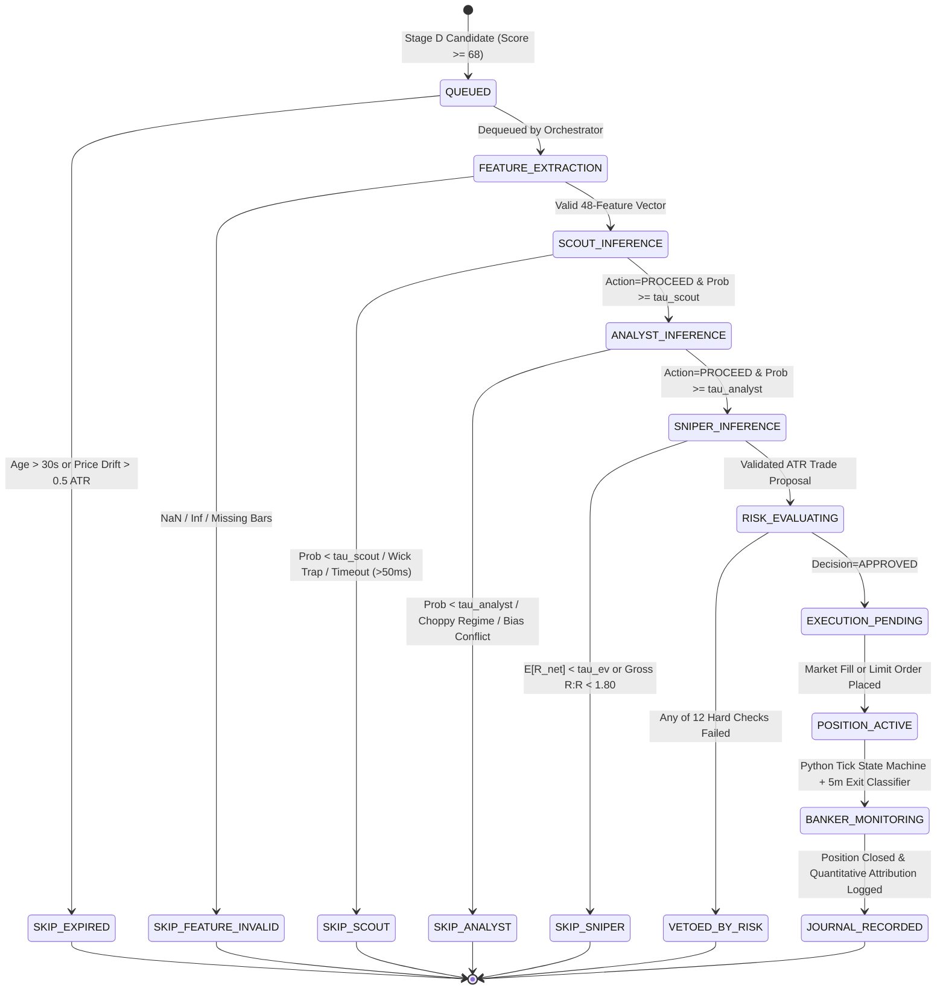

# AGENT_COMMUNICATION_PROTOCOL.md: Local ML Orchestration & Data Contracts

## 1. End-to-End Pipeline State Machine

Every candidate dequeued from Stage D is assigned a unique `pipeline_run_id` (ULID format, e.g., `run_01J8Z9K0X2...`) and progresses through a deterministic finite state machine managed by `PipelineOrchestrator` (`src/quantum/agents/orchestrator.py`). Because all inference is executed locally on the CPU, the entire `SCOUT -> ANALYST -> SNIPER -> RISK` pipeline completes in **`1.2 - 3.5 ms`** (Engineering Estimate, Acceptance Target `< 15.0 ms` worst-case / `< 5.0 ms` P95).



---

## 2. Message Envelope & Event Bus Protocol

All inter-component messages are immutable Python `@dataclass(frozen=True, slots=True)` objects carrying a standardized `MessageEnvelope` header:

```python
@dataclass(frozen=True, slots=True)
class MessageEnvelope:
    message_id: str             # ULID
    pipeline_run_id: str        # Correlates Scout -> Analyst -> Sniper -> Risk -> Execution
    idempotency_key: str        # SHA256(pipeline_run_id + stage_name)
    source: str                 # e.g. "SCANNER_STAGE_D", "AGENT_SCOUT", "RISK_ENGINE"
    topic: str                  # e.g. "pipeline.scout.completed"
    created_at_ms: int          # Synced UTC timestamp
    snapshot_timestamp_ms: int  # Underlying market data timestamp
    model_version: str          # e.g. "scout_lgbm_v1.0.2" or "rule_baseline_v1"
    payload: Any                # Typed Pydantic contract or frozen dataclass
```

### 2.1 Canonical EventBus Topics

| Topic Name | Producer | Consumer(s) | Priority Lane | Payload Schema |
| :--- | :--- | :--- | :---: | :--- |
| `market.ticker.updated` | `ExchangeAdapter` | `BankerMonitor`, `PaperSimulator`, `UIViewModel` | `P2` (Telemetry) | `NormalizedTicker` |
| `market.orderbook.updated` | `ExchangeAdapter` | `PaperSimulator`, `UIViewModel` | `P2` (Telemetry) | `NormalizedOrderBook` |
| `scanner.cycle.completed` | `MarketScanner` | `UIViewModel`, `SQLiteWriter` | `P2` (Telemetry) | `ScannerCycleSummary` |
| `pipeline.candidate.queued` | `StageDQueue` | `PipelineOrchestrator`, `UIViewModel` | `P1` (Pipeline) | `ScannerCandidate` |
| `pipeline.stage.completed` | `PipelineOrchestrator` | `UIViewModel`, `SQLiteWriter` | `P1` (Pipeline) | `AgentStageCompleted` |
| `pipeline.proposal.created` | `SniperAgent` | `RiskEngine`, `SQLiteWriter` | `P1` (Pipeline) | `SniperOutput` |
| `risk.decision.evaluated` | `RiskEngine` | `PaperSimulator`, `UIViewModel`, `SQLiteWriter` | `P0` (Critical) | `RiskDecision` |
| `execution.order.updated` | `PaperSimulator` | `BankerMonitor`, `PortfolioState`, `UIViewModel`, `SQLiteWriter` | `P0` (Critical) | `PaperOrderEvent` |
| `execution.position.updated` | `PaperSimulator` | `BankerMonitor`, `PortfolioState`, `UIViewModel`, `SQLiteWriter` | `P0` (Critical) | `PaperPositionEvent` |
| `ml.training.progress` | `TrainingManager` | `UIViewModel`, `SQLiteWriter` | `P2` (Telemetry) | `TrainingProgressEvent` |
| `ml.model.hot_swapped` | `ModelRegistry` | `PipelineOrchestrator`, `UIViewModel` | `P1` (Pipeline) | `ModelHotSwappedEvent` |

---

## 3. Inference Timeouts, Model Loading Policy & Fallback Semantics

### 3.1 Per-Agent Execution Latency & Timeout Matrix

| Stage | Execution Engine | Typical Latency (Engineering Estimate) | Hard Wall-Clock Timeout (Acceptance Target) | Failure / Invalid Default Action |
| :--- | :--- | :---: | :---: | :--- |
| **Feature Extractor** | Vectorized NumPy (`48 float32`) | `0.4 - 1.2 ms` | `25.0 ms` | `SKIP_FEATURE_INVALID` |
| **SCOUT** | `LightGBM` + Isotonic Calibrator | `0.3 - 0.8 ms` | `50.0 ms` | `SKIP_SCOUT_TIMEOUT` |
| **ANALYST** | Regime Filter + `LightGBM` Meta-Model | `0.4 - 1.0 ms` | `50.0 ms` | `SKIP_ANALYST_TIMEOUT` |
| **SNIPER** | Barrier Grid + `LightGBM` + ATR Geometry | `0.5 - 1.5 ms` | `50.0 ms` | `SKIP_SNIPER_TIMEOUT` |
| **RISK** | Deterministic 12-Gate Python | `0.1 - 0.4 ms` | `25.0 ms` | `VETO_INTERNAL_ERROR` |
| **BANKER (Tick Loop)** | Deterministic State Machine | `< 0.1 ms` | `10.0 ms` | Retain hard SL/TP orders |
| **BANKER (5m Exit ML)** | Optional `LightGBM` Exit Classifier | `0.3 - 0.8 ms` | `50.0 ms` | Retain deterministic trailing stop |

### 3.2 Model Loading, Hot-Swapping & Version Compatibility (`src/quantum/ml/registry.py`)
1. **Pre-Loaded Resident Boosters**: Active `PRODUCTION` boosters (`SCOUT`, `ANALYST`, `SNIPER`, `BANKER`) remain resident in RAM (`< 10 MB` combined) so zero disk I/O occurs during real-time candidate evaluation.
2. **Feature Schema Hash Verification**: Every model `manifest.json` stores `feature_schema_hash = SHA256(",".join(feature_names_and_dtypes))`. Upon loading a model, `ModelRegistry` asserts that `manifest.feature_schema_hash == FEATURE_SCHEMA_V1_HASH`. If a mismatch is detected, the model is rejected (`IncompatibleSchemaError`) and never executed.
3. **Atomic Hot-Swap on Promotion**: When the offline `train_worker.py` finishes training and promotes a new model version (or when the user switches versions in the `Agents` UI), `ModelRegistry` loads and validates the new `Booster` + `Calibrator` in a staging variable, then swaps the active reference pointer atomically between pipeline runs.

### 3.3 Missing Data, Confidence Calibration & Threshold Policy
1. **Strict Zero-Imputation Policy on Real-Time Inference**:
   * If `np.isnan(feature_vec).any()` or `np.isinf(feature_vec).any()` is `True`, the orchestrator does **not** impute zeros or medians during live trading; it immediately aborts the candidate with `SKIP_FEATURE_INVALID` and triggers an async OHLCV backfill for that contract.
2. **Configurable Calibrated Probability Thresholds (Validation-Tuned)**:
   * `scout_min_prob` ($\tau_{\text{scout}}$): Initial default `0.56` (range `0.50 - 0.80`), calibrated and frozen per validation fold under trade frequency constraints.
   * `analyst_min_prob` ($\tau_{\text{analyst}}$): Initial default `0.58` (range `0.50 - 0.85`), calibrated and frozen per validation fold.
   * `sniper_min_expected_r` ($\tau_{\text{EV}}$): Initial default `+0.25R` (range `0.10R - 1.00R`), tuned on validation folds.
   * `banker_hazard_exit_prob`: Default `0.78` (range `0.65 - 0.95`).
   * *All thresholds are configurable via the `Settings` UI workspace and must be frozen before OOS evaluation.*
3. **Explicit Fallback Behavior (`FALLBACK_RULE_ONLY` vs. `STRICT_ML_ONLY`)**:
   * Controlled by setting `ml_fallback_policy` in `Settings`:
     * `"FALLBACK_RULE_ONLY"` (default for new installs): If no trained ML model artifact is promoted yet for a stage, use the deterministic `RuleBaselinePredictor` and record `inference_mode = "FALLBACK_RULE_ONLY"` in SQLite.
     * `"STRICT_ML_ONLY"`: If a `PRODUCTION` ML model is missing or unhealthy, immediately return `SKIP_MODEL_UNAVAILABLE`.
