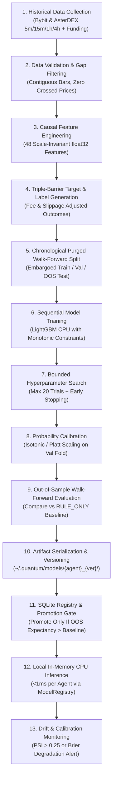

# AGENT_PROMPTS.md: Local ML Feature Contracts, Training Pipeline & Decision Policies

*(Architectural Note: Because QUANTUM uses 100% local CPU machine learning and deterministic quantitative algorithms with zero cloud LLM dependencies, this specification replaces prompt templates with the canonical **Feature Engineering Contract**, **13-Stage Local Model Training Pipeline**, **Model Artifact Manifest**, and **Agent Decision Policies**).*

---

## 1. Canonical Feature Engineering Contract (`src/quantum/ml/features.py`)

To guarantee **zero train/serve skew**, both the offline `train_worker.py` and the real-time `PipelineOrchestrator` call the exact same pure NumPy function `extract_feature_vector(snapshot, ohlcv_map, orderbook)` which produces a fixed-order, 48-element `float32` feature array.

### 1.1 Anti-Leakage & Stationarity Rules
1. **Strictly Scale-Invariant (Dimensionless) Features**: Raw price levels (`$68,000`, `$0.042`), raw moving averages, and raw USDT volume are **never** fed directly into any ML model. All price distances are normalized by $\text{ATR}_{14}$ or percentage return, and all volumes are normalized as rolling Z-scores or relative ratios ($\text{RVOL}$).
2. **Closed-Bar Causal Alignment**: Higher-timeframe features (`15m`, `1h`, `4h`) at timestamp $t$ use **only** bars whose close timestamp $t_{\text{close}} \le t$. A `1h` candle covering `14:00-15:00` is never visible to a `15m` sample at `14:15` or `14:30`.
3. **Direction-Signed Symmetry (`bias_sign`)**: Let $s = +1.0$ if `candidate_bias == "LONG"` and $s = -1.0$ if `candidate_bias == "SHORT"`. Directional features (returns, EMA slopes, orderbook imbalance, funding rate) are multiplied by $s$ so the models learn unified "aligned with trade direction" vs. "opposing trade direction" dynamics across both longs and shorts.

### 1.2 The 48 Canonical Quantitative Features (`FEATURE_SCHEMA_V1`)

| Feature Index | Feature Name Group | Exact Mathematical Definition (Scale-Invariant) | Used By Agents |
| :---: | :--- | :--- | :--- |
| **`f00..f05`** | **Signed Multi-TF Log Returns** | $s \cdot \ln(C_t / C_{t-k})$ for $5\text{m}(1, 3)$, $15\text{m}(1, 4, 16)$, and $1\text{h}(4)$ normalized by respective $\text{NATR}_{14}$. | `SCOUT`, `ANALYST`, `SNIPER` |
| **`f06..f11`** | **Signed EMA Structure Distances** | $s \cdot \frac{C_t - \text{EMA}_n}{\text{ATR}_{14}}$ for `5m` ($\text{EMA}_9, \text{EMA}_{21}$), `15m` ($\text{EMA}_9, \text{EMA}_{21}, \text{EMA}_{50}$), and `1h` ($\text{EMA}_{50}, \text{EMA}_{200}$). | `SCOUT`, `ANALYST`, `SNIPER` |
| **`f12..f15`** | **EMA Slope & Alignment Scores** | Signed 3-bar slope of `15m` $\text{EMA}_{21}$ and `1h` $\text{EMA}_{21}$ in ATR units; multi-TF alignment index $\in [-1.0, +1.0]$. | `ANALYST`, `SNIPER` |
| **`f16..f21`** | **Momentum & Oscillator Regimes** | Directional RSI: $50 + s \cdot (\text{RSI}_{14} - 50)$ across `5m`, `15m`, `1h`; signed `15m` MACD histogram slope; `15m` and `1h` $\text{ADX}_{14}$. | `SCOUT`, `ANALYST`, `SNIPER` |
| **`f22..f27`** | **Volatility & Squeeze Dynamics** | `15m` and `1h` $\text{NATR}_{14}$; $\text{ATR}_{15m} / \text{ATR}_{1h}$ ratio; Bollinger Bandwidth $\text{BBW}(20,2)$ 100-bar percentile; current bar $\text{TrueRange} / \text{ATR}_{14}$; Parkinson high-low volatility ratio. | `SCOUT`, `ANALYST`, `SNIPER` |
| **`f28..f33`** | **Volume & Candle Microstructure** | `5m` and `15m` $\text{RVOL}_{20}$; `15m` Volume Z-score $Z_{\text{vol},20}$; signed Close Location Value $s \cdot \frac{2C - H - L}{H - L + \epsilon}$; opposing wick-to-range trap ratio; body-to-range conviction ratio. | `SCOUT`, `ANALYST`, `SNIPER`, `BANKER` |
| **`f34..f39`** | **Structural Support / Resistance Proximity** | Distance in `15m` ATR units to 20-bar and 50-bar Donchian High/Low ($H_{20}, L_{20}, H_{50}, L_{50}$); distance to rolling 24h VWAP in ATR units; distance to `4h` major swing barrier in ATR units. | `ANALYST`, `SNIPER` |
| **`f40..f43`** | **Order Book & Liquidity Microstructure** | Live `spread_bps / (NATR_15m_bps)`; top-10 L2 orderbook signed imbalance $s \cdot \frac{V_{\text{bid10}} - V_{\text{ask10}}}{V_{\text{bid10}} + V_{\text{ask10}}}$; book depth ratio within $0.25 \times \text{ATR}$ vs $0.50 \times \text{ATR}$; $\log_{10}(\text{turnover\_24h\_usdt})$. | `SCOUT`, `SNIPER`, `BANKER` |
| **`f44..f47`** | **Perpetual Derivatives & Cross-Asset Context** | Signed funding rate $s \cdot \text{funding\_rate\_bps}$ (positive means trade pays funding); funding rate 30-period Z-score; mark-to-index basis bps; 24-bar rolling correlation & relative strength vs. `BTCUSDT`. | `SCOUT`, `ANALYST`, `SNIPER` |

---

## 2. Complete 13-Stage Local Model Training Pipeline (`src/quantum/ml/train_worker.py`)

### Detailed Specification of the 13 Required Training Stages

1. **Stage 1: Historical Market Data Collection**:
   * Fetches up to 180 days of `5m`, `15m`, `1h`, and `4h` klines and historical funding rates for the top 50 liquid perpetual contracts across Bybit and AsterDEX, caching compressed `.npz` arrays under `~/.quantum/historical/`.
2. **Stage 2: Data Validation**:
   * Rejects any contiguous segment shorter than `250` bars, removes halted/delisted intervals, verifies `high >= max(open, close)` and `low <= min(open, close)`, and flags any timestamp gap $> 1 \times \text{interval\_ms}` so rolling windows never bridge across missing data.
3. **Stage 3: Feature Engineering**:
   * Runs `extract_feature_vector()` causally across historical Stage C trigger timestamps, storing a compact `float32` matrix (`N_samples x 48`) and asserting zero `NaN` or `Inf` values.
4. **Stage 4: Target & Label Generation (Triple-Barrier Method with Realistic Friction)**:
   * To ensure training labels reflect true live trading reality, label generation in `ml/labels.py` matches `PaperSimulator` assumptions exactly:
     * **Entry Delay**: Entry is assumed to execute on the Open of candle $t_0 + 1$ (or $t_0 + 100\text{ ms}$ for real-time), never at the Close of signal trigger candle $t_0$.
     * **Friction Drag**: Barrier returns explicitly subtract taker entry fee (or maker if limit), taker exit fee on SL, half-spread crossing, and depth slippage. Accrued funding payments over the holding duration are calculated and deducted.
     * **Same-Bar TP/SL Collision Resolution (Anti-Optimism Rule)**:
       If both the upper Take-Profit barrier and lower Stop-Loss barrier are touched within the High-Low range of the same candle:
       1. The generator drills down into 1-minute (`1m`) klines within that candle to trace the exact chronological sequence of touch.
       2. If 1-minute klines are unavailable or if both barriers were touched within the same 1-minute bar, the generator applies the **Pessimistic Worst-Case Tie-Break**: Assume the Stop-Loss was touched first ($y = 0$). This guarantees the model never trains on optimistic double-touch hallucinations.
     * **Gap-Through Slippage**: If a bar opens past the stop-loss level (Open < SL for Long, Open > SL for Short), exit fill price is modeled at the worse Open price, not the barrier price.
     * **Maximum Holding Horizon ($H_{\max}$)**: Defined per agent ($H_{\max} = 8\text{ bars}$ for `SCOUT`, $16\text{ bars}$ for `ANALYST`, $24\text{ bars}$ for `SNIPER` on `15m`). If neither barrier is touched before $H_{\max}$, the trade terminates at the vertical barrier (mark-to-market close on the final bar).
     * **Unresolved Boundary Censoring**: Candidates occurring within $H_{\max}$ of the end of the historical dataset where neither barrier is hit are treated as censored/unresolved and dropped from training sets to prevent label distortion.
     * **Agent-Specific Labels**:
       * **SCOUT Label ($y_{\text{scout}} \in \{0, 1\}$)**: $1$ if price reaches $+1.2 \sigma_{\text{ATR}}$ before $-1.0 \sigma_{\text{ATR}}$ within $H = 8\text{ bars}$; $0$ otherwise.
       * **ANALYST Label ($y_{\text{analyst}} \in \{0, 1\}$)**: Meta-label $1$ if trade with stop at structural invalidation $P_{\text{inv}}$ achieves $+2.0R$ net profit before hitting $P_{\text{inv}}$ within $H = 16\text{ bars}$; $0$ otherwise.
       * **SNIPER Targets ($y_{\text{tp1}}, y_{\text{tp2}} \in \{0, 1\},\; y_{\text{net\_r}} \in \mathbb{R}$)**: Binary barrier hits for candidate $R$-multiples ($1.8R, 2.0R, 3.2R$) plus realized net $R$-multiple over horizon $H = 24\text{ bars}$ (`6 hours`).
       * **BANKER Hazard Label ($y_{\text{hazard}} \in \{0, 1\}$)**: Sampled at closed `5m` bars during active simulated trades in drawdown; $1$ if the trade subsequently hits its stop-loss without ever returning to breakeven.
5. **Stage 5: Chronological Train / Validation / Test Splitting (Purged & Embargoed)**:
   * **Random `train_test_split` or random K-Fold is strictly forbidden**.
   * Uses anchored expanding or rolling **Walk-Forward Splits** sorted strictly by global UTC timestamp $t_0$ across all symbols simultaneously:
     * `Train Window`: e.g., Days $1 \dots 90$
     * `Mathematically Derived Purge Buffer`: Dropped between `Train` and `Validation` (and between `Validation` and `Test`). Calculated dynamically from the maximum label horizon:
       $$\text{PurgeDuration} = 1.5 \times (H_{\max} + \text{MaxEntryDelay})$$
       For `15m` models with $H_{\max} = 24\text{ bars} = 6\text{ hours}$, $\text{PurgeDuration} = 9.5\text{ hours}$ (38 bars). For `1h` models with $H_{\max} = 24\text{ bars} = 24\text{ hours}$, $\text{PurgeDuration} = 37.5\text{ hours}$. Overlapping multi-hour triple-barrier labels cannot cross split boundaries.
     * `Embargo Buffer`: Post-validation buffer of $0.5 \times H_{\max}$ to eliminate auto-correlation leakage.
     * `Validation Window`: e.g., Days $92 \dots 115$ (used strictly for early stopping, probability calibration, and threshold selection).
     * `Out-of-Sample (OOS) Test Window`: e.g., Days $117 \dots 140$ (held out strictly for final promotion gating).
   * **Strict Transformation Fit Boundaries**: All scalers, quantile normalizers, and calibrators are `fit()` **exclusively on the training fold (or validation fold for calibration)** and only applied (`transform()`) forward. Fitting preprocessors on the combined dataset is strictly prohibited.
6. **Stage 6: Model Training**:
   * Trains `lightgbm.LGBMClassifier` / `LGBMRegressor` sequentially (one agent model at a time) using shallow, regularized trees to prevent overfitting:
     * `n_estimators = 300` (with `early_stopping_rounds = 30` on validation log-loss)
     * `max_depth = 5`, `num_leaves = 20`, `min_child_samples = 150`
     * `subsample = 0.8`, `colsample_bytree = 0.7`, `reg_alpha = 1.0`, `reg_lambda = 5.0`
     * `learning_rate = 0.03`
7. **Stage 7: Bounded Hyperparameter Optimization**:
   * Runs a deterministic 16-configuration random/Latin-hypercube grid search over `(max_depth in [3,4,5], num_leaves in [12,16,24], min_child_samples in [100,200,300], reg_lambda in [2.0,5.0,10.0])` capped at **`max 3 minutes` wall-clock time per agent**.
8. **Stage 8: Walk-Forward Validation, Probability Calibration & Threshold Optimization**:
   * Fits `sklearn.calibration.IsotonicRegression(out_of_bounds="clip")` (or sigmoid Platt scaling if validation samples $< 1,000$) on the purged Validation fold so predicted probabilities $p \in [0, 1]$ match empirical hit rates (verified via Brier score).
   * **Validation-Only Threshold Selection**:
     1. Sweeps candidate decision thresholds ($p_{\text{thresh}} \in [0.50, 0.75]$) across the Validation fold.
     2. Evaluates the Precision-Recall trade-off and total simulated net return $\sum \mathbb{E}[R_{\text{net}}]$ subject to a **Minimum Trade Coverage Constraint** ($\ge 3$ to $8$ trades per active symbol per week).
     3. Selects the threshold that maximizes net expectancy while preserving trade frequency, and **freezes it** in `manifest.json`.
9. **Stage 9: Out-of-Sample Evaluation vs. Rule Baseline**:
   * Replays the strictly unseen OOS Test fold through the full `PaperSimulator` (with fees, spread, and slippage) using the frozen validation thresholds, comparing the newly trained model against both the current production model and `RULE_ONLY`.
   * **Hard Promotion Gate**: A newly trained model is promoted to `PRODUCTION` only if its OOS net expectancy $E_R > \text{RULE\_ONLY } E_R$, OOS Profit Factor $\ge 1.15$, and Brier calibration score improves or remains $< 0.23$. Tuning thresholds on OOS data is strictly prohibited.
10. **Stage 10: Model Artifact Storage**:
    * Saves a self-contained directory `~/.quantum/models/{agent_name}_{semver}_{timestamp}/` containing:
      * `booster.lgb` (native LightGBM text/binary model, `~500 KB - 1.8 MB`)
      * `calibrator.joblib` (`scikit-learn` isotonic/sigmoid calibrator, `~20 KB`)
      * `manifest.json` (feature names, schema hash, training window dates, OOS metrics, SHA-256 checksums, and optimal probability threshold).
11. **Stage 11: Model Versioning**:
    * Registers the artifact in the SQLite `model_registry` table with status `CANDIDATE`, `PRODUCTION`, `ARCHIVED`, or `REJECTED`. Supports 1-click rollback to any prior version in the `Agents` UI.
12. **Stage 12: Local Inference**:
    * `ModelRegistry` loads the active `PRODUCTION` `booster.lgb` with `num_threads=1` and executes `calibrator.predict(booster.predict(feature_row))` in `< 1.0 ms`.
13. **Stage 13: Model Monitoring & Retraining Policy**:
    * Every 50 closed paper trades (or weekly), `DriftMonitor` (`src/quantum/ml/drift.py`) computes the **Population Stability Index (PSI)** across the top 10 features and tracks rolling 50-trade realized Brier score vs. expected calibration.
    * If $\text{PSI} > 0.25$ (significant regime shift) or realized win rate diverges $> 2\sigma$ below calibrated probability, the UI displays a `MODEL_DRIFT_WARNING` badge recommending an updated walk-forward training run.
