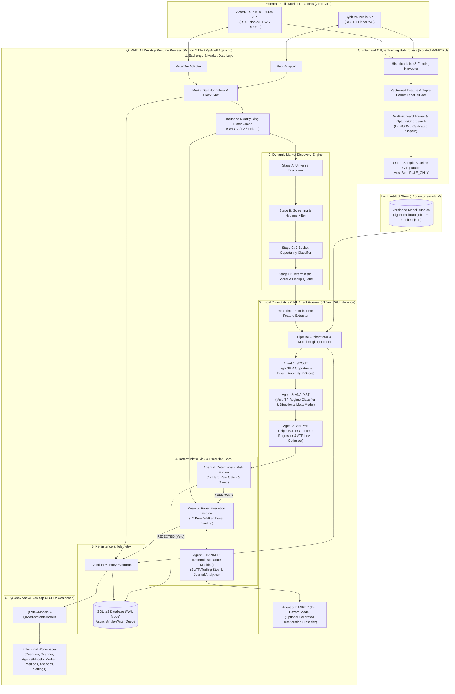

# ARCHITECTURE.md: QUANTUM Multi-Agent Quantitative Trading Desk (100% Local ML Edition)

## 1. Executive Summary & Architectural Philosophy

**QUANTUM** is a local-first, desktop-native cryptocurrency perpetual futures research and paper trading system engineered for low-resource hardware. It discovers dynamic long and short opportunities across all active USDT-margined perpetual futures on **Bybit** and **AsterDEX**, evaluates qualified setups using a five-agent **100% local CPU machine learning and quantitative intelligence pipeline**, enforces deterministic Python risk gates, and simulates realistic order execution in a local SQLite (WAL) database.

### Core Engineering Principles
1. **Zero Paid AI API / Zero Cloud Inference Cost**: All intelligence runs locally on the user's CPU using compact tabular gradient-boosted decision trees (`LightGBM`), statistical regime models (`scikit-learn`), and deterministic quantitative math. There are zero paid API keys, zero per-token costs, and zero local heavyweight neural networks.
2. **Process Separation (Desktop Runtime vs. Offline Training)**:
   * **Desktop Runtime Process**: Runs `PySide6` (Qt6), `qasync`, market data ingestion, and local model inference inside a memory footprint bounded by an **Acceptance Target of $\le 300\text{ MB}$ idle RAM** (Engineering Estimate: ~205-240 MB).
   * **Offline Training Subprocess**: Model training, walk-forward validation, and hyperparameter tuning execute in a bounded, on-demand background subprocess (`python -m quantum.ml.train_worker`) that writes immutable, versioned model artifacts to disk and exits cleanly, returning 100% of training RAM to the OS.
3. **Deterministic First, Calibrated Local ML Second**: Market scanning, technical feature extraction, position sizing, hard risk veto checks, and tick-by-tick stop-loss/take-profit monitoring run in deterministic Python/NumPy. Local ML models (`SCOUT`, `ANALYST`, `SNIPER`, and optional `BANKER` exit classifier) provide calibrated probability estimates, ranking scores, and regime classifications that must outperform a deterministic `RULE_ONLY` baseline in walk-forward testing before promotion.
4. **Strict Exchange Isolation**: Exchange-specific REST and WebSocket quirks (Bybit V5 vs. AsterDEX Futures V1/V3) are encapsulated behind a unified `ExchangeAdapter` interface emitting canonical domain models.
5. **Fail-Safe Default (`SKIP`)**: Every agent stage is governed by strict Pydantic data contracts, `NaN`/`Inf` feature validation gates, wall-clock inference timeouts (`50 ms`), and deterministic price-level derivation. Any missing feature, corrupt input, or uncalibrated model fallback defaults immediately to `SKIP` (or explicit rule-based fallback if configured).
6. **Reproducible Paper Simulation**: All order fills account for bid/ask spread, order-book depth slippage, maker/taker fees, funding rate settlements, and partial fill constraints.

---

## 2. Feasibility Audit & Performance Benchmark Classifications

### 2.1 Metric & Benchmark Classification Protocol
To maintain scientific and engineering rigor, all numerical performance claims throughout this specification are classified into three distinct categories:
* **MEASURED RESULT**: Empirically measured and recorded on specified physical test hardware following a standardized, reproducible benchmark procedure. *(Note: At this pre-implementation blueprint stage, zero production code has run; therefore, zero figures are classified as Measured Results).*
* **ENGINEERING ESTIMATE**: Derived mathematically from library C/C++ memory layouts, raw array byte sizes ($N \times K \times 4\text{ bytes}$ for `float32`), operational time complexity, and published benchmarks of underlying runtimes (`Qt6`, `LightGBM`, `NumPy`, `SQLite WAL`).
* **ACCEPTANCE TARGET**: Hard contractual ceiling or floor that the implementation must pass during Phase 1/5/8 automated testing before milestone sign-off.

### 2.2 Numerical Performance Claims Audit Table

| Performance Dimension | Numerical Figure in Spec | Classification | Derivation / Justification | Acceptance Verification Protocol |
| :--- | :---: | :---: | :--- | :--- |
| **Desktop Runtime Idle RAM** | `~205 MB` | **Engineering Estimate** | Python 3.11 base (`~32 MB`) + `PySide6-Essentials` (`~85 MB`) + `numpy`/`scipy` (`~28 MB`) + `lightgbm`/`sklearn` runtime (`~34 MB`) + SQLite WAL (`~16 MB`) + `aiohttp` (`~20 MB`). | **Acceptance Target: $\le 300\text{ MB}$** on Low-Resource Reference Hardware after 10m idle soak. |
| **Active Scanning / Inference RAM** | `~272 MB` | **Engineering Estimate** | Idle baseline (`~205 MB`) + Tier 2 ring buffers (`~20 MB`) + active pipeline workspaces (`~25 MB`) + UI table buffers (`~22 MB`). | **Acceptance Target: $\le 340\text{ MB}$** under continuous 60s scans + 25 active WS streams + 3 open positions. |
| **Offline Training Subprocess RAM** | `350 - 550 MB` | **Engineering Estimate** | $250,000\text{ rows} \times 48\text{ features} \times 4\text{ bytes} \approx 48\text{ MB}$ raw matrix + LightGBM histogram bins (`max_bin=255`, $1\text{ byte}$/feature) + gradient arrays + sequential single-model training with `gc.collect()`. | **Acceptance Target: $\le 550\text{ MB}$ peak RSS** during full walk-forward retraining run. |
| **Single-Agent CPU Inference Latency** | `0.3 - 1.5 ms` | **Engineering Estimate** | C-compiled `LightGBM` tree traversal (`<= 300` trees, depth $\le 5$) with `num_threads=1` evaluating a single 48-element `float32` vector. | **Acceptance Target: $\le 2.5\text{ ms}$ (P95)** on reference CPU. |
| **Full Pipeline Latency (Scout->Analyst->Sniper->Risk)** | `1.2 - 3.5 ms` | **Engineering Estimate** | Sum of 48-feature extraction (`0.5-1.2 ms`) + 3 local ML inferences (`1.0-2.5 ms`) + Risk Python math (`0.2-0.5 ms`). | **Acceptance Target: $\le 15.0\text{ ms}$ (P95)** end-to-end wall-clock time. |

### 2.3 Comprehensive Feasibility Matrix

| Requirement | Feasibility | Classification | Evidence / Source | Technical Limitation | Recommended Implementation |
| :--- | :--- | :--- | :--- | :--- | :--- |
| **Bybit Linear Perpetuals API** | High | **VERIFIED FACT** | Bybit V5 REST (`https://api.bybit.com/v5/market/...`) & Public Linear WS (`wss://stream.bybit.com/v5/public/linear`). | IP limit: 600 HTTP req / 5s. Kline call returns max 1000 bars per request in reverse chronological order. | Use bulk `GET /v5/market/tickers?category=linear` (1 call for all pairs) for Universe Discovery; subscribe to WS `tickers.{symbol}` and `kline.{interval}.{symbol}` only for top-ranked candidates. |
| **AsterDEX Perpetuals API** | High | **VERIFIED FACT** | AsterDEX Futures REST (`https://fapi.asterdex.com`) & WS (`wss://sstream.asterdex.com`). Follows USDⓈ-M Futures convention (`/fapi/v1/...`, `/fapi/v3/...`). | Weight-based IP limits (`X-MBX-USED-WEIGHT-*`). `GET /fapi/v1/ticker/24hr` without symbol carries weight 40. WS connections expire at 24h; ping every 3m. | Poll bulk `/fapi/v1/ticker/24hr`, `/fapi/v1/premiumIndex`, and `/fapi/v1/ticker/bookTicker` at most every 60s. Implement custom `AsterDexAdapter` with 23h45m proactive WS rotation and pong heartbeat handler. |
| **CCXT Compatibility** | Medium (Bybit: High, Aster: Partial) | **VERIFIED FACT** / **UNVERIFIED CAPABILITY** | CCXT supports `ccxt.bybit` and `ccxt.aster`. However, DEX V3 endpoints and specialized bulk weight headers often lag in generic CCXT wrappers. | Loading full CCXT exchange registry inflates RAM by 60-90 MB. `ccxt.aster` coverage of all funding/mark-price nuances is **UNVERIFIED** for edge cases. | Do **not** import the full `ccxt` package in production. Implement lightweight `aiohttp` REST/WS adapters directly against Bybit V5 and AsterDEX `/fapi/v1` specifications. |
| **PySide6 Desktop Suitability** | High | **VERIFIED FACT** | Qt6 C++ rendering with Python bindings (`PySide6-Essentials`) + `pyqtgraph` hardware-accelerated 2D plotting. | Updating Qt widgets from background threads causes segfaults; heavy table redraws on every WS tick can spike CPU on 2-core machines. | Run single-thread `qasync` event loop. Coalesce UI updates via a 250ms (4 Hz) UI frame timer using `QAbstractTableModel` batch `dataChanged` signals. |
| **Local CPU ML Inference (`LightGBM` + `scikit-learn`)** | High | **VERIFIED FACT** (C-API Specs) / **ENGINEERING ESTIMATE** (Latency) | `lightgbm.Booster.predict()` on a single 1D NumPy feature vector (48 features, 100-300 trees, depth $\le 5$) executes with low computational complexity and consumes `< 2.5 MB` per resident booster. | Concurrent multi-threaded OpenMP calls for single-row inference add thread-synchronization overhead on 2-4 core desktop CPUs. | Force `n_jobs=1` (`num_threads=1`) for all real-time single-candidate inference calls. Keep loaded boosters in memory (`< 10 MB` total for all agents). |
| **Offline Local ML Training on Low-Resource Hardware** | High | **ENGINEERING ESTIMATE** (Training duration & memory) | Training a shallow LightGBM classifier on 250,000 historical bar rows $\times$ 48 `float32` features (`~48 MB` raw matrix) takes estimated `5-25 seconds` per agent on a 4-core CPU using `max_bin=255`. | Running training inside the GUI process would spike RAM by `+300-500 MB` and contend for the Python GIL and disk I/O. | Execute all historical dataset builds, walk-forward splits, and model training in an isolated on-demand child process (`subprocess.Popen` with low OS CPU priority `BELOW_NORMAL_PRIORITY_CLASS` and `psutil.IOPRIO_LOW` on Windows). |
| **Exchange Data Completeness** | Medium-High | **TECHNICAL ASSUMPTION** | Newly listed perpetuals on AsterDEX or Bybit may have $< 210$ historical klines or wide, thin order books. | Missing historical bars produce `NaN` in long-period features (e.g., EMA-200, 100-bar volatility percentiles). | Enforce Stage B Data Completeness Gate: require minimum 210 contiguous candles on 15m/1h timeframes and zero `NaN`/`Inf` in the computed `FeatureVector` before any ML inference runs. |
| **Low-Resource Hardware Compatibility (12 GB RAM + HDD)** | High | **ACCEPTANCE TARGET** | System designed to operate on reference low-resource hardware: 4 cores / 4 threads, 12 GB RAM, mechanical HDD (5400/7200 RPM), Windows 10/11 x64. | Mechanical HDD exhibits slow random access (`12-18 ms` seek time); heavy SQLite write locks or unbuffered disk logging can cause UI latency spikes. | SQLite WAL mode with asynchronous single-writer queue; bulk sequential binary reads for `.npz` feature data; bounded memory-mapped I/O (`mmap_size=32MB`). |
| **Paper Execution Realism** | Medium-High | **PROPOSED SOLUTION** | Public market data provides L2 top-50 depth and recent trades, but cannot know our simulated order's exact queue position or market impact. | Naive mid-price fills vastly overstate backtest and paper PnL, especially on volatile altcoins. | Fill market orders by walking the live L2 orderbook snapshot (`VWAP` across depth levels) plus a volatility-scaled latency slippage penalty. Require limit orders to see trade prints through the limit price or L1 queue depletion. |

---

## 3. High-Level System Context & Architecture



---

## 4. Top-Level Module & Package Structure

All application code resides under `src/quantum/` with strict unidirectional dependency boundaries:

```text
quantum-multi-agent/
├── pyproject.toml
├── README.md
├── assets/
│   ├── fonts/                     # JetBrains Mono, IBM Plex Sans
│   └── styles/                    # Compiled QSS dark theme tokens
├── src/
│   └── quantum/
│       ├── __init__.py
│       ├── main.py                # Desktop entrypoint: initializes qasync, SQLite WAL, ModelRegistry, MainWindow
│       ├── config/
│       │   └── settings.py        # Pydantic settings models & runtime threshold loader
│       ├── domain/
│       │   ├── models.py          # Canonical frozen dataclasses (Instrument, Ticker, Candle, OrderBook, Position)
│       │   ├── enums.py           # ExchangeId, Side, OrderType, CandidateCategory, MarketRegime, AgentId
│       │   └── events.py          # Typed EventBus payload classes
│       ├── core/
│       │   ├── event_bus.py       # Async pub/sub bus with bounded queues and priority lanes
│       │   ├── clock.py           # UTC clock synchronization and exchange offset tracker
│       │   └── logging.py         # Rotating JSONL + human-readable structured logger
│       ├── exchanges/
│       │   ├── base.py            # Abstract ExchangeAdapter protocol & rate-limit token bucket
│       │   ├── bybit_adapter.py   # Bybit V5 REST + Linear Public WebSocket implementation
│       │   ├── aster_adapter.py   # AsterDEX /fapi/v1 REST + sstream WebSocket implementation
│       │   └── cache.py           # Bounded NumPy ring-buffer store for OHLCV, Tickers, and L2 Depth
│       ├── scanner/
│       │   ├── indicators.py      # Vectorized NumPy indicator & statistical math library
│       │   ├── universe.py        # Stage A: Eligible contract discovery across exchanges
│       │   ├── screener.py        # Stage B: Liquidity, spread, turnover, and data completeness gates
│       │   ├── classifier.py      # Stage C: 7-bucket opportunity classification
│       │   └── queue.py           # Stage D: Deterministic multi-factor scorer, deduplication & cooldowns
│       ├── ml/
│       │   ├── features.py        # Shared point-in-time feature extractor (identical for training & runtime)
│       │   ├── labels.py          # Triple-barrier method (TP/SL/Time) & volatility-normalized target builder
│       │   ├── splitter.py        # Purged & embargoed chronological walk-forward cross-validator
│       │   ├── registry.py        # Local model artifact loader, SHA-256 verifier, and hot-swap manager
│       │   ├── calibration.py     # Isotonic / Platt probability calibration & Brier score evaluator
│       │   ├── drift.py           # Population Stability Index (PSI) feature drift & calibration monitor
│       │   └── train_worker.py    # Isolated CLI/subprocess entrypoint for offline dataset build & training
│       ├── agents/
│       │   ├── contracts.py       # Strict Pydantic input/output contracts & feature schema validators
│       │   ├── orchestrator.py    # Pipeline state machine (Scout -> Analyst -> Sniper -> Risk -> Execution)
│       │   ├── scout.py           # Agent 1: LightGBM Opportunity Classifier + Statistical Anomaly Scorer
│       │   ├── analyst.py         # Agent 2: Multi-TF Regime Classifier + Directional Meta-Labeling Model
│       │   ├── sniper.py          # Agent 3: Expected Value / Barrier Outcome Model + ATR Price Geometry
│       │   └── banker.py          # Agent 5: Deterministic Position State Machine + Optional Exit Classifier
│       ├── risk/
│       │   ├── engine.py          # Agent 4: Deterministic 12-point risk gate & position sizer
│       │   └── portfolio_state.py # Real-time exposure, drawdown, and loss-streak cooldown tracker
│       ├── execution/
│       │   ├── simulator.py       # Realistic paper fill engine (L2 depth walk, slippage, partial fills)
│       │   ├── funding.py         # Perpetual funding settlement calculator at exchange funding timestamps
│       │   └── accounting.py      # Margin, leverage, realized/unrealized PnL, and fee ledger
│       ├── storage/
│       │   ├── database.py        # Async single-writer SQLite WAL manager
│       │   ├── migrations/        # Sequential SQL schema migrations
│       │   └── repositories.py    # DAOs for candidates, model_registry, training_runs, agent_runs, positions
│       ├── analytics/
│       │   ├── metrics.py         # Expectancy, profit factor, Sharpe/Sortino, max drawdown, fee drag
│       │   ├── attribution.py     # Performance breakdown by exchange, pair, category, and model version
│       │   └── ablation.py        # Walk-forward comparator (RULE_ONLY vs SINGLE_ML vs MULTI_MODEL vs 5-AGENT)
│       └── ui/
│           ├── app_window.py      # Main QMainWindow shell, sidebar navigation, status bar
│           ├── theme.py           # QSS stylesheet generator and color token definitions
│           ├── viewmodels/        # 4 Hz throttled Qt signals & QAbstractTableModels
│           ├── widgets/           # Reusable PySide6 components
│           └── pages/             # 7 required workspaces (Overview, Scanner, Agents, Market, Positions, Analytics, Settings)
└── tests/
    ├── unit/
    ├── adapters/
    ├── ml/
    ├── agents/
    ├── execution/
    └── benchmarks/
```

---

## 5. Hardware & Resource Budget (Separated Runtime vs. Training)

Because local ML training and real-time desktop inference have fundamentally different memory and I/O profiles, **QUANTUM** separates them into distinct operating budgets:

### 5.1 Low-Resource Reference Hardware Profile
All performance budgets, RAM ceilings, and benchmark procedures are calibrated against the following minimum physical hardware baseline:
* **CPU**: 4 cores / 4 threads (e.g., Intel Core i5-7200U / i5-6500 or AMD Ryzen 3 3200G).
* **System RAM**: 12 GB DDR4 (system total, with approximately 8 GB free for user-space applications).
* **Storage**: 5400/7200 RPM mechanical HDD (testing real-world random seek latency and page-file thrashing resistance) or entry-level SATA SSD.
* **Operating System**: Windows 10/11 x64 (PowerShell 7+ / Qt 6.7+).

### 5.2 Desktop Runtime + Live CPU Inference Budget (Acceptance Target: $\le 300\text{ MB}$ Idle RAM)

| Component | Idle RAM (MB) [Estimate] | Active Scanning + Live ML Inference (MB) [Estimate] | Peak Burst (MB) [Target Ceiling] | Strategy to Bound Memory |
| :--- | :---: | :---: | :---: | :--- |
| **Python 3.11+ Interpreter & Stdlib** | 32 MB | 35 MB | 40 MB | Single desktop process; zero training datasets loaded in GUI process. |
| **PySide6-Essentials + pyqtgraph** | 85 MB | 105 MB | 125 MB | Lazy-load non-visible chart views; reuse `QAbstractTableModel` instances. |
| **Async Networking (`aiohttp`)** | 20 MB | 28 MB | 35 MB | Shared `aiohttp.ClientSession` with connection pool limit = 20; max 4 WS connections. |
| **Market Data Ring-Buffer Cache (`numpy`)** | 18 MB | 38 MB | 48 MB | Pre-allocated `float64` arrays: max 60 active hot symbols $\times$ 5 timeframes $\times$ 500 bars. |
| **Local ML Runtime (`lightgbm` + `scikit-learn` + `scipy` + 4 Loaded Boosters)** | 34 MB | 42 MB | 50 MB | Each compiled `lightgbm.Booster` (`<= 300` trees, depth $\le 5$) + isotonic calibrator occupies `< 2.5 MB` RAM (`< 10 MB` for all agents combined). |
| **SQLite (WAL Mode) + Writer Queue** | 16 MB | 24 MB | 32 MB | `PRAGMA cache_size = -8000` (8 MB page cache limit); `PRAGMA temp_store = MEMORY`. |
| **Total Desktop Runtime Footprint** | **`~205 MB` [Est.]** | **`~272 MB` [Est.]** | **`340 MB` [Target]** | Bounded below the 300 MB idle / 340 MB active acceptance targets. |

### 5.3 Isolated Offline Training Subprocess Budget (On-Demand Only)
* **Invocation**: Triggered manually by the user from the `Agents` / `Settings` workspace (`[Run Walk-Forward Training]`) or scheduled during off-hours.
* **Subprocess RAM Bound**: **Acceptance Target: Peak RSS $\le 550\text{ MB}$** while executing (Engineering Estimate: 350-500 MB; released 100% back to the OS the second `train_worker.py` finishes).
  * Uses `float32` feature matrices ($250,000\text{ rows} \times 48\text{ features} \times 4\text{ bytes} \approx 48\text{ MB}$), sequentially training one agent model at a time (`SCOUT`, then `ANALYST`, then `SNIPER`, then `BANKER`) with explicit `del X_train; gc.collect()` between models so two models are **never** trained simultaneously in memory.
* **Subprocess CPU & I/O Bound**: Capped at `max(1, os_cpu_count // 2)` threads (`n_jobs`) and set to `BELOW_NORMAL_PRIORITY_CLASS` with `psutil.IOPRIO_LOW` so mechanical HDD head thrashing never freezes the desktop UI if the user trains models while paper trading is active.

### 5.4 Standardized Reproducible Benchmark Protocol
To verify performance without ambiguity, benchmarks in Phase 1, 5, and 8 must follow this exact harness:
1. **Hardware Configuration**: Executed on the 12 GB RAM + 4-core reference hardware.
2. **Dataset Size**: Standard benchmark dataset of 250,000 historical bars for training and 50,000 bars for OOS evaluation.
3. **Warm-Up Period**: 50 full pipeline inference cycles (or 1 full 60-second market scan) executed before beginning measurements to warm CPU caches and JIT paths.
4. **Repetition Count**: Exactly 1,000 consecutive candidate inference cycles for latency; 30 minutes continuous operation for RAM stability.
5. **Reported Statistics**: Latency reported as Median (P50), 95th Percentile (P95), and 99th Percentile (P99). Memory reported as Peak Resident Set Size (RSS) sampled every 1.0 second via `psutil`.

---

## 6. Key Architectural Decisions (ADRs)

### ADR-01: Gradient-Boosted Decision Trees (`LightGBM`) Over Deep Neural Networks or Local LLMs
* **Context**: Deep learning sequence models (LSTMs, Transformers) and local LLMs require GBs of RAM/VRAM, train slowly on laptop CPUs, overfit noisy financial time series easily, and offer poor feature interpretability.
* **Decision**: Standardize on **`LightGBM`** (with `scikit-learn` `CalibratedClassifierCV` / `Ridge` / `GaussianHMM` where appropriate) for tabular multi-timeframe quantitative features.
* **Consequence**: Single-row CPU inference runs in `< 1.0 ms`, model artifacts are `< 2 MB` on disk, feature importances (gain/split) are natively transparent in the UI, and training completes in seconds to minutes on standard CPUs.

### ADR-02: Cold-Start Rule-Based Fallback (`HEURISTIC_BASELINE`) Before First Model Training
* **Context**: On first launch (`Day 0`), before historical klines have been harvested and before the user has trained local ML models, the pipeline must still operate deterministically and safely.
* **Decision**: Every ML agent (`SCOUT`, `ANALYST`, `SNIPER`, `BANKER`) implements both a `LocalMLPredictor` (loaded from `ModelRegistry`) and a deterministic `RuleBaselinePredictor` (`RULE_ONLY` mode). If no promoted model artifact exists or if a model fails calibration/health checks, the agent explicitly runs in `FALLBACK_RULE_ONLY` mode (clearly badged in the UI) rather than crashing or blocking paper research.
* **Consequence**: Immediate out-of-the-box functionality on fresh installs, and provides the exact `RULE_ONLY` benchmark required to prove whether trained ML models add net expectancy.

### ADR-03: Deterministic Price-Level Geometry in `SNIPER` (Models Never Invent Prices)
* **Context**: Letting a regression model directly predict raw price levels (e.g., predicting `$68,412.50`) fails across non-stationary asset price scales and can produce invalid stop/target ordering.
* **Decision**: `SNIPER`'s ML models predict **dimensionless, volatility-normalized outcomes** (e.g., probability of hitting $+2.5 \times \text{ATR}_{15m}$ before $-1.0 \times \text{ATR}_{15m}$, and expected ATR excursion). Deterministic Python code then converts the selected optimal ATR multipliers and live L1/swing structure into tick-rounded `entry_price`, `stop_loss`, `take_profit_1`, and `take_profit_2`.
* **Consequence**: Mathematically impossible for `SNIPER` to fabricate an arbitrary price or invert stop/target geometry.

---

## 7. Architecture Document Index

1. [ARCHITECTURE.md](file:///d:/quantum-multi-agent/ARCHITECTURE.md): Executive summary, Feasibility Audit, system context, separated runtime/training RAM budgets, and ADRs.
2. [SYSTEM_DESIGN.md](file:///d:/quantum-multi-agent/SYSTEM_DESIGN.md): Desktop runtime vs. training subprocess lifecycle, `qasync` concurrency, clock sync, and fault tolerance.
3. [EXCHANGE_INTEGRATION.md](file:///d:/quantum-multi-agent/EXCHANGE_INTEGRATION.md): Bybit V5 & AsterDEX REST/WS endpoint specifications, rate limits, historical harvester, and normalized interface.
4. [MARKET_DISCOVERY_PIPELINE.md](file:///d:/quantum-multi-agent/MARKET_DISCOVERY_PIPELINE.md): 4-stage scanner (Universe, Screening, 7-Bucket Classification, Deterministic Queue & Deduplication).
5. [AGENT_SPECIFICATION.md](file:///d:/quantum-multi-agent/AGENT_SPECIFICATION.md): Quantitative & local ML responsibilities, algorithms, and strict data contracts for Scout, Analyst, Sniper, Risk, and Banker.
6. [AGENT_PROMPTS.md](file:///d:/quantum-multi-agent/AGENT_PROMPTS.md): *(Repurposed as Local ML Feature Contracts, Training Pipeline & Decision Policies)* Complete feature engineering specification, triple-barrier labeling, walk-forward training, and inference thresholds.
7. [AGENT_COMMUNICATION_PROTOCOL.md](file:///d:/quantum-multi-agent/AGENT_COMMUNICATION_PROTOCOL.md): EventBus topics, pipeline state machine, `<50ms` inference timeouts, model registry hot-swapping, and `SKIP` fail-safe semantics.
8. [DATA_PIPELINE.md](file:///d:/quantum-multi-agent/DATA_PIPELINE.md): Market data ingestion, ring-buffer memory layout, point-in-time feature extraction (zero leakage), and historical training store.
9. [UI_SPECIFICATION.md](file:///d:/quantum-multi-agent/UI_SPECIFICATION.md): PySide6 layout specification, component hierarchy, 7 workspace pages (including Model Health & Training controls), and 4 Hz ViewModel state binding.
10. [UI_DESIGN_SYSTEM.md](file:///d:/quantum-multi-agent/UI_DESIGN_SYSTEM.md): Dark terminal design tokens, typography, WCAG AA contrast verification, status colors, and QSS architecture.
11. [DATABASE_SCHEMA.md](file:///d:/quantum-multi-agent/DATABASE_SCHEMA.md): Complete SQLite WAL DDL (16 tables including `model_registry`, `training_runs`, and `model_evaluations`), ER diagram, indexes, and retention policies.
12. [RISK_ENGINE_SPECIFICATION.md](file:///d:/quantum-multi-agent/RISK_ENGINE_SPECIFICATION.md): Deterministic risk rules, volatility/stop-based position sizing formulas, exposure caps, and drawdown circuit breakers.
13. [PAPER_EXECUTION_SPECIFICATION.md](file:///d:/quantum-multi-agent/PAPER_EXECUTION_SPECIFICATION.md): L2 orderbook fill simulator, slippage/spread modeling, partial fills, fee tiers, and funding settlements.
14. [PERFORMANCE_OPTIMIZATION.md](file:///d:/quantum-multi-agent/PERFORMANCE_OPTIMIZATION.md): Zero-API-cost policy, runtime vs. training memory management, single-thread `LightGBM` latency tuning, and sequential training bounds.
15. [TESTING_STRATEGY.md](file:///d:/quantum-multi-agent/TESTING_STRATEGY.md): Unit, adapter, anti-leakage feature tests, walk-forward validation, calibration checks, and 4-tier ablation evaluation (`RULE_ONLY` vs. `SINGLE_ML_MODEL` vs. `MULTI_MODEL` vs. `QUANTUM_5_AGENT`).
16. [IMPLEMENTATION_ROADMAP.md](file:///d:/quantum-multi-agent/IMPLEMENTATION_ROADMAP.md): 8-phase incremental engineering plan with deliverables, tests, risks, and exit criteria.
17. [DEPENDENCY_MATRIX.md](file:///d:/quantum-multi-agent/DEPENDENCY_MATRIX.md): Approved Python packages (`lightgbm`, `scikit-learn`, `scipy`, `joblib`, `numpy`, `PySide6-Essentials`), RAM footprint justification, and banned dependencies.
18. [ACCEPTANCE_CRITERIA.md](file:///d:/quantum-multi-agent/ACCEPTANCE_CRITERIA.md): System-wide functional, quantitative, local ML, UI, and resource verification gates.
