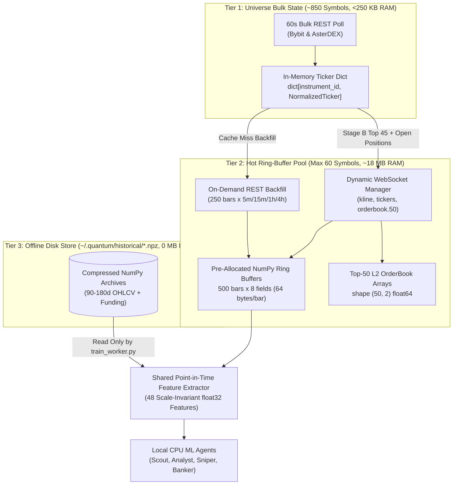

# DATA_PIPELINE.md: Market Data Ingestion, Ring Buffers & Point-in-Time Feature Store

## 1. End-to-End Data Flow Architecture

To remain well inside the ~300 MB desktop runtime RAM target while scanning 850+ perpetual contracts and supporting local ML training, **QUANTUM** separates market data into a **Three-Tier Data Hierarchy**:

1. **Tier 1: Universe Bulk Ticker Map (All ~850 Active Pairs in RAM)**:
   * Stores only the latest `NormalizedTicker` (`slots=True` frozen dataclass, ~220 bytes per symbol) in a flat `dict[str, NormalizedTicker]`.
   * Total RAM footprint for 1,000 symbols: **`< 250 KB`**.
   * Refreshed every **60 seconds** via bulk REST (`Bybit /v5/market/tickers` + `AsterDEX /fapi/v1/ticker/24hr`, `premiumIndex`, `bookTicker`), plus real-time WebSocket updates for subscribed symbols.
2. **Tier 2: Hot Multi-Timeframe Ring-Buffer Cache (Max 60 Active Symbols in RAM)**:
   * Holds pre-allocated `numpy` structured ring buffers of OHLCV candles (`1m`, `5m`, `15m`, `1h`, `4h`) and top-50 L2 orderbooks exclusively for:
     * All symbols with open paper positions or working paper limit orders.
     * Top 45 Stage B/C candidate symbols.
     * The symbol currently inspected in the user's `Market` chart tab.
   * Managed with an **LRU eviction policy** that never evicts symbols with active paper positions or orders.
3. **Tier 3: On-Disk Compressed Historical Training Store (`~/.quantum/historical/*.npz`)**:
   * Stores 90-180 days of contiguous historical `5m`, `15m`, `1h`, and `4h` OHLCV and funding rate arrays on disk (`0 MB` resident RAM in the desktop process; loaded sequentially by the isolated `train_worker.py` subprocess only during offline model training).



---

## 2. NumPy Structured Ring-Buffer Memory Layout

`MarketDataCache` (`src/quantum/exchanges/cache.py`) uses pre-allocated fixed-capacity NumPy structured arrays:

```python
import numpy as np

CANDLE_DTYPE = np.dtype([
    ("ts", "<i8"),         # Open timestamp in UTC milliseconds (int64, 8 bytes)
    ("open", "<f8"),       # float64 (8 bytes)
    ("high", "<f8"),       # float64 (8 bytes)
    ("low", "<f8"),        # float64 (8 bytes)
    ("close", "<f8"),      # float64 (8 bytes)
    ("volume", "<f8"),     # Base asset volume (8 bytes)
    ("turnover", "<f8"),   # Quote USDT volume (8 bytes)
    ("is_closed", "?"),    # Boolean closed flag (1 byte + 7 padding = 8 bytes aligned)
])
# Total size per bar = 64 bytes aligned
```

### 2.1 Exact RAM Calculation for Tier 2 Hot Cache
* **Capacity per Buffer**: `500` bars per `(instrument_id, timeframe)`.
* **Timeframes per Hot Symbol**: `5` (`1m`, `5m`, `15m`, `1h`, `4h`).
* **Bytes per Symbol (OHLCV)**: $500 \text{ bars} \times 5 \text{ TFs} \times 64 \text{ bytes} = 160,000 \text{ bytes} \approx \mathbf{160\text{ KB}}$.
* **Bytes per Symbol (L2 Top-50 OrderBook)**: $2 \text{ sides} \times 50 \text{ levels} \times 16 \text{ bytes} = \mathbf{1.6\text{ KB}}$.
* **Total for 60 Hot Symbols**: $60 \times 161.6\text{ KB} \approx \mathbf{9.7\text{ MB}}$ of raw NumPy array memory (`< 20 MB` including temporary indicator workspace buffers).

### 2.2 O(1) Ring-Buffer Update Rules
Each `KlineRingBuffer` tracks `head_idx: int` and `size: int`:
1. **Intra-Bar WebSocket Tick (`candle.ts == buffer[head_idx].ts`)**: Overwrites `high`, `low`, `close`, `volume`, `turnover`, and `is_closed` at `head_idx` in $O(1)$ time with zero memory allocation.
2. **New Bar Rollover (`candle.ts == buffer[head_idx].ts + interval_ms`)**: Marks `buffer[head_idx].is_closed = True`, advances `head_idx = (head_idx + 1) % 500`, and writes the new bar.
3. **Sequence Gap Detection (`candle.ts > buffer[head_idx].ts + interval_ms`)**: Marks the buffer `is_dirty = True` and schedules an asynchronous REST `fetch_ohlcv` backfill for the missing range before allowing Stage C or any ML agent to read that symbol.

---

## 3. Point-in-Time Causal Alignment (Zero Data Leakage Guarantee)

When computing multi-timeframe indicators (`5m`, `15m`, `1h`, `4h`) for either real-time inference or historical training at reference evaluation timestamp $t_{\text{eval}}$:

1. **Strict Closed-Candle Slicing**:
   For any timeframe $\tau \in \{5\text{m}, 15\text{m}, 1\text{h}, 4\text{h}\}$ with bar duration $\Delta_\tau$:
   $$\text{ValidBars}_\tau(t_{\text{eval}}) = \{ b \in \text{Buffer}_\tau \mid b.\text{ts} + \Delta_\tau \le t_{\text{eval}} \text{ and } b.\text{is\_closed} == \text{True} \}$$
   This guarantees that an unclosed higher-timeframe candle's future `high`, `low`, or `close` never leaks into historical training rows or live features.
2. **Vectorized NumPy Indicator Suite (`src/quantum/scanner/indicators.py`)**:
   * **EMA ($9, 21, 50, 200$)**: Recursive exponential filter initialized via SMA of first $N$ bars.
   * **Wilder's RSI ($14$), ATR ($14$), and ADX ($14$)**: Exact Wilder smoothing ($\alpha = 1/14$).
   * **Bollinger Bandwidth ($20, 2.0$) & 100-Bar Rolling Percentile**: Computed via sliding window variance.
   * **Hurst Exponent ($64$-bar Rescaled Range $R/S$)**: Distinguishes persistent trending ($H > 0.55$) from mean-reverting ($H < 0.45$) regimes for `ANALYST`.
   * **Donchian Channels ($20, 50$)**: Rolling highs/lows over closed bars `[t-N : t-1]`.

---

## 4. Dynamic WebSocket Subscription Manager

`SubscriptionManager` reconciles desired vs. active WebSocket streams every **60 seconds**:
1. **Pinned Subscriptions (Never Unsubscribed)**:
   * Any `instrument_id` with an open paper position (`status == "OPEN"`) or working limit order (`status == "OPEN"`).
   * The symbol currently active in the `Market` chart tab.
   * Subscribed topics: `tickers`, `orderbook.50` (or `@depth20@100ms`), and `kline` (`1m`, `5m`, `15m`).
2. **Dynamic Candidate Subscriptions (Max 25 Symbols)**:
   * Top 25 symbols from Stage C/D receive `tickers` and `kline.15m` WebSocket streams with a 5-minute minimum retention hysteresis to avoid subscription thrashing.
