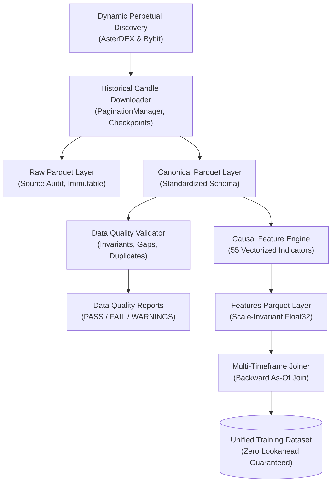

# Historical Market Data Pipeline & Causal Feature Store Specification

## 1. Architectural Overview

The QUANTUM Phase 4 historical data pipeline provides a reproducible, low-resource data engineering architecture for USDT perpetual futures.

The system decouples data collection, raw audit retention, canonical normalization, data quality validation, and deterministic feature computation into modular, stateless layers:



---

## 2. Dynamic Perpetual Contract Discovery

Instruments are not hardcoded. Active perpetual contracts are discovered dynamically via exchange metadata endpoints:

### Qualification Rules
1. **Contract Type:** Perpetual only (`PERPETUAL` on AsterDEX, `linear` on Bybit). Spot, inverse, and dated deliveries are strictly excluded.
2. **Settlement Asset:** USDT quote and margin currency (`USDT`).
3. **Trading Status:** Only currently active contracts (`status == TRADING`).
4. **Valid Filter Constraints:** `tick_size > 0.0`, `lot_step > 0.0`, `min_order_qty > 0.0`.
5. **Base Asset Sanitization:** Valid non-empty base asset symbol.

Discovered contracts are observed with an authoritative timestamp (`observed_at_ms`) and persisted to the SQLite `exchange_instruments` table.

---

## 3. Storage Hierarchy: Raw vs Canonical

QUANTUM implements a two-tier storage architecture separating auditability from analytical modeling.

### 3.1 Raw Storage Layer (`data/raw/`)
Preserves the exact payload representation returned by the exchange API for compliance, auditing, and reprocessing:
- Partitioning: `raw/exchange={EXCHANGE}/symbol={SYMBOL}/timeframe={TIMEFRAME}/data.parquet` (or `{YEAR}.parquet`)
- Schema:
  - `exchange`: string
  - `symbol`: string
  - `contract_type`: string
  - `timeframe`: string
  - `exchange_candle_ts_ms`: int64 (open time)
  - `raw_open`: string
  - `raw_high`: string
  - `raw_low`: string
  - `raw_close`: string
  - `raw_volume`: string
  - `raw_turnover`: string (nullable)
  - `raw_trades`: string (nullable)
  - `raw_taker_buy_volume`: string (nullable)
  - `raw_taker_buy_turnover`: string (nullable)
  - `raw_payload_json`: string (verbatim unaltered JSON array string directly from exchange REST response)
  - `retrieval_timestamp_ms`: int64
  - `source_endpoint`: string
  - `collection_run_id`: string
- Conflict Policy: Conflicting duplicate records (same timestamp, differing OHLCV) are never silently dropped; they are quarantined to `conflicts.parquet` with complete provenance. Exact duplicates (identical OHLCV) are safely deduplicated.
- Concurrency Protection: Thread-safe partition directory locks and atomic temporary files prevent concurrent write collisions.

### 3.2 Canonical Normalized Layer (`data/canonical/`)
Provides a shared, validated schema across all supported derivatives exchanges:
- Partitioning: `canonical/exchange={EXCHANGE}/symbol={SYMBOL}/timeframe={TIMEFRAME}/data.parquet`
- Schema:
  - `exchange`: string
  - `symbol`: string
  - `market_type`: string ("PERPETUAL")
  - `timeframe`: string ("5m", "15m", "1h", "4h", "1d")
  - `open_time_ms`: int64 (UTC ms)
  - `close_time_ms`: int64 (UTC ms)
  - `open`: float64
  - `high`: float64
  - `low`: float64
  - `close`: float64
  - `volume`: float64 (base asset volume)
  - `quote_volume`: float64 (turnover in USDT, nullable)
  - `trade_count`: int64 (nullable, never fabricated as zero)
  - `taker_buy_volume`: float64 (nullable)
  - `taker_buy_quote_volume`: float64 (nullable)
  - `ingestion_time_ms`: int64
  - `source_run_id`: string

---

## 4. Downloader, Pagination & Checkpoint Architecture

### 4.1 Directional Pagination
- **Backward Pagination (Default for Historical Backfills):**
  - Begins at `requested_end_ms`.
  - Queries exchange klines with `endTime` / `end` cursor.
  - Upon receiving $K$ bars, records earliest bar open time $T_{\text{earliest}}$.
  - Advances cursor to $T_{\text{earliest}} - 1$.
  - Terminates when cursor reaches `requested_start_ms` or an empty / partial response indicates the contract listing start.
- **Forward Pagination (For Live Incremental Catch-up):**
  - Begins at `requested_start_ms`.
  - Queries with `startTime` / `start` cursor.
  - Advances cursor to $T_{\text{latest}} + \text{interval\_ms}$.
  - Terminates upon reaching `requested_end_ms`.

### 4.2 Checkpointing and Interrupted Resumption
- Intermediate progress is flushed to Parquet in 2,000-candle batches.
- Progress checkpoints are persisted in SQLite (`historical_collection_checkpoints`):
  - `last_fetched_open_time_ms`
  - `earliest_open_time_ms`
  - `latest_open_time_ms`
  - `is_exhausted`
- If a download is interrupted by network drop, power loss, or application exit, restarting the job reads the checkpoint and resumes seamlessly from `last_fetched_open_time_ms` without duplicate requests.
- Upon successful validation, the temporary checkpoint is pruned.

### 4.3 Data Collection Operational Policy
1. Primary Source: Historical collection strictly utilizes exchange-provided historical REST endpoints (`/fapi/v1/klines` on AsterDEX and `/v5/market/kline` on Bybit).
2. Rapid Backfill: Historical backfill targets up to 3 years of listing history. It executes in minutes/hours via paginated REST calls and does NOT require continuous days or weeks of laptop runtime.
3. Incremental Updates: Supported via `sync_incremental` whenever the desktop application is launched, requesting only the delta range from the latest stored bar to the current time. If already up to date, zero network requests are issued.
4. Live Collection Boundary: Live WebSocket collection is optional, resource-bounded, and clearly separated from historical backfill. It is never a prerequisite for Phase 4 historical dataset acceptance.
5. Invariant: Unavailable historical exchange data is never claimed to be reconstructible through live collection. Missing exchange history remains documented as missing.

---

## 5. Data Quality Validation

Before writing a canonical dataset, the `DataQualityValidator` evaluates five dimensions:

1. **OHLC Invariants:**
   - $H_t \ge L_t$, $H_t \ge O_t$, $H_t \ge C_t$
   - $L_t \le O_t$, $L_t \le C_t$
   - $O_t, H_t, L_t, C_t > 0$
   - $V_t \ge 0$
2. **Incomplete Candle Exclusion:**
   - Bars where $C_{\text{close\_ms}} > \text{now\_ms}$ or $C_{\text{open\_ms}} + \text{interval\_ms} > \text{now\_ms}$ are flagged as in-flight and excluded from closed-candle datasets.
3. **Exact vs Conflicting Duplicates:**
   - Exact duplicates (identical OHLCV) are deduplicated keeping the latest record.
   - Conflicting duplicates (same timestamp, differing prices) are flagged as data defects and trigger validation failure.
4. **Gap Analysis:**
   - Identifies intervals where $T_{\text{curr}} - T_{\text{prev}} > \text{interval\_ms}$.
   - Calculates missing bar count: $\lfloor (T_{\text{curr}} - T_{\text{prev}}) / \text{interval\_ms} \rfloor - 1$.
   - Never interpolates or fabricates missing bars. Missing bars remain missing.
5. **Coverage Metrics:**
   $$\text{coverage\_pct} = \min\left(100.0, \frac{\text{observed\_count}}{\text{expected\_count}} \times 100\right)$$
   - `PASS`: coverage >= 98.0%, zero invalid OHLC, zero conflicting duplicates.
   - `PASS_WITH_WARNINGS`: coverage between 80.0% and 98.0% or minor clean gaps.
   - `FAIL`: coverage < 80.0%, invalid OHLC > 0, or conflicting duplicates > 0.
   - `INSUFFICIENT_HISTORY`: observed bars < 30.

---

## 6. Feature Engineering Specification (55 Features)

All 55 primary technical indicators are calculated using causal, vectorized operations without future data access. The resulting feature matrix contains 57 total columns: `open_time_ms`, `close_time_ms`, and the 55 indicator columns.

### 6.1 Price & Returns
1. `simple_return`: $(C_t - C_{t-1}) / C_{t-1}$
2. `log_return`: $\ln(C_t / C_{t-1})$
3. `pct_change`: `simple_return * 100`
4. `hl_range`: $H_t - L_t$
5. `hl_range_pct`: $(H_t - L_t) / C_t$
6. `body_pct`: $|C_t - O_t| / (H_t - L_t + \epsilon)$
7. `upper_wick_pct`: $(H_t - \max(O_t, C_t)) / (H_t - L_t + \epsilon)$
8. `lower_wick_pct`: $(\min(O_t, C_t) - L_t) / (H_t - L_t + \epsilon)$
9. `clv`: $(2 C_t - H_t - L_t) / (H_t - L_t + \epsilon)$

### 6.2 Trend Features
10-14. `ema_9`, `ema_21`, `ema_50`, `ema_100`, `ema_200`: Initialized with SMA on first $N$ bars, then recursive exponential smoothing ($\alpha = 2 / (N + 1)$).
15-19. `price_dist_ema_9..200`: $(C_t - \text{EMA}_N) / \text{EMA}_N$
20-24. `ema_9..200_slope`: $(\text{EMA}_{N, t} - \text{EMA}_{N, t-1}) / \text{EMA}_{N, t-1}$
25-27. `crossover_9_21`, `crossover_21_50`, `crossover_50_200`: Binary indicators for moving average alignment.

### 6.3 Momentum Features
28. `rsi_14`: Wilder's Relative Strength Index with exact $\alpha = 1/14$ smoothing.
29-31. `macd_line`, `macd_signal`, `macd_hist`: Fast EMA 12, Slow EMA 26, Signal EMA 9.
32-34. `stoch_k`, `stoch_d`, `stoch_slow_d`: Fast %K (5-bar window), %D (SMA 3 of %K), Slow %D (SMA 3 of %D).
35. `roc_10`: $(C_t - C_{t-10}) / C_{t-10}$

### 6.4 Volatility Features
36. `atr_14`: Wilder's True Range smoothing over 14 bars.
37. `atr_14_pct`: $\text{ATR}_{14} / C_t$
38. `rolling_std_returns_20`: Sample standard deviation of `simple_return` over 20 bars.
39-43. `bb_middle_20`, `bb_upper_20`, `bb_lower_20`, `bb_width_20`, `bb_pct_b_20`: Bollinger Bands (20-bar SMA, 2.0 standard deviations).
44. `rolling_hl_range_20`: $(\max(H_{t-19..t}) - \min(L_{t-19..t})) / C_t$

### 6.5 Volume Features
45. `vol_sma_20`: 20-bar Simple Moving Average of base volume.
46. `rvol_20`: Relative volume $V_t / \text{vol\_sma\_20}_t$.
47. `vol_change`: Relative volume change $(V_t - V_{t-1}) / V_{t-1}$.
48-49. `quote_vol_sma_20`, `quote_rvol_20`: Quote asset turnover volume metrics when supported.

### 6.6 Market Structure Features
50-51. `donchian_high_20`, `donchian_low_20`: Strict rolling maximum and minimum of past 20 closed bars $[t-20 : t-1]$ (shifted by 1 bar to eliminate lookahead).
52. `donchian_breakout_dist`: Normalized breakout distance beyond Donchian channels.
53-54. `dist_from_high_20`, `dist_from_low_20`: Relative distance to 20-bar rolling extremes.
55. `trend_state`: Binary macro trend state ($+1.0$ for bullish, $-1.0$ for bearish, $0.0$ for neutral).

---

## 7. Multi-Timeframe Alignment & Causal As-Of Join

### 7.1 Mathematical Zero-Lookahead Invariant
When joining higher-timeframe features (e.g. 1h, 4h, 1d) into lower-timeframe rows (e.g. 5m):

$$\text{ValidHTFBars}(T_{\text{base}}) = \{ H \in \text{HTF} \mid H.\text{close\_time\_ms} \le T_{\text{base}} \}$$

A lower-timeframe bar opening at $T_{\text{base}}$ can ONLY observe higher-timeframe candles that have **already completed their close** on or before $T_{\text{base}}$.

### 7.2 Implementation via `pandas.merge_asof`
```python
pd.merge_asof(
    base_df.sort_values("open_time_ms"),
    htf_df.sort_values("close_time_ms"),
    left_on="open_time_ms",
    right_on="close_time_ms",
    direction="backward",
)
```

- **Example:**
  - 1h Candle A: Open 10:00:00, Close 11:00:00.
  - 5m Candle 1: Open 10:55:00.
    - Since $11:00:00 > 10:55:00$, Candle A is still in-flight.
    - The join matches backward to the candle that closed at 10:00:00 (Candle from 09:00 to 10:00).
  - 5m Candle 2: Open 11:00:00.
    - Since $11:00:00 \le 11:00:00$, Candle A has now fully closed.
    - The 11:00:00 bar is the first bar that joins Candle A.
- Zero future leakage is mathematically guaranteed and verified via adversarial mutation tests.
