# IMPLEMENTATION_ROADMAP.md: Eight-Phase Incremental Engineering Plan (Local ML Edition)

## 1. Execution Philosophy

**QUANTUM** is structured into **8 sequential, strictly gated engineering phases** designed so a solo developer can build, verify, and benchmark each layer incrementally without big-bang integration failures. No phase may begin until the prior phase's automated tests and exit criteria pass.

```mermaid
flowchart LR
    P1["Phase 1<br/>Desktop Foundation<br/>(PySide6 + SQLite WAL)"] --> P2["Phase 2<br/>Multi-Agent Core<br/>(Contracts + EventBus)"]
    P2 --> P3["Phase 3<br/>Exchange Integration<br/>(Bybit + AsterDEX)"]
    P3 --> P4["Phase 4<br/>Dynamic Market Discovery<br/>(Stages A-D + 48 Features)"]
    P4 --> P5["Phase 5<br/>Local ML & Risk Pipeline<br/>(LightGBM + Walk-Forward + Risk)"]
    P5 --> P6["Phase 6<br/>Paper Execution<br/>(L2 Fills + Banker State Machine)"]
    P6 --> P7["Phase 7<br/>Analytics & Ablation<br/>(5-Tier Baseline Ablation)"]
    P7 --> P8["Phase 8<br/>Reliability & Low-Resource Benchmarks<br/>(12GB HDD Audit + Drift)"]
```

---

## Phase 1: Desktop Foundation

* **Objectives**: Establish project scaffolding, `qasync` event loop integration, SQLite WAL database engine with all 18 tables (`DATABASE_SCHEMA.md`), rotating structured logger, and the PySide6 7-workspace UI shell with dark theme tokens (`UI_DESIGN_SYSTEM.md`).
* **Modules**: `src/quantum/main.py`, `config/settings.py`, `core/logging.py`, `storage/database.py`, `storage/migrations/001_initial.sql`, `ui/app_window.py`, `ui/theme.py`, and skeleton workspaces 1-7 with Empty/Loading/Error states.
* **Dependencies**: None (root phase).
* **Deliverables**:
  * Launchable native PySide6 desktop window (`python -m quantum.main`) with working `Alt+1..7` workspace navigation, top pipeline status strip, bottom telemetry bar, and functional `Settings` persistence.
  * Initialized `~/.quantum/quantum_desk.db` in WAL mode with non-blocking PRAGMA settings.
* **Tests**:
  * `tests/unit/test_database.py`: Verify WAL pragma activation (`synchronous = NORMAL`), schema migration idempotency, and concurrent read/single-writer integrity.
  * `tests/ui/test_shell.py`: Verify keyboard navigation (`R-32`), WCAG AA contrast ratios across all theme tokens (`R-25`), and clean `qasync` shutdown.
* **Acceptance Criteria**: App launches in `< 1.5s`, uses `< 160 MB` RAM at empty shell idle, and passes all Phase 1 unit/UI tests.
* **Risks**: `qasync` loop teardown hangs on Windows if background tasks are not awaited.
* **Exit Conditions**: Clean startup/shutdown cycle verified 10 consecutive times with zero orphan tasks or SQLite lock errors.

---

## Phase 2: Multi-Agent Core & Data Contracts

* **Objectives**: Implement the typed `EventBus` with priority lanes (`P0`, `P1`, `P2`), canonical domain models, strict Pydantic input/output contracts for all 5 agents (`AGENT_SPECIFICATION.md`), `ModelRegistry` loader with SHA-256 and feature-schema hash checks, deterministic `RuleBaselinePredictor` (`FALLBACK_RULE_ONLY`), and the `PipelineOrchestrator` state machine.
* **Modules**: `domain/enums.py`, `domain/models.py`, `domain/events.py`, `core/event_bus.py`, `core/clock.py`, `ml/registry.py`, `agents/contracts.py`, `agents/orchestrator.py`.
* **Dependencies**: Phase 1.
* **Deliverables**:
  * Complete in-memory pipeline state machine (`QUEUED -> FEATURE_EXTRACTION -> SCOUT -> ANALYST -> SNIPER -> RISK -> EXECUTION`) wired to the `Agents` and `Overview` UI workspaces.
* **Tests**:
  * `tests/ml/test_contracts.py`: Test 100% of valid and invalid payloads, `NaN`/`Inf` feature rejections, and inverted SL/TP geometries.
  * `tests/ml/test_registry.py`: Verify SHA-256 verification, `feature_schema_hash` mismatch rejection, atomic model hot-swapping, and `FALLBACK_RULE_ONLY` cold-start mode.
* **Acceptance Criteria**: Any `NaN`/`Inf` feature, schema mismatch, or timeout (`> 50ms`) deterministically transitions the run to `SKIP_*` and logs to `agent_runs` and `agent_messages`.
* **Risks**: Train/serve feature ordering mismatch (mitigated by strict `FEATURE_SCHEMA_V1` tuple and hash enforcement).
* **Exit Conditions**: 100% branch coverage on `contracts.py`, `registry.py`, and `orchestrator.py` state transitions.

---

## Phase 3: Exchange Integration

* **Objectives**: Build `BybitAdapter` and `AsterDexAdapter` (`EXCHANGE_INTEGRATION.md`), token-bucket rate limiters, clock synchronization, dynamic WebSocket subscription manager, historical OHLCV/funding harvester, and the bounded NumPy ring-buffer cache (`DATA_PIPELINE.md`).
* **Modules**: `exchanges/base.py`, `exchanges/bybit_adapter.py`, `exchanges/aster_adapter.py`, `exchanges/cache.py`.
* **Dependencies**: Phase 1, Phase 2.
* **Deliverables**:
  * Live public REST & WebSocket ingestion from both Bybit V5 (`api.bybit.com`) and AsterDEX (`fapi.asterdex.com` / `sstream.asterdex.com`).
  * Live `Market` workspace displaying real-time `pyqtgraph` candlesticks, EMA overlays, and L2 order-book depth bars.
* **Tests**:
  * `tests/adapters/test_bybit.py` & `tests/adapters/test_aster.py`: Verify bulk ticker normalization, Bybit delta ticker merging, AsterDEX 3-endpoint join (`ticker/24hr` + `premiumIndex` + `bookTicker`), chronological kline ordering, and crossed-book filtering.
* **Acceptance Criteria**: Both adapters fetch full active USDT perpetual universes (~850 contracts total) in `< 2.5s` and maintain stable WebSocket streams with automatic reconnect and zero memory growth over a 30-minute soak test.
* **Risks**: AsterDEX newly listed contracts missing `indexPrice` or historical klines (`< 210` bars).
* **Exit Conditions**: Live market data renders accurately in the `Market` workspace for both `BYBIT:BTCUSDT` and `ASTER:BTCUSDT`.

---

## Phase 4: Dynamic Market Discovery & Causal Feature Engine

* **Objectives**: Implement the 4-stage scanner (`MARKET_DISCOVERY_PIPELINE.md`): Stage A Universe Discovery, Stage B Screening & Hygiene Filter, Stage C Vectorized NumPy Indicator Engine & 7-Bucket Classifier, Stage D Deterministic Scorer, State-Hash Deduplicator, and Cooldown Queue, plus the 48-feature point-in-time `extract_feature_vector` engine (`AGENT_PROMPTS.md`).
* **Modules**: `scanner/indicators.py`, `scanner/universe.py`, `scanner/screener.py`, `scanner/classifier.py`, `scanner/queue.py`, `ml/features.py`, `ui/pages/scanner_page.py`.
* **Dependencies**: Phase 3.
* **Deliverables**:
  * Full-universe scanner executing every 60 seconds in `< 300 ms` of vectorized NumPy compute time.
  * Causal 48-element `float32` feature extractor shared between live inference and offline training.
  * Interactive `Market Scanner` workspace (`Alt+2`) with live filtering across all 7 candidate categories for both `LONG` and `SHORT` biases.
* **Tests**:
  * `tests/unit/test_indicators.py` & `tests/unit/test_features_leakage.py`: Automated leakage verification by mutating future candles ($t > t_{\text{eval}}$) and proving that extracted features at $t_{\text{eval}}$ remain bit-for-bit identical.
  * `tests/unit/test_scanner_pipeline.py`: Verify top gainers with bearish exhaustion classify as `SHORT` reversal candidates, state-hash deduplication suppresses repeat market states, and stale candidates expire at 30s.
* **Acceptance Criteria**: Scanner processes 850+ symbols without dropping UI frame rate below 60 FPS and outputs deterministic, reproducible `ScannerCandidate` rankings and 48-feature vectors.
* **Risks**: Excessive REST kline backfill on cold start (mitigated by top-45 hot pool + `Semaphore(5)`).
* **Exit Conditions**: Stage A-D funnel metrics and candidate rankings populate live in the `Market Scanner` UI and `scanner_candidates` SQLite table.

---

## Phase 5: Local ML Pipeline, Walk-Forward Trainer & Deterministic Risk Engine

* **Objectives**: Implement the 13-stage local ML training pipeline (`ml/labels.py`, `ml/splitter.py`, `ml/calibration.py`, `ml/train_worker.py`), Agents 1-3 (`Scout`, `Analyst`, `Sniper` with `LightGBM` + Isotonic Calibration + deterministic ATR price geometry), and Agent 4 (`RiskEngine` deterministic 12-point gate & position sizer per `RISK_ENGINE_SPECIFICATION.md`).
* **Modules**: `ml/labels.py`, `ml/splitter.py`, `ml/calibration.py`, `ml/train_worker.py`, `agents/scout.py`, `agents/analyst.py`, `agents/sniper.py`, `risk/engine.py`, `risk/portfolio_state.py`, `ui/pages/agents_page.py`.
* **Dependencies**: Phase 2, Phase 4.
* **Deliverables**:
  * Isolated offline training subprocess (`train_worker.py`) that builds triple-barrier labels (with same-candle collision tie-breaks, gap-through fills, and boundary censoring), executes dynamically purged chronological walk-forward splits ($\text{PurgeDuration} = 1.5 \times (H_{\max} + \text{MaxEntryDelay})$, Embargo $= 0.5 \times H_{\max}$), tunes thresholds on validation folds under minimum trade frequency constraints ($N_{\text{trades}} \ge 50$), compares against `RULE_ONLY`, and saves versioned `.lgb` bundles.
  * Training runs with `BELOW_NORMAL_PRIORITY_CLASS` and `IOPRIO_LOW` using sequential `.npz` chunks to protect 12 GB RAM / mechanical HDD systems.
  * Live CPU inference pipeline (`SCOUT -> ANALYST -> SNIPER -> RISK`) producing verified, risk-sized `APPROVED` or `REJECTED (Veto)` trade decisions.
  * Complete `Agents` workspace (`Alt+3`) displaying model health, feature contributions, walk-forward evaluation metrics, and 1-click training/rollback controls.
* **Tests**:
  * `tests/ml/test_walk_forward.py`: Verify dynamic purge and embargo gaps completely prevent label overlap across train, validation, and OOS splits.
  * `tests/ml/test_labels.py`: Verify intra-bar double-touch collision resolution (1m drill-down / pessimistic SL tie-break) and boundary mark-to-market censoring.
  * `tests/unit/test_risk_engine.py`: Exhaustive tests of all 12 risk checks, lot-step rounding, fee-adjusted $R:R_{\text{net}} \ge 1.80$, and drawdown circuit breakers.
* **Acceptance Criteria**: Risk Engine deterministically blocks 100% of out-of-policy proposals; `SNIPER` never invents arbitrary prices; training subprocess stays under `550 MB` RAM without thrashing HDD and releases 100% of memory upon exit.
* **Risks**: Overfitting on small symbol subsets (mitigated by shallow depth $\le 5$, `min_child_samples >= 150`, and mandatory OOS promotion gate against `RULE_ONLY`).
* **Exit Conditions**: Verified pipeline runs persisted in `training_runs`, `model_registry`, `model_evaluations`, `agent_runs`, `trade_proposals`, and `risk_decisions`.

---

## Phase 6: Paper Execution Engine & Banker Lifecycle

* **Objectives**: Implement `PaperSimulator` (`PAPER_EXECUTION_SPECIFICATION.md`) with L2 order-book depth walk VWAP + slippage, partial limit fills, maker/taker fees, 8h funding rate settlements, intra-bar collision resolution matching `ml/labels.py`, and Agent 5 (`Banker` deterministic position state machine + optional 5m `LightGBM` Exit Hazard Classifier + quantitative post-trade journal).
* **Modules**: `execution/simulator.py`, `execution/funding.py`, `execution/accounting.py`, `agents/banker.py`, `ui/pages/positions_page.py`.
* **Dependencies**: Phase 3, Phase 5.
* **Deliverables**:
  * Realistic paper trading lifecycle from order placement through partial TP1 fill, breakeven stop ratchet, ATR trailing stop, funding settlement, final exit, and `trade_journal` MFE/MAE attribution.
  * Interactive `Positions` workspace (`Alt+5`) with manual override actions (`[Close 50%]`, `[Close 100%]`, `[Move SL to Breakeven]`, `[Cancel Order]`).
* **Tests**:
  * `tests/execution/test_simulator.py`: Verify L2 book walk slippage math, partial limit order queue depletion, stop-loss mark-price triggering, intra-bar collision pessimistic tie-break, and exact cash/margin/uPnL accounting conservation.
  * `tests/execution/test_banker.py`: Verify deterministic state machine transitions and verify `Banker` exit classifier can never widen an existing stop-loss.
* **Acceptance Criteria**: Every simulated fill is 100% reproducible from its recorded `market_snapshots` and L2 book state; crash-restart rehydrates open positions with zero state loss.
* **Risks**: Floating-point rounding drift in cumulative fee/funding ledger (mitigated by `round(..., 8)` precision and SQLite atomic transactions).
* **Exit Conditions**: Full trade lifecycle (`Open -> TP1 -> Trail SL -> Close -> Journal`) verified end-to-end on both Bybit and AsterDEX symbols.

---

## Phase 7: Analytics, Attribution & 5-Tier Baseline Ablation Suite

* **Objectives**: Build the quantitative evaluation and ablation engine (`TESTING_STRATEGY.md`), equity & underwater drawdown curves, 3-way performance attribution tables, Brier calibration plots, and the 5-Tier Ablation Suite (`RULE_ONLY`, `SCOUT_ONLY`, `SCOUT_ANALYST`, `SCOUT_ANALYST_SNIPER`, `QUANTUM_5_AGENT`) tracking trade frequency and funnel drop-off Pareto charts.
* **Modules**: `analytics/metrics.py`, `analytics/attribution.py`, `analytics/ablation.py`, `ui/pages/analytics_page.py`.
* **Dependencies**: Phase 6.
* **Deliverables**:
  * Complete `Analytics` workspace (`Alt+6`) comparing all 5 ablation tiers across Net Expectancy ($R$), Profit Factor, Max Drawdown, Monthly Trade Frequency, Trade Coverage Ratio, Fee/Slippage/Funding Drag, and Brier calibration.
* **Tests**:
  * `tests/unit/test_metrics.py` & `tests/ml/test_ablation.py`: Validate Sharpe/Sortino, Profit Factor, Expectancy $E_R$, Brier score, and 5-tier walk-forward ablation reproducibility.
* **Acceptance Criteria**: All analytics render accurately with sample-size statistical confidence warnings when $N < 30$ trades; trade coverage ratios and rejection reason distributions update live.
* **Risks**: Division-by-zero on 0 losing trades or 0 closed trades (handled explicitly with `INF` / `N/A` display states).
* **Exit Conditions**: Analytics workspace passes full UI and mathematical verification.

---

## Phase 8: Reliability, Low-Resource Hardware Benchmarks & Memory Audit

* **Objectives**: Implement `DriftMonitor` (`ml/drift.py` PSI & calibration tracking), conduct continuous soak testing, memory leak profiling (`tracemalloc` + `psutil`), CPU frame-time tuning, chaos injection testing, and execute the 5 Operational Acceptance Tests on the Reference Low-Resource Hardware Profile (4 cores, 12 GB RAM, mechanical SATA HDD) per `TESTING_STRATEGY.md` and `ACCEPTANCE_CRITERIA.md`.
* **Modules**: `ml/drift.py`, `tests/benchmarks/bench_memory.py`, `tests/benchmarks/bench_cpu.py`, `tests/benchmarks/bench_hdd_io.py`.
* **Dependencies**: Phases 1-7.
* **Deliverables**:
  * Benchmark report confirming $\le 300\text{ MB}$ desktop runtime idle RAM (`~205 MB` expected), $\le 340\text{ MB}$ active load RAM, `< 5 ms` P95 local ML pipeline latency over 1,000 reps, zero HDD thrashing or virtual memory paging thrash during training, and 100% passing test suite.
* **Tests**: Full regression + 60-minute accelerated soak test + chaos recovery suite + 5 hardware operational acceptance tests.
* **Acceptance Criteria**: Zero unhandled exceptions, zero memory leaks, zero paid external dependencies, and 100% compliance with `ACCEPTANCE_CRITERIA.md`.
* **Risks**: Mechanical HDD seek contention between SQLite WAL flush and training data reads (mitigated by `IOPRIO_LOW` and sequential `.npz` storage).
* **Exit Conditions**: All 18 architecture specifications satisfied and signed off for production paper trading.
