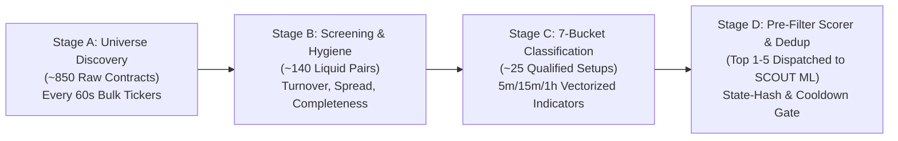

# MARKET_DISCOVERY_PIPELINE.md: Four-Stage Dynamic Market Scanner

## 1. Design Objectives & Anti-Watchlist Architecture

The Dynamic Market Discovery System scans the **entire eligible USDT-margined perpetual futures universe** across Bybit and AsterDEX (~600 to 900+ contracts combined) every **60 seconds** using deterministic, vectorized Python/NumPy math.
* **Fast Vectorized Funnel**: Stages A, B, C, and D execute purely in vectorized NumPy (`< 300 ms` compute time per cycle) to filter ~850 raw contracts down to the top qualified candidates before extracting the full 48-feature vector for `SCOUT` (Agent 1).
* **Bidirectional Discovery**: Top gainers are never blindly treated as `LONG` signals; extreme parabolic extensions with waning volume or negative funding divergence are classified into `REVERSAL_CANDIDATES (SHORT)`, while clean high-volume structural breakouts classify into `BREAKOUT_CANDIDATES (LONG)`.

---

## 2. Stage A: Universe Discovery

### 2.1 Execution Schedule
* **Instrument Catalog Refresh (`fetch_instruments`)**: Every **30 minutes** (or on startup).
* **Bulk Ticker & Funding Snapshot (`fetch_all_tickers`)**: Every **60 seconds** concurrently across Bybit (`1 REST call`) and AsterDEX (`3 parallel REST calls`).

### 2.2 Eligibility Rules
A contract passes Stage A if and only if:
1. `quote_asset == "USDT"` and contract type is Linear Perpetual.
2. `status == "TRADING"` (excludes `SETTLING`, `DELIVERING`, `PRE_LAUNCH`, `HALTED`).
3. `onboard_timestamp_ms <= now_ms - (14 * 86_400_000)` (configurable default: exclude contracts listed less than **14 days** ago so 200+ historical bars exist across `15m`, `1h`, and `4h` timeframes).

---

## 3. Stage B: Market Screening & Hygiene Filter

Stage B eliminates illiquid, wide-spread, or data-corrupted contracts before computing multi-timeframe features. All thresholds are user-configurable in the `Settings` page and stored in `app_settings`.

### 3.1 Stage B Configurable Thresholds

| Filter Metric | Default Threshold (Bybit) | Default Threshold (AsterDEX) | Formula / Check | Rationale |
| :--- | :---: | :---: | :--- | :--- |
| **Minimum 24h Turnover** | `>= $15,000,000 USDT` | `>= $3,000,000 USDT` | `ticker.turnover_24h_usdt >= min_turnover` | Avoids thin books where $1,000 paper orders suffer severe slippage. |
| **Maximum Bid/Ask Spread** | `<= 12.0 bps` (`0.12%`) | `<= 18.0 bps` (`0.18%`) | `((ask1 - bid1) / mid) * 10000 <= max_spread_bps` | Prevents immediate negative expectancy from spread crossing. |
| **Minimum 24h Volatility Range** | `>= 2.5%` | `>= 2.5%` | `((high_24h - low_24h) / low_24h) * 100 >= min_range_pct` | Excludes dead or pegged pairs that cannot cover round-trip fees. |
| **Price Sanity Check** | `mark_price` within `1.0%` of `last_price` | `mark_price` within `1.2%` of `last_price` | `abs(mark - last) / mark <= 0.01` | Rejects manipulated wicks or dislocated index feeds. |
| **Data Completeness Gate** | `>= 210` contiguous bars on `5m`, `15m`, `1h` | `>= 210` contiguous bars on `5m`, `15m`, `1h` | `len(candles) >= 210` and `max_gap_ms == interval_ms` | Ensures `EMA-200`, `100-bar` volatility percentiles, and ML features contain zero `NaN` values. |

### 3.2 Two-Tier Kline Fetching Strategy
To avoid fetching klines for all 140 Stage B survivors every minute:
1. **Bulk Pre-Rank**: Rank Stage B survivors by an activity composite:
   $$\text{ActivityIndex} = 0.5 \cdot \text{Percentile}(\text{Turnover}_{24h}) + 0.5 \cdot \text{Percentile}(|\Delta \text{Price}_{24h}|)$$
2. **Hot Pool Selection**: Select the top **45 symbols** across both exchanges (plus any symbols already subscribed via WebSocket).
3. **Incremental Kline Sync**: If a symbol is already in the hot NumPy ring buffer, WebSocket `kline` streams keep it updated at **0 REST cost**. If a symbol newly enters the top 45, fetch `250` bars of `5m`, `15m`, `1h`, and `4h` via REST controlled by an `asyncio.Semaphore(5)`.

---

## 4. Stage C: Seven-Bucket Opportunity Classification

For each symbol passing Stage B with complete `5m`, `15m`, `1h`, and `4h` OHLCV data, the vectorized indicator engine computes:
* **Returns**: Log returns $r_{5m}, r_{15m}, r_{1h}, r_{4h}, r_{24h}$
* **Trend**: $\text{EMA}_{9}, \text{EMA}_{21}, \text{EMA}_{50}, \text{EMA}_{200}$ on `15m` and `1h`; $\text{ADX}_{14}$
* **Momentum**: $\text{RSI}_{14}$ (`5m`, `15m`, `1h`), $\text{MACD}(12, 26, 9)$ normalized histogram slope
* **Volatility**: $\text{ATR}_{14}$ (`5m`, `15m`, `1h`), Normalized ATR ($\text{NATR} = \text{ATR}_{14} / \text{Close}$), Bollinger Bandwidth $\text{BBW}(20, 2.0)$ & 100-bar percentile
* **Volume & Order Flow**: Relative Volume $\text{RVOL}_{15m} = V_{\text{closed}} / \text{SMA}(V, 20)$, Volume Z-Score $Z_{\text{vol}} = (V - \mu_{20}) / \sigma_{20}$
* **Structure Levels**: 20-bar and 50-bar Donchian High/Low ($H_{20}, L_{20}, H_{50}, L_{50}$), rolling VWAP distance in ATR units

### 4.1 The Seven Candidate Categories

| # | Category Enum | Quantitative Trigger Condition | Directional Bias Assigned |
| :-: | :--- | :--- | :--- |
| **1** | `TOP_GAINERS` | Top 10 symbols by $R_{24h} \ge +8.0\%$ with $\text{RVOL}_{15m} \ge 1.5$. | `LONG` if $\text{Close}_{15m} > \text{EMA}_{21}$ and $\text{RSI}_{15m} \in [55, 74]$ (trend continuation); `SHORT` if $\text{RSI}_{15m} > 80$ and bearish 15m rejection wick $> 40\%$ of bar range. |
| **2** | `TOP_LOSERS` | Bottom 10 symbols by $R_{24h} \le -8.0\%$ with $\text{RVOL}_{15m} \ge 1.5$. | `SHORT` if $\text{Close}_{15m} < \text{EMA}_{21}$ and $\text{RSI}_{15m} \in [26, 45]$ (breakdown continuation); `LONG` if $\text{RSI}_{15m} < 20$ and bullish 15m hammer wick + positive volume spike. |
| **3** | `VOLUME_SURGE` | $\text{RVOL}_{15m} \ge 3.0$ or $Z_{\text{vol}, 15m} \ge 2.5$ with bar body $\ge 0.6 \times (\text{High} - \text{Low})$. | `LONG` if close is in top $25\%$ of bar range; `SHORT` if close is in bottom $25\%$ of bar range. |
| **4** | `MOMENTUM_ACCELERATION` | $\text{ADX}_{14, 15m} \ge 25$, $|\Delta \text{MACD\_Hist}_{15m}|$ expanding for 3 consecutive bars, and `5m`/`15m`/`1h` $\text{EMA}_9 > \text{EMA}_{21}$ aligned. | `LONG` on bullish 3-TF alignment; `SHORT` on bearish 3-TF alignment. |
| **5** | `VOLATILITY_EXPANSION` | Prior 10-bar $\text{BBW}_{15m}$ in bottom 20th percentile of 100-bar lookback (squeeze), followed by current bar $\text{TrueRange} \ge 1.8 \times \text{ATR}_{14}$. | `LONG` if expansion breaks above upper Bollinger Band; `SHORT` if expansion breaks below lower Bollinger Band. |
| **6** | `REVERSAL_CANDIDATES` | Price stretched $\ge 2.5 \times \text{ATR}_{14, 1h}$ from $\text{EMA}_{21, 1h}$, $\text{RSI}_{15m} \ge 78$ (or $\le 22$), and 5m structure breaks prior swing low (for short) or swing high (for long), often accompanied by extreme funding rate ($|\text{Funding}| \ge 0.05\%$). | `SHORT` on overbought exhaustion; `LONG` on oversold capitulation. |
| **7** | `BREAKOUT_CANDIDATES` | `15m` candle closes above 50-bar high $H_{50}$ (or below 50-bar low $L_{50}$) with $\text{RVOL}_{15m} \ge 1.8$ and `1h` trend not opposing. | `LONG` on upside Donchian breakout; `SHORT` on downside Donchian breakdown. |

---

## 5. Stage D: Candidate Scoring, Deduplication & Queue Management

### 5.1 Deterministic Multi-Factor Pre-Score ($0\text{ to }100$)
Every symbol qualifying for at least one Stage C bucket receives a deterministic composite `scanner_score`:

$$\text{Score} = w_{\text{vol}} S_{\text{vol}} + w_{\text{struct}} S_{\text{struct}} + w_{\text{mtf}} S_{\text{mtf}} + w_{\text{liq}} S_{\text{liq}} + w_{\text{fund}} S_{\text{fund}}$$

Where each sub-score is normalized to $[0, 100]$ and weighted as:
* **$S_{\text{vol}}$ (Weight `0.25`, Volume Conviction)**: Scaled linearly from $\text{RVOL}_{15m} \in [1.2, 5.0]$.
* **$S_{\text{struct}}$ (Weight `0.30`, Setup Quality)**: Measures closeness to clean invalidation ($1.0\text{-}2.5 \times \text{ATR}$ away), candle body-to-wick conviction, and multi-bucket confluence (+10 bonus if qualifying for 2 complementary buckets).
* **$S_{\text{mtf}}$ (Weight `0.20`, Multi-Timeframe Alignment)**: Alignment between `5m`, `15m`, and `1h` EMA slopes and RSI regimes relative to the candidate's directional bias.
* **$S_{\text{liq}}$ (Weight `0.15`, Execution Quality)**: Penalizes spread and rewards high 24h turnover: $100 \times (1 - \text{spread\_bps} / \text{max\_spread\_bps})$.
* **$S_{\text{fund}}$ (Weight `0.10`, Funding Rate Tailwind)**: Rewards setups where funding pays the holder or penalizes crowded positioning.

**Qualification Gate**: Only candidates with $\text{Score} \ge 68.0$ (configurable) enter the `CandidateQueue` for `SCOUT` ML inference.

### 5.2 Five Controls Against Duplicate Candidates & Stale Processing

1. **Cross-Bucket Symbol Consolidation**: If `BYBIT:SOLUSDT` triggers both `VOLUME_SURGE` and `BREAKOUT_CANDIDATES` in the same scan cycle, they are merged into a **single** `ScannerCandidate` entry with `primary_category = BREAKOUT_CANDIDATES` and `secondary_categories = [VOLUME_SURGE]`.
2. **Market State Fingerprint Hashing (Anti-Repeat Evaluation)**:
   Each candidate generates a structural state hash:
   $$\text{StateHash} = \text{SHA256}\left(\text{instrument\_id} \parallel \text{bias} \parallel \text{primary\_category} \parallel \text{floor}\left(\frac{\text{close\_price}}{0.5 \times \text{ATR}_{15m}}\right) \parallel t_{\text{15m\_bar\_open}}\right)$$
   If an identical `StateHash` was already evaluated by `SCOUT` within the last **15 minutes** (the same 15m bar and same half-ATR price band), the candidate is suppressed (`DEDUP_STATE_UNCHANGED`).
3. **Per-Symbol Cooldown Timer**:
   * After a symbol is evaluated and rejected (`SKIP`) by any agent stage: **15-minute cooldown** for that symbol + bias unless price moves by $\ge 1.5 \times \text{ATR}_{15m}$ or $\text{RVOL}_{15m}$ doubles.
   * While a paper position or entry order is open on an `instrument_id`, new discovery candidates for that symbol are suppressed.
4. **Strict Candidate TTL (Stale Prevention)**:
   * Every queued candidate carries `expires_at_ms = created_at_ms + 30_000` (30 seconds, since local CPU ML inference takes `< 10 ms` total).
   * Immediately before `SCOUT` runs, if `now_ms > expires_at_ms` or if live price has drifted $> 0.5 \times \text{ATR}_{15m}$ away from the snapshot price, the candidate is dropped (`EXPIRED_IN_QUEUE`).
5. **Bounded Dispatch Rate**:
   * Up to **5 top-ranked candidates** per 60-second scanner cycle are evaluated through the local `SCOUT -> ANALYST -> SNIPER` ML pipeline (which completes in `< 50 ms` total CPU time).
