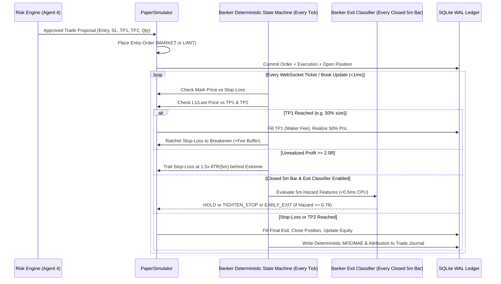

# PAPER_EXECUTION_SPECIFICATION.md: Realistic Perpetual Futures Simulator

## 1. Realism Philosophy: Zero Idealized Fills

Naive paper trading engines assume every market order fills at `last_price` and every limit order fills the instant `last_price` touches `limit_price`. That approach produces fictional backtest and paper equity curves that collapse in live trading.

**QUANTUM's `PaperSimulator` (`src/quantum/execution/simulator.py`)** enforces realistic microstructure physics:
1. **Market & Stop-Market Orders Cross the Spread and Walk the L2 Book**: Buyers pay the `asks` queue; sellers hit the `bids` queue, incurring volume-weighted depth slippage plus a latency impact buffer.
2. **Limit Orders Require Queue Depletion or Price Trade-Through**: Merely touching a limit price does not guarantee a 100% fill; partial fills are modeled against resting L1 liquidity.
3. **Stop-Loss Triggers Reference `mark_price` (Anti-Wick Standard)**: Matching Bybit and AsterDEX default perpetual mechanics, `STOP_MARKET` orders trigger off `mark_price` (to avoid unfair single-trade wick stop-outs), but once triggered, the resulting market order executes against the live L2 order book (`bids` or `asks`).
4. **Full Fee & Funding Accounting**: Maker/taker fees and 8-hour (or 4h/1h dynamic) perpetual funding rate cashflows are deducted or credited directly against account equity.

---

## 2. Order Fill & Slippage Mathematics

### 2.1 Market & Stop-Market Order Execution (L2 Book Walk + Latency Slippage)
When a `MARKET` or triggered `STOP_MARKET` order for quantity $Q_{\text{req}}$ arrives:
1. **Select Counterparty L2 Book Side**:
   * For a `BUY` (Long Entry or Short Exit): walk `orderbook.asks` sorted ascending $[ (P_1, V_1), (P_2, V_2), \dots, (P_k, V_k) ]$.
   * For a `SELL` (Short Entry or Long Exit): walk `orderbook.bids` sorted descending $[ (P_1, V_1), (P_2, V_2), \dots, (P_k, V_k) ]$.
2. **Compute Depth VWAP ($P_{\text{vwap}}$)**:
   Match $Q_{\text{req}}$ across successive levels $i = 1 \dots m$ until $\sum_{i=1}^m q_i = Q_{\text{req}}$ (where $q_i = \min(Q_{\text{rem}}, V_i)$):
   $$P_{\text{vwap}} = \frac{\sum_{i=1}^m q_i \cdot P_i}{Q_{\text{req}}}$$
   *(Fallback if L2 depth is temporarily unavailable: $P_{\text{vwap}} = P_{\text{ask1}}$ for BUY or $P_{\text{bid1}}$ for SELL, plus a linear size penalty of $2.0\text{ bps}$ per $\$5,000$ notional).*
3. **Add Micro-Latency Volatility Penalty ($\delta_{\text{lat}}$)**:
   Simulates `50-150 ms` network round-trip adverse selection during fast candles:
   $$\delta_{\text{lat}} = 0.05 \times \frac{\text{ATR}_{1m}}{P_{\text{mid}}}$$
   $$P_{\text{fill}} = \begin{cases} \text{round\_to\_tick}\left(P_{\text{vwap}} \cdot (1 + \delta_{\text{lat}})\right) & \text{if BUY} \\ \text{round\_to\_tick}\left(P_{\text{vwap}} \cdot (1 - \delta_{\text{lat}})\right) & \text{if SELL} \end{cases}$$
4. **Compute Recorded Spread & Slippage Metrics**:
   * `reference_mid_price`: $P_{\text{mid}} = \frac{P_{\text{bid1}} + P_{\text{ask1}}}{2}$
   * `spread_cost_bps`: $\frac{P_{\text{ask1}} - P_{\text{mid}}}{P_{\text{mid}}} \times 10^4$
   * `slippage_bps`: $\frac{|P_{\text{fill}} - P_{\text{top\_of\_book}}|}{P_{\text{mid}}} \times 10^4$
   * `liquidity_role`: `"TAKER"`

### 2.2 Limit Order Execution & Partial Fill Simulation (`ENTRY`, `TP1`, `TP2`)
1. **Post-Only vs. Marketable Limit Check on Submission**:
   * If a `BUY LIMIT` is submitted with $P_{\text{limit}} \ge P_{\text{ask1}}$ (or `SELL LIMIT` with $P_{\text{limit}} \le P_{\text{bid1}}$), it crosses the book immediately and executes as a **`TAKER`** using the L2 Book Walk formula above.
   * Otherwise, the order rests on the book as a **`MAKER`** with an assigned virtual queue position:
     $$Q_{\text{ahead}} = 0.50 \times V_{\text{level}}(\text{at } P_{\text{limit}})$$
2. **Fill Conditions on Subsequent Market Updates**:
   * **Condition A: Full Trade-Through**: If `ask1_price < P_limit` (for a resting `BUY LIMIT`) or `bid1_price > P_limit` (for a resting `SELL LIMIT`), the market has completely traded through the level; `100%` of remaining open quantity fills at $P_{\text{limit}}$ as `"MAKER"`.
   * **Condition B: Touch & Partial Queue Depletion**: When `last_price == P_limit` or `bid1_price == P_limit` (for `BUY LIMIT`), incoming traded volume at that price decrements $Q_{\text{ahead}}$. Once $Q_{\text{ahead}} \le 0$, the order fills incrementally in partial chunks bounded by available L1 size ($\max 25\%$ of L1 volume per tick), transitioning order status `OPEN -> PARTIALLY_FILLED -> FILLED`.
   * If the partial fill leaves a remainder smaller than the contract's `min_order_qty`, the remainder is rounded into the current fill.

### 2.3 Same-Bar TP/SL Collision & Gap-Through Execution Rules (Matching ML Label Generator)
To ensure zero divergence between paper execution and historical model training labels:
1. **Intra-Bar Collision Resolution (Anti-Optimism Standard)**:
   If a market update or historical replay bar exhibits both `high >= take_profit` and `low <= stop_loss` on the same candle:
   * `PaperSimulator` queries the 1-minute (`1m`) kline stream or recent public trades to determine the exact chronological touch order.
   * If sub-bar resolution is unavailable or if both barriers were breached within the same 1-minute interval, the simulator applies the **Pessimistic Worst-Case Tie-Break**: the Stop-Loss is deemed to have triggered first, liquidating the position at market and canceling resting take-profit limit orders.
2. **Gap-Through Price Slippage**:
   If a flash wick or market restart results in an opening price beyond the stop-loss level ($P_{\text{open}} < P_{\text{stop}}$ for a Long, or $P_{\text{open}} > P_{\text{stop}}$ for a Short):
   * The stop-loss does not receive an idealized fill at $P_{\text{stop}}$.
   * The order executes as a market order walking the L2 book starting at $P_{\text{open}}$, taking the realistic gap loss.

---

## 3. Position Lifecycle, Stop-Loss, Take-Profit & Trailing Stops

---

## 4. Fee, Funding & Equity Accounting Formulas

### 4.1 Trading Fees (`Default Exchange Tiers`)
Unless overridden in `exchange_instruments`:
* **Bybit V5 Perpetual Default (Non-VIP)**: `Maker = 0.020%` (`0.0002`), `Taker = 0.055%` (`0.00055`).
* **AsterDEX Perpetual Default**: `Maker = 0.020%` (`0.0002`), `Taker = 0.050%` (`0.00050`).
* **Fee Formula per Execution**:
  $$\text{Fee}_{\text{USDT}} = Q_{\text{fill}} \times P_{\text{fill}} \times f_{\text{role}}$$

### 4.2 Perpetual Funding Rate Settlement (`src/quantum/execution/funding.py`)
Perpetual contracts settle funding at each exchange's `next_funding_time_ms` (typically every 8 hours at `00:00`, `08:00`, `16:00` UTC, or 4h/1h for high-volatility pairs):
* When `synced_utc_ms >= position.next_funding_time_ms` while a position is `OPEN`:
  $$\text{Notional}_{\text{mark}} = Q_{\text{open}} \times P_{\text{mark}}$$
  $$\text{FundingPayment}_{\text{USDT}} = \begin{cases} +\text{Notional}_{\text{mark}} \times r_{\text{funding}} & \text{if LONG} \\ -\text{Notional}_{\text{mark}} \times r_{\text{funding}} & \text{if SHORT} \end{cases}$$
  * If $\text{FundingPayment}_{\text{USDT}} > 0$, the position **pays** funding (deducted from account cash balance and added to `position.total_funding_usdt`).
  * If $\text{FundingPayment}_{\text{USDT}} < 0$, the position **receives** funding (credited to account cash balance).
  * Every settlement writes an immutable audit row to `funding_events`.

### 4.3 Realized & Unrealized PnL Accounting
For an open position with average entry price $P_{\text{entry}}$, open quantity $Q_{\text{open}}$, and live mark price $P_{\text{mark}}$:
* **Unrealized Gross PnL**:
  $$\text{uPnL}_{\text{gross}} = \begin{cases} Q_{\text{open}} \cdot (P_{\text{mark}} - P_{\text{entry}}) & \text{if LONG} \\ Q_{\text{open}} \cdot (P_{\text{entry}} - P_{\text{mark}}) & \text{if SHORT} \end{cases}$$
* **Estimated Exit Fee Reserve**:
  $$\text{Fee}_{\text{exit\_est}} = Q_{\text{open}} \cdot P_{\text{mark}} \cdot f_{\text{taker}}$$
* **Unrealized Net PnL**:
  $$\text{uPnL}_{\text{net}} = \text{uPnL}_{\text{gross}} - \text{Fee}_{\text{exit\_est}}$$
* **Realized Net PnL (upon full position close)**:
  $$\text{rPnL}_{\text{net}} = \sum \text{RealizedGrossDelta}_{\text{fills}} - \text{total\_fees\_usdt} - \text{total\_funding\_usdt}$$
* **Total Account Equity**:
  $$\text{TotalEquity}_{\text{USDT}} = \text{StartingEquity} + \sum_{\text{all trades}} \text{rPnL}_{\text{net}} + \sum_{\text{open positions}} \text{uPnL}_{\text{net}}$$
