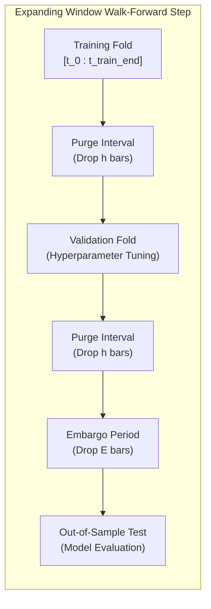

# QUANTUM Phase 5.0 - Validation Design Specification

**Role:** Senior Quantitative Research Engineer, ML Research Scientist, and Financial Data Auditor  
**Repository:** https://github.com/RAYDENFLY/quantum-multi-agent  
**Phase:** Phase 5.0 (Dataset Readiness & Target Research)  
**Date:** November 1, 2026  
**Status:** Design Completed - Temporal Architecture Specified  

---

## 1. Executive Summary

Standard k-fold cross-validation is mathematically invalid in financial time series. Random shuffling creates severe lookahead leakage and information contamination because:
1. Future market observations are used to predict past observations.
2. Consecutive financial features and returns exhibit serial correlation and autoregressive memory.
3. Multi-period prediction targets ($h > 1$) produce overlapping forward return windows, where training samples share identical future price paths with testing samples.

This specification establishes a **Purged and Embargoed Expanding-Window Walk-Forward Validation Architecture** tailored specifically for cryptocurrency perpetual futures. The design guarantees zero information leakage across temporal boundaries, accounts for market regime non-stationarity, and preserves a sacred, completely untouched final holdout period.

---

## 2. Comparison of Validation Methodologies

| Validation Methodology | Temporal Order Preserved? | Prevents Overlapping Label Contamination? | Evaluates Multiple Market Regimes? | Information Efficiency | Recommendation |
| :--- | :---: | :---: | :---: | :---: | :--- |
| **Random K-Fold** | NO (Violates time) | NO (Severe leakage) | N/A | Flawed | **REJECTED**: Produces fictitious, overfit performance. |
| **Simple Chronological Holdout (70/15/15)** | YES | PARTIAL (Only 1 boundary) | NO (Evaluates only 1 test regime) | Low | **INSUFFICIENT**: Performance depends heavily on the arbitrary split point. |
| **Rolling-Window Walk-Forward** | YES | NO (Unless purged) | YES | Moderate | **SUBOPTIMAL**: Discards valuable older structural market history. |
| **Purged & Embargoed Expanding Walk-Forward** | **YES** | **YES (Mathematical guarantee)**| **YES (Multi-regime)** | **High** | **RECOMMENDED**: Statistically rigorous, robust against regime shifts. |

---

## 3. The Purged & Embargoed Cross-Validation (PE-CV) Algorithm

The proposed validation architecture implements the formal framework developed by Marcos López de Prado (2018), adapted for high-frequency perpetual futures:

### 3.1 The Purging Mechanism
When labeling with horizon $h$ (e.g. 12 bars on 5-minute data = 60 minutes), an observation at time $t$ has a label $y_t$ that depends on market prices up to $t + h$.
- If a test set begins at $t_{\text{test}}$, any training observation $t_i$ where $t_i + h \ge t_{\text{test}}$ has a label containing price data from inside the test set.
- **Purging Rule**: All training observations $t_i$ satisfying:
  $$t_{\text{test}} - h < t_i < t_{\text{test}}$$
  are strictly purged from the training set before model fitting.

### 3.2 The Embargoing Mechanism
Financial time series exhibit persistent memory in volatility and order flow imbalances. After a test set ends at $t_{\text{test\_end}}$, immediate subsequent training data in the next fold may leak information through autoregressive indicator states.
- **Embargoing Rule**: An embargo window of length $E = h \times 2$ (e.g. 24 bars = 2 hours) is placed immediately following every test segment. No subsequent training sample is drawn from within the embargo window.

---

## 4. Concrete Temporal Split Architecture

Assuming the full 3-year historical backfill on 5-minute data (~315,360 bars from November 2023 to November 2026):

### 4.1 Global Data Partitioning
1. **Research & Development Window (83.3% = 2.5 Years)**: November 1, 2023 to April 30, 2026 (~262,800 candles). Used for walk-forward training, hyperparameter tuning, and cross-validation.
2. **Final Untouched Holdout Window (16.7% = 6 Months)**: May 1, 2026 to October 31, 2026 (~52,560 candles).
   - **Sacred Boundary Rule**: This dataset remains strictly locked during Phase 5.0 and Phase 5.1 research. It is evaluated only once as a final operational gate before any deployment consideration.

### 4.2 Expanding Walk-Forward Folds (R&D Window)

| Fold | Training Window | Purge/Embargo | Validation Window | OOS Test Window | Tested Market Regime |
| :---: | :--- | :---: | :--- | :--- | :--- |
| **Fold 1** | Nov 1, 2023 - Oct 31, 2024 (12 mos) | $h=12, E=24$ | Nov 1, 2024 - Dec 31, 2024 (2 mos) | Jan 1, 2025 - Mar 31, 2025 (3 mos) | Early 2025 Bull Expansion |
| **Fold 2** | Nov 1, 2023 - Mar 31, 2025 (17 mos) | $h=12, E=24$ | Apr 1, 2025 - May 31, 2025 (2 mos) | Jun 1, 2025 - Aug 31, 2025 (3 mos) | Mid 2025 Consolidation |
| **Fold 3** | Nov 1, 2023 - Aug 31, 2025 (22 mos) | $h=12, E=24$ | Sep 1, 2025 - Oct 31, 2025 (2 mos) | Nov 1, 2025 - Jan 31, 2026 (3 mos) | Late 2025 High Volatility |
| **Fold 4** | Nov 1, 2023 - Jan 31, 2026 (27 mos) | $h=12, E=24$ | Feb 1, 2026 - Feb 28, 2026 (1 mo) | Mar 1, 2026 - Apr 30, 2026 (2 mos) | Early 2026 Distribution |
| **Final Holdout** | **Nov 1, 2023 - Apr 30, 2026 (30 mos)**| **$h=12, E=24$**| **Dedicated Gate** | **May 1, 2026 - Oct 31, 2026 (6 mos)**| **Untouched OOS Gate** |

---

## 5. Strict Preprocessing Boundaries

To eliminate silent feature distribution leakage:
1. **Stateful Transformers**: Any preprocessor that computes dataset parameters (e.g. `StandardScaler` mean and standard deviation, `RobustScaler` median and IQR, PCA projection matrices):
   - **MUST** call `fit()` or `fit_transform()` strictly on the training fold slice.
   - **MUST** call `transform()` (never `fit`) on the validation fold, test fold, and holdout set.
2. **Missing Value Imputation**: Forward-fill or zero-fill parameters must be calculated strictly from training history.
3. **Threshold Selection**: Classification decision thresholds (e.g. minimum probability for signal generation) must be calibrated strictly on the validation fold and evaluated without modification on the test fold.

---

## 6. Treatment of Regime Shifts and Non-Stationarity

Cryptocurrency perpetual markets undergo severe structural shifts across volatility, liquidity, and trend regimes.

### Regime Adaptation Protocol
1. **Scale-Invariant Feature Enforcement**: Only features independent of the nominal USDT price level are admitted to the model matrix. Fractional returns, normalized oscillator bounds, relative volume ratios, and moving average distance percentages remain valid across arbitrary price regimes.
2. **Volatile Regime Weighting**: In tree-based models and loss functions, sample weighting inversely proportional to local volatility prevents high-volatility outlier periods from dominating split criteria.
3. **Regime Attribution Tracking**: Test fold evaluation must record separate performance metrics across distinct macro regimes (bull trend, bear trend, low-volatility chop, high-volatility crash) using the `trend_state` feature as a stratification label.
