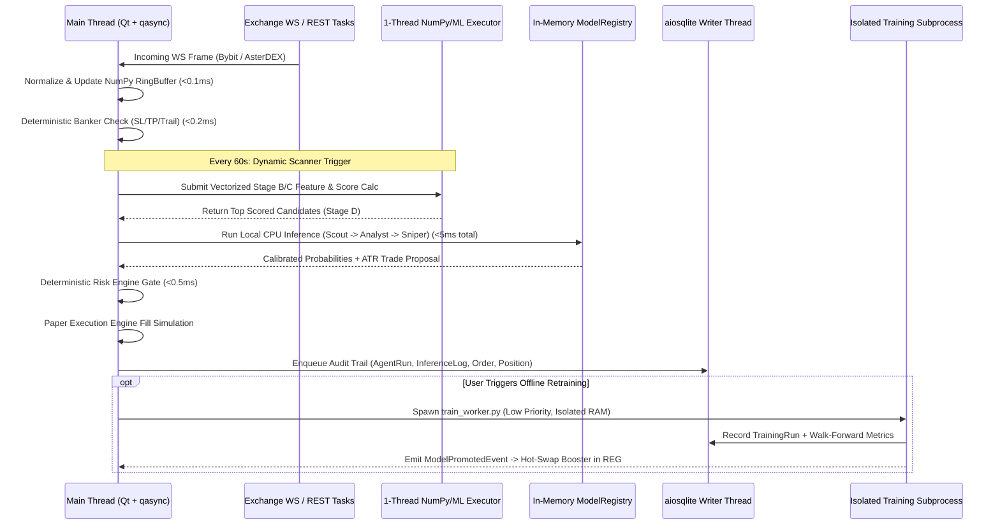

# SYSTEM_DESIGN.md: Runtime Lifecycle, Training Subprocess & Fault Tolerance

## 1. Dual-Workload Process Model & Low-Resource Hardware Architecture

To keep the desktop trading terminal responsive on low-resource computers (4-core CPU, 12 GB RAM, mechanical HDD) while supporting full walk-forward machine learning, **QUANTUM** separates real-time operations from offline model training:

1. **Primary Desktop Runtime Process (`python -m quantum.main`)**:
   * Runs continuously during research and paper trading (Acceptance Target: $\le 300\text{ MB}$ idle RAM, Engineering Estimate: `~205 MB` idle, `~272 MB` active).
   * Integrates `PySide6` (Qt6) and `asyncio` via `qasync.QEventLoop` on the main OS thread.
   * Performs real-time feature extraction and in-process single-row CPU inference (`LightGBM` + `scikit-learn` calibrators) with `num_threads=1` (Acceptance Target: $\le 15.0\text{ ms}$ P95 full pipeline).
2. **On-Demand Offline Training Subprocess (`python -m quantum.ml.train_worker`)**:
   * Spawned only when the user clicks `[Start Walk-Forward Training]` in the UI or triggers a scheduled retraining job.
   * Runs as an isolated child process (`asyncio.create_subprocess_exec`) with OS process priority set to `psutil.BELOW_NORMAL_PRIORITY_CLASS` and disk I/O priority set to `psutil.IOPRIO_LOW` on Windows.
   * OpenMP and BLAS compute threads are strictly capped at `max(1, cpu_count // 2)` (2 threads on a 4-core machine).
   * Memory is strictly bounded to an Acceptance Target of $\le 550\text{ MB}$ peak RSS by training models sequentially with explicit `gc.collect()`.
   * Streams progress updates (`JSONL` lines over `stdout`) back to the main UI process, writes validated model bundles to `~/.quantum/models/{agent}_{version}/`, registers metrics in SQLite, and **terminates completely** so zero training memory persists in the desktop app.

### 1.1 Mechanical HDD & 12 GB RAM Stability Engineering
Standard entry-level desktop machines frequently utilize mechanical HDDs (5400/7200 RPM) with high random-seek latency (`12-18 ms`). If background model training saturates disk heads or if total RAM triggers Windows page-file paging, the desktop UI will stutter or freeze. The following safeguards eliminate this risk:
* **Sequential Buffered Dataset I/O**: Historical kline datasets are stored as compressed binary archives (`.npz`) read sequentially into contiguous memory buffers. No fragmented per-trade or per-candle micro-files are ever written to disk.
* **Non-Blocking SQLite WAL Mode**: SQLite commits run asynchronously via `aiosqlite` with `PRAGMA synchronous = NORMAL`. The main UI thread never waits for a mechanical disk head write before processing WebSocket frames.
* **Zero Swap-Thrashing Headroom**: On a 12 GB RAM system with ~8 GB user-space headroom, QUANTUM's combined peak footprint (Desktop Runtime `~272 MB` + Training Subprocess `~450 MB` $\approx \mathbf{722\text{ MB}}$ total) utilizes less than **10% of available RAM**. Windows virtual memory paging to mechanical HDD is mathematically prevented.

---

## 2. Application Startup & Shutdown Sequence

### 2.1 Deterministic Startup Sequence (7 Steps)
1. **Bootstrap & Lockfile**: Acquire single-instance file lock (`~/.quantum/quantum.lock`) and initialize rotating JSONL + console logger (`~/.quantum/logs/quantum.log`, max 10 MB $\times$ 5 files).
2. **Configuration Load**: Load settings from SQLite `app_settings` (with fallback defaults in `config/settings.py`). Zero paid API keys are required.
3. **Database Initialization**: Open SQLite database (`~/.quantum/quantum_desk.db`), execute `PRAGMA journal_mode=WAL; PRAGMA synchronous=NORMAL; PRAGMA foreign_keys=ON; PRAGMA busy_timeout=5000; PRAGMA cache_size=-8000;`, and run any pending schema migrations.
4. **Local Model Registry Warmup**: Scan `~/.quantum/models/` and SQLite `model_registry` for the active `PRODUCTION` model bundle for `SCOUT`, `ANALYST`, `SNIPER`, and `BANKER`. Verify SHA-256 artifact checksums and feature schema hashes. If no trained model exists yet (fresh install), initialize the explicit `FALLBACK_RULE_ONLY` baseline predictors.
5. **State Recovery**: Rehydrate open paper positions, working limit orders, daily PnL counters, and active risk cooldown timers from SQLite into `PortfolioState` and `PaperSimulator`.
6. **Clock Synchronization & Exchange Warmup**: Query Bybit (`GET /v5/market/time`) and AsterDEX (`GET /fapi/v1/time`) concurrently; record `server_offset_ms`, fetch active instrument catalogs (`Stage A`), and open WebSocket streams for rehydrated open paper positions.
7. **UI Shell Launch**: Construct `MainWindow`, attach 4 Hz `UIStateSynchronizer` timer, render the `Overview` workspace, and start `ScannerScheduler` and `BankerMonitor`.

### 2.2 Graceful Shutdown Sequence
When the user closes the window or triggers `SIGINT`/`SIGTERM`:
1. **Halt New Pipelines & Terminate Active Training Subprocess**: Set `Orchestrator.is_shutting_down = True`. If an offline `train_worker` subprocess is running, send `SIGTERM`, clean up temporary `.part` artifact files, and mark `training_runs.status = 'ABORTED'`.
2. **Preserve Paper State**: Flush latest mark prices and unrealized PnL snapshots to the `positions` table without auto-liquidating open paper positions.
3. **Close Exchange Streams**: Send clean WebSocket close frames (`code=1000`) to Bybit and AsterDEX and close the shared `aiohttp.ClientSession`.
4. **Drain SQLite Queue**: Wait up to `3.0s` for the `aiosqlite` writer queue to drain all pending log and audit records, run `PRAGMA wal_checkpoint(TRUNCATE);`, and close the database connection.

---

## 3. Typed Event Bus Architecture

All cross-module communication flows through an in-process, strongly typed `EventBus` (`src/quantum/core/event_bus.py`).

### 3.1 Priority Lanes & Backpressure

| Priority Lane | Queue Capacity | Drop / Overflow Policy | Example Event Types |
| :--- | :---: | :--- | :--- |
| **CRITICAL (`P0`)** | `500` | **Never Drop** (blocks producer or triggers emergency halt) | `PositionStopTriggered`, `RiskCircuitBreakerTripped`, `OrderFilledEvent`, `FundingSettledEvent` |
| **PIPELINE (`P1`)** | `1,000` | Drop oldest expired candidate if `age > ttl_ms` | `CandidateQueuedEvent`, `AgentStepCompletedEvent`, `TradeProposalCreatedEvent`, `RiskDecisionEvent`, `ModelHotSwappedEvent` |
| **TELEMETRY (`P2`)** | `2,500` | Coalesce by `symbol` (latest-value wins) | `TickerUpdatedEvent`, `OrderBookSnapshotEvent`, `ScannerCycleSummaryEvent`, `TrainingProgressEvent` |

---

## 4. Clock Synchronization & Stale Data Defense

* **Monotonic Internal Reference**: All internal elapsed-time measurements (e.g., inference latency, rate-limit token buckets, scanner intervals) use `time.monotonic_ns()`.
* **Exchange Server Offset Calculation**:
  Every 300 seconds, for each exchange $E \in \{\text{BYBIT}, \text{ASTER}\}$:
  $$\text{RTT}_E = t_{\text{recv\_local}} - t_{\text{send\_local}}$$
  $$\text{Offset}_E = t_{\text{exchange\_server}} - \left(t_{\text{send\_local}} + \frac{\text{RTT}_E}{2}\right)$$
* **Stale Market Data Gate**:
  Before `SNIPER` proposes a trade or `RISK` approves execution, the engine verifies:
  $$\text{Now}_{\text{synced}} - t_{\text{latest\_ticker}} \le \text{max\_data\_age\_ms} \quad (\text{default: } 5,000\text{ ms})$$
  If the market snapshot is older than `5,000 ms`, the pipeline immediately aborts with status `SKIP_STALE_DATA`.

---

## 5. Fault Tolerance, Circuit Breakers & Recovery

| Failure Mode | Detection Mechanism | Immediate Automated Action | Recovery Strategy |
| :--- | :--- | :--- | :--- |
| **WebSocket Disconnect (Bybit or AsterDEX)** | EOF frame, socket error, or missing heartbeat/message for `> 15s`. | Mark exchange feed status as `DEGRADED` in UI; pause new `Stage D` candidates for that exchange. | Reconnect with exponential backoff (`1s, 2s, 4s, 8s, max 30s` + $\pm 20\%$ jitter). If open paper positions exist on that exchange, poll REST `/tickers` every `3s` as a fallback until WS recovers. |
| **AsterDEX 24h WebSocket Expiration** | Connection age timer reaches `23h 45m`. | Open secondary warm WS connection, subscribe to active streams, swap active stream pointer, and cleanly close old socket. | Zero-downtime make-before-break socket rotation. |
| **Exchange HTTP 429 / 418 (Rate Limit)** | HTTP status `429` or Bybit `retCode=10006` or AsterDEX weight $> 90\%$ of cap. | Trip exchange REST Circuit Breaker for `reset_timestamp` (or `60s` default). | Drain token bucket to `0`; resume at $50\%$ polling frequency for 5 minutes after cooldown expires. |
| **Feature Vector `NaN` / `Inf` or Schema Mismatch** | `FeatureValidator` detects missing bar data, zero variance division, or feature list mismatch against model manifest. | Reject candidate immediately with `SKIP_FEATURE_INVALID`. | Schedule asynchronous kline backfill for that symbol; never pass imputed zeros or `NaN` into a production model if primary indicators are missing. |
| **Model Artifact Missing / Checksum Corrupt** | `ModelRegistry.load()` SHA-256 verification fails or no `PRODUCTION` model exists yet. | Switch affected agent to explicit `FALLBACK_RULE_ONLY` mode (or `SKIP_MODEL_UNAVAILABLE` if user disabled rule fallback in Settings). | Display warning badge in `Agents` workspace prompting user to roll back to prior model version or run training. |
| **Model Inference Timeout (`> 50 ms`)** | Single-row inference exceeds `50 ms` wall-clock guard. | Abort current candidate (`SKIP_INFERENCE_TIMEOUT`). | Log slow inference warning and verify `num_threads=1` on the loaded booster. |
| **SQLite Write Contention / Disk Full** | `sqlite3.OperationalError` in writer coroutine. | Emit critical UI banner alert; halt new trade openings; dump emergency position state to `~/.quantum/crash_recovery.json`. | Retry transaction up to 3 times with `100ms` backoff. |
