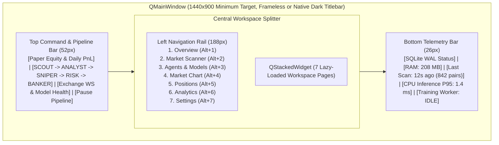

# UI_SPECIFICATION.md: PySide6 Desktop Terminal Architecture (Local ML Edition)

## 1. Visual & Functional Design Read

> **Design Read**: Professional desktop quantitative multi-agent trading terminal for solo crypto derivatives researchers, in a high-density dark institutional terminal style, dial **ENERGY 2 / RHYTHM 2 / MOTION 1**.

### 1.1 Desktop Terminal Layout Architecture
**QUANTUM** adapts the multi-agent trading terminal layout to a widescreen desktop workspace (`1440x900` baseline, scaling cleanly from `1280x768` up to `3840x2160` 4K monitors):
* **Persistent Top Command & Pipeline Strip (`52px` height)**: Displays live Paper Equity, Session PnL, Drawdown Meter, the **5-Stage Local Quantitative Pipeline Stepper (`SCOUT -> ANALYST -> SNIPER -> RISK -> BANKER`)** with real-time state indicators, Exchange Connectivity & Model Registry Pills (`BYBIT WS`, `ASTER WS`, `ML REGISTRY: READY`), and the emergency **"Pause Pipeline"** toggle.
* **Compact Left Rail Navigation (`64px` collapsed / `188px` expanded)**: Keyboard-accessible (`Alt+1` through `Alt+7`) vertical workspace switcher for the 7 required pages.
* **Multi-Pane Splitter Workspaces (`QSplitter`)**: Every page is organized around the **primary decision the operator makes on that screen**, eliminating decorative filler cards or dead controls.

---

## 2. Specification of the 7 Required Workspaces

### Workspace 1: `Overview` (`Alt+1`)
* **Primary Operator Decision**: Assess overall desk health, active paper exposure, and live 5-agent local ML pipeline flow at a glance.
* **Layout Grid (3 Asymmetric Zones)**:
  1. **Top KPI Strip (5 Purposeful Metrics)**:
     * `Paper Equity (USDT)` + `Available Margin`
     * `Total Net PnL ($ / %)` (after fees & funding)
     * `Daily PnL ($ / %)` + `Daily Loss Limit Remaining Bar`
     * `Active Positions / Max Cap` + `Net Long/Short Delta Exposure ($)`
     * `Win Rate (%)` + `Profit Factor (Rolling 50 Trades)`
  2. **Center-Left (60% width): Live Agent Pipeline & Active Positions Split**:
     * **Upper Panel: Active Pipeline Stage Cards**: Horizontal 5-card flow showing `SCOUT`, `ANALYST`, `SNIPER`, `RISK`, and `BANKER`. Each card shows current status (`IDLE`, `RUNNING`, `PROCEED`, `SKIP`, `VETO`), active `Exchange:Symbol`, `Model Version`, CPU inference latency (`ms`), calibrated probability (`%`), and a 2-line quantitative feature summary.
     * **Lower Panel: Open Paper Positions Table**: Compact live grid (`Symbol`, `Side`, `Size`, `Lev`, `Entry`, `Mark`, `SL`, `TP1/TP2`, `uPnL $/%`, `Banker Status`, `[Close Market]` action button).
  3. **Center-Right (40% width): Top Qualified Opportunities & Live Event Stream**:
     * **Upper Panel: Top 5 Stage D Queued Candidates**: Clickable rows showing `Exchange`, `Symbol`, `Category Badge`, `Bias`, `Scanner Score (0-100)`, `RVOL`, and `[Inspect in Market]` action.
     * **Lower Panel: Structured Activity Feed**: Timestamped chronological log of real system events (Candidate queued, Scout probability, Analyst regime classification, Sniper E[R] proposal, Risk veto reason, Order filled, Stop ratcheted).

### Workspace 2: `Market Scanner` (`Alt+2`)
* **Primary Operator Decision**: Inspect how the 4-stage scanner narrows ~850 contracts down to top-ranked long and short candidates, and drill into any symbol.
* **Layout**:
  1. **Filter & Control Header**:
     * Exchange Selector (`ALL`, `BYBIT`, `ASTER`), Symbol Search Box (`Ctrl+F`), Directional Bias Filter (`ALL`, `LONG`, `SHORT`), and Category Tabs (`All Qualified`, `Top Gainers`, `Top Losers`, `Volume Surge`, `Momentum Accel`, `Volatility Exp`, `Reversal`, `Breakout`).
     * Stage Funnel Counter Pill: `Universe: 846 -> Screened (Stage B): 138 -> Classified (Stage C): 24 -> Queued (Stage D): 4`.
  2. **Main Candidate Ranking Table (`QTableView` + `QSortFilterProxyModel`)**:
     * Columns: `Rank`, `Exchange`, `Symbol`, `Suggested Bias (LONG/SHORT)`, `Primary Category`, `Secondary Categories`, `Scanner Score (0-100)`, `Last Price`, `24h Change %`, `24h Turnover ($M)`, `Spread (bps)`, `Funding %`, `15m RVOL`, `15m RSI`, `15m NATR %`, `Queue Status (`QUEUED`, `EVALUATED`, `COOLDOWN`, `DEDUP`)`, and Action (`[Open Chart]`, `[Run ML Pipeline]`).
  3. **Bottom Collapsible Drawer: Candidate History (`candidate_history`)**:
     * Historical log of past Stage D candidates, their deterministic scores at discovery time, `SCOUT` / `ANALYST` / `SNIPER` calibrated probabilities, and final outcome (`APPROVED_TRADE`, `SKIP_SCOUT`, `SKIP_ANALYST`, `SKIP_SNIPER`, or `VETO_RISK`).

### Workspace 3: `Agents` (`Alt+3` - Local ML Intelligence & Model Registry)
* **Primary Operator Decision**: Monitor each agent's loaded local ML model health, inspect feature importances and per-run feature contributions, compare walk-forward evaluation metrics, and trigger or roll back local model training runs.
* **Layout**:
  1. **Top 5-Agent Model Health Header**:
     * Five dedicated agent cards (`SCOUT [LightGBM]`, `ANALYST [Regime + LightGBM]`, `SNIPER [Barrier EV + ATR]`, `RISK [100% Python]`, `BANKER [State Machine + Hazard ML]`) showing: `Model Status (`READY`, `FALLBACK_RULE_ONLY`, `DRIFT_WARNING`)`, `Active Model Version`, `Inference Mode`, `P50 / P95 CPU Latency (ms)`, `OOS Brier Calibration Score`, `Feature Drift (PSI)`, and `Pass / Skip Rate %`.
  2. **Left Pane (45% width): Pipeline Inference Runs Master Table**:
     * Filterable list of `pipeline_run_id` executions with columns: `Timestamp`, `Exchange:Symbol`, `Bias`, `Scout Prob`, `Analyst Regime & Prob`, `Sniper E[R_net]`, `Risk Decision`, `Final Outcome`, `Total CPU Latency (ms)`, `Model Bundle Version`.
  3. **Right Pane (55% width): Quantitative Inspector & Model Management Tabs**:
     * **Tab A: Run Feature Contributions & Decision View**: Displays the 48 extracted features for the selected run, top positive/negative feature contributions (`gain`), `Analyst` support/resistance & invalidation levels, `Sniper` barrier grid probabilities (`P(TP1)`, `P(TP2)`, `E[R_net]`), and `Risk` 12-point checklist results.
     * **Tab B: Model Registry, Walk-Forward Evaluation & Training Control**:
       * Table of all registered model versions (`Version`, `Agent`, `Trained Date`, `Train/Val/OOS Window`, `OOS Net Expectancy R` vs `RULE_ONLY`, `OOS Profit Factor`, `Brier Score`, `Status`, `[Activate Version]`, `[Rollback]`).
       * Offline Training Controls: `[Harvest Historical Data]`, `[Start Walk-Forward Training Subprocess]`, live progress bar streaming from `train_worker.py`, and `[Abort Training]`.
     * **Tab C: Validation & Veto History**: Filtered view of `NaN`/missing-bar rejections, feature drift alerts, and Risk Engine vetoes.

### Workspace 4: `Market` (`Alt+4`)
* **Primary Operator Decision**: Visually verify multi-timeframe price action, technical indicators, Sniper ATR trade levels, and live L2 orderbook depth for any selected contract.
* **Layout**:
  1. **Top Instrument Header**: Symbol selector dropdown (`BYBIT:BTCUSDT`, etc.), Timeframe switcher (`1m`, `5m`, `15m`, `1h`, `4h`), Indicator toggles (`EMA 9/21/50/200`, `Bollinger Bands`, `Donchian 50`, `Trade Levels Overlay`), and live ticker stats (`Mark`, `Index`, `Funding + Countdown`, `24h Vol`, `Spread bps`).
  2. **Center-Left (75% width): Hardware-Accelerated `pyqtgraph` Multi-Pane Chart**:
     * **Main Plot (70% height)**: Candlestick items + EMA/Bollinger overlays + interactive horizontal price lines for active Position or Sniper Proposal (`Entry Zone`, `Stop-Loss`, `TP1`, `TP2`, `Analyst Invalidation`).
     * **Volume Sub-Plot (15% height)**: OHLC-colored volume bars with `SMA(20)` volume baseline.
     * **Oscillator Sub-Plot (15% height)**: `RSI(14)` with `30/70` regime bands (or `MACD(12,26,9)` toggle).
  3. **Center-Right (25% width): Live Order Book & Multi-Timeframe Matrix**:
     * **Upper Box: Multi-Timeframe Regime Matrix**: Compact 5-row table (`1m`, `5m`, `15m`, `1h`, `4h`) showing `EMA Trend`, `RSI-14`, `ADX-14`, `NATR%`, and `RVOL` alignment.
     * **Lower Box: Live L2 Order-Book Depth (`Top 20 Asks / Bids`)**: Horizontal depth volume bars behind `Price`, `Size`, and `Cumulative USDT`, separated by the live `Spread (bps)` and `Mid / Mark Price` banner.

### Workspace 5: `Positions` (`Alt+5`)
* **Primary Operator Decision**: Monitor and manage active paper positions, working limit orders, execution fills, and trade journal entries.
* **Layout (3 Sub-Tabs + Persistent Top Position Summary)**:
  1. **Tab 1: Active Paper Positions & Working Orders**:
     * **Active Positions Grid**: `Position ID`, `Exchange:Symbol`, `Side`, `Size`, `Notional ($)`, `Leverage`, `Entry Price`, `Mark Price`, `Liquidation Price (Est)`, `Stop-Loss (Current vs Initial)`, `TP1 / TP2`, `Unrealized PnL ($ / % / R-Multiple)`, `Accrued Fees + Funding ($)`, `Holding Duration`, `Banker State / Hazard Prob`, and interactive controls (`[Close 50% Market]`, `[Close 100% Market]`, `[Move SL to Breakeven]`).
     * **Working Limit Orders Grid**: `Order ID`, `Symbol`, `Side`, `Limit Price`, `Distance to Mark %`, `Filled / Total Qty`, `Time in Force / Expiry Countdown`, `[Cancel Order]`.
  2. **Tab 2: Closed Positions & Execution Fill Ledger**:
     * Master-detail table: selecting a closed position reveals every child execution fill (`Entry Fill`, `TP1 Partial Fill`, `Trailing Stop Fill`, `Fee Charged`, `Slippage bps`, `Funding Settled`).
  3. **Tab 3: Banker Quantitative Trade Journal**:
     * Displays the structured entry metrics from `Analyst`/`Sniper` alongside `Banker`'s deterministic post-trade evaluation (`Realized R`, `MFE R`, `MAE R`, `Edge Ratio`, `Slippage Drag R`, `Funding Drag R`, and `Model Version`).

### Workspace 6: `Analytics` (`Alt+6`)
* **Primary Operator Decision**: Evaluate statistically whether the local ML multi-agent system achieves positive net expectancy after realistic fees, slippage, and funding compared against the `RULE_ONLY` and `SINGLE_ML_MODEL` baselines.
* **Layout**:
  1. **Top Quantitative Summary Cards (6 Cards)**:
     * `Net PnL ($ / %)` vs `Gross PnL ($)`
     * `Profit Factor` & `Net Expectancy ($ / R per trade)`
     * `Win Rate (%)` & `Avg Win R / Avg Loss R`
     * `Max Drawdown ($ / %)` & `Current Drawdown (%)`
     * `Execution Drag Breakdown`: `Total Fees ($)` + `Total Slippage ($)` + `Net Funding ($)`
     * `Sample Size Confidence Badge`: Displays warning banner if `Total Closed Trades < 30` ("Preliminary: Insufficient sample size for statistical significance").
  2. **Center Chart: Equity, Baseline Comparison & Drawdown Curve (`pyqtgraph`)**:
     * Dual-linked time-series chart: Upper curve shows `Net Equity (5-Agent Local ML)` vs. shadow `RULE_ONLY Baseline Equity`; lower area plot shows underwater `Drawdown %`.
  3. **Bottom 3-Way Attribution Tables**:
     * **By Pair & Exchange**: `Symbol`, `Trades`, `Win %`, `Net PnL`, `Avg R`, `Profit Factor`.
     * **By Market Condition / Scanner Bucket**: Performance across the 7 Stage C buckets (`BREAKOUT`, `REVERSAL`, `VOLUME_SURGE`, etc.).
     * **By Model Version & Calibration Bucket**: Compares predicted probability deciles (`0.55-0.65`, `0.65-0.75`, `0.75+`) against realized empirical win rate and expectancy (`Brier Reliability Curve`).

### Workspace 7: `Settings` (`Alt+7`)
* **Primary Operator Decision**: Configure local ML model thresholds, training parameters, exchange polling, scanner thresholds, deterministic risk limits, and paper account rules with immediate validation.
* **Layout (Form Sections with Explicit `[Save & Apply]`, `[Reset to Conservative Defaults]`, and `[Test Exchange Latency]` Controls)**:
  1. **Local ML Inference & Training Configuration**:
     * Inference Fallback Policy (`FALLBACK_RULE_ONLY` vs. `STRICT_ML_ONLY`).
     * Agent Prediction Thresholds: `Scout Min Probability (initial default 0.56)`, `Analyst Min Probability (initial default 0.58)`, `Sniper Min Expected Net R (initial default +0.25R)` (each tuned and calibrated on validation folds under minimum trade frequency constraints), `Banker Exit Classifier Enabled (True/False)` & `Hazard Threshold (0.78)`.
     * Offline Training Resource Limits: `Max Training CPU Threads`, `Historical Lookback Days (90-180d)`, and `[Verify Local Model Checksums]` button.
  2. **Exchange & Data Configuration**: Enable/Disable `Bybit` or `AsterDEX`, REST polling interval (`60s`), max WebSocket subscriptions (`25`), and `[Test Exchange Latency]` button.
  3. **Scanner Stage B/C/D Thresholds**: Min 24h Turnover (`$`), Max Spread (`bps`), Min Scanner Score (`68.0`), Symbol Cooldown (`15m`), and optional Pinned/Excluded Symbols list.
  4. **Deterministic Risk Limits (Agent 4)**: Max Concurrent Positions (`3`), Risk per Trade (`0.5%` equity), Max Symbol Exposure (`15%`), Max Total Exposure (`45%`), Max Leverage (`3.0x`), Max Daily Loss (`2.5%`), Max Drawdown (`8.0%`), Min Net R:R (`1.8`), Max Slippage (`10 bps`), Loss-Streak Cooldown (`3 losses -> 60m pause`).
  5. **Paper Account Management**: Starting Paper Equity (`$10,000 USDT` default) and a confirmation-gated `[Reset Paper Account & Archive History]` button.

---

## 3. State Management & 4 Hz UI Refresh Architecture

1. **Unidirectional Data Flow**:
   `Background Tasks / EventBus` $\rightarrow$ `UIStateStore` (in-memory dirty-flag buffer) $\rightarrow$ `250ms QTimer (4 Hz)` $\rightarrow$ `QAbstractTableModel.dataChanged` / Widget updates.
2. **Zero Per-Tick Widget Allocation**: All tables use custom `QAbstractTableModel` subclasses backed by flat Python lists/NumPy arrays and emit `dataChanged` only for visible rows whose values changed during the 250ms window.
3. **Complete UI States (`R-27` Compliance)**: Every table, chart, and model inspector implements explicit **Empty**, **Loading**, and **Error** overlay states explaining the exact cause and next action (e.g., *"No trained ML model artifact found for SCOUT; running in deterministic FALLBACK_RULE_ONLY mode. Open Agents -> Model Registry to run initial Walk-Forward Training"*).
