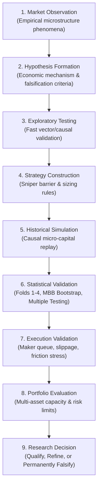
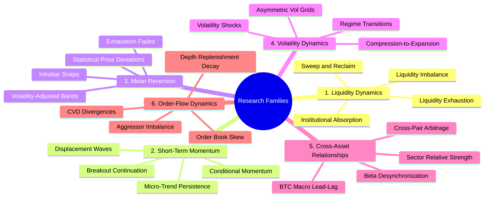
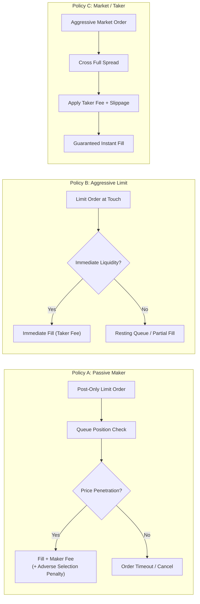
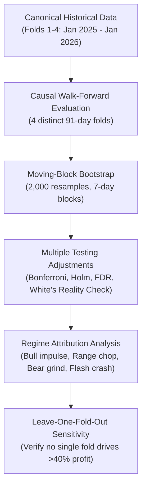

# QUANTUM — High-Turnover Alpha Feasibility Study
## Research Roadmap, Execution Methodology & Implementation Timeline

**Initiative Name:** QUANTUM High-Turnover Alpha Feasibility Study  
**Document Identifier:** `docs/research/HIGH_TURNOVER_ALPHA_FEASIBILITY_ROADMAP.md`  
**Git Branch:** `research/high-turnover-alpha-feasibility`  
**Base Commit:** `dcc8ceb54d80b1b9685d92236f48b0994610522a`  
**Author:** QUANTUM Quantitative Research & Architecture Team  
**Supervisory Authority:** Human Governance Supervisor / Project Owner (Azis Maulana Suhada)  
**Creation Date:** `2026-11-03`  
**Operational Status:** **SESSION 0 — PREPARATION ONLY (NO EXPERIMENTS AUTHORIZED YET)**

---

## 1. Project Objective

The primary objective of the **High-Turnover Alpha Feasibility Study** is to rigorously determine whether the QUANTUM autonomous quantitative system can systematically discover, validate, and execute high-frequency, high-turnover trading strategies that maintain **statistically robust, positive net economic expectancy after all realistic friction costs**.

Our research ambition encompasses high annualized compounding, scaling to hundreds or thousands of percent if supported by genuine, reproducible, out-of-fold empirical evidence. However, this study operates on strict scientific principles:
- High returns are treated as an **empirical research question**, never an unverified assumption.
- The system will **never force or curve-fit backtests** to manufacture an arbitrary return target.
- Risk controls and capital preservation constraints remain absolute and non-negotiable.

---

## 2. Central Research Question

The core scientific inquiry governing this entire initiative is:

> **"Can QUANTUM discover high-turnover market opportunities with statistically significant, positive net expectancy after accounting for realistic order-book execution mechanics, taker fees, bid-ask spread crossing, queue latency, adverse selection, and funding costs across diverse cryptocurrency perpetual assets and distinct macroeconomic volatility regimes?"**

Sub-questions under active investigation:
1. *What is the empirical gross alpha ceiling of the existing 11 specialist LightGBM models across micro-timeframes?*
2. *Can passive maker order placement overcome the queue priority and adverse selection penalties in high-volatility regimes?*
3. *What is the minimum holding horizon required for a directional or mean-reverting trade to overcome the 18–44 bps round-trip friction hurdle of centralized and decentralized derivative venues?*
4. *How does strategy turnover scale with capital capacity, given minimum notional constraints ($5.00 USDT) and exchange rate limits?*

---

## 3. Research Philosophy: Research-Driven Discovery

QUANTUM strictly rejects blind brute-force parameter optimization, unconstrained grid searches, and p-hacking. Discovery must follow a hypothesis-driven 9-stage scientific lifecycle:



### 3.1 Standards of Proof
Every proposed strategy candidate must satisfy:
- **Economic Rationale:** Explicitly state *why* the counterparty is giving up alpha (e.g. inventory rebalancing, forced liquidation cascades, structural order-flow imbalance, liquidity provider skew).
- **Testable Conditions:** Formulated in declarative, machine-readable parameter contracts.
- **Explicit Falsification Criteria:** Pre-defined statistical failure boundaries that permanently retire the hypothesis if breached.
- **Deterministic Code:** All backtests, PnL accounting, and metrics must be calculated by deterministic, testable Python code—never LLM qualitative assertion.

---

## 4. Research Families to Investigate

The feasibility study will explore six foundational quantitative alpha families across micro-horizons (1-minute to 60-minute holding horizons):



1. **Liquidity Dynamics:**
   - *Phenomenon:* Large market orders exhaust resting book depth at major swing points, followed by institutional absorption and rapid price reclaim.
   - *Hypothesis:* When an aggressive price spike penetrates a liquidity pool without continuation, entering in the direction of the absorption provides positive skew.
2. **Short-Term Momentum:**
   - *Phenomenon:* Momentum persistence following volume-backed range breakouts.
   - *Hypothesis:* Directional impulse with relative volume (RVOL $\ge 1.8$) and aggressor buy ratio ($\ge 55\%$) continues for 3–12 bars before mean-reverting.
3. **Mean Reversion:**
   - *Phenomenon:* Extreme short-term statistical price deviations from moving averages or VWAP session anchors.
   - *Hypothesis:* Counter-trend entries conditioned on volatility-adjusted extremes ($\ge 2.5\sigma$) with lower/upper wick rejection yield favorable reward-to-risk reversion.
4. **Volatility Dynamics:**
   - *Phenomenon:* Periods of low historical volatility (compression) precede high-velocity volatility expansions.
   - *Hypothesis:* Capping entries to the early phase of volatility expansion ($\sigma_{20}/\sigma_{96} \ge 1.25$) avoids choppy regimes and expands barrier widths.
5. **Cross-Asset Relationships:**
   - *Phenomenon:* High-beta altcoins exhibit delayed responses (15–45 seconds to 3 minutes) to sharp Bitcoin price displacements.
   - *Hypothesis:* Altcoin specialists entering on BTC shock continuation or BTC liquidity reclaim capture amplified beta displacement.
6. **Order-Flow Dynamics:**
   - *Phenomenon:* Cumulative Volume Delta (CVD) divergences where price makes a new low but aggressive selling decreases.
   - *Hypothesis:* Aggressor trade flow exhaustion signals imminent order book replenishment and directional bounce.

---

## 5. Existing Six-Agent Architecture & Responsibility Matrix

The study strictly operates through QUANTUM's established six operational agents. No agents will be added, removed, or modified in scope:

| Agent Name | Architectural Identity | Feasibility Study Role & Responsibilities | Core Deliverables & State Contracts |
| :--- | :--- | :--- | :--- |
| **Scout** | `ScoutAgent` (`AgentId.SCOUT`) | Microstructure surveillance, candidate filtering, anomaly detection, fast wick-trap and spread gating. | `ScoutInput` $\rightarrow$ `ScoutOutput` (`AgentAction.PROCEED` or `SKIP`). |
| **Analyst** | `AnalystAgent` (`AgentId.ANALYST`) | Regime classification (`TREND_IMPULSE`, `MEAN_REVERT_RANGE`, `HIGH_VOL_EXHAUSTION`, `LOW_LIQ_CHOP`), model probability calibration, predictive value verification. | `AnalystInput` $\rightarrow$ `AnalystOutput` (`MarketRegime`, calibrated probability, invalidation ATR). |
| **Sniper** | `SniperAgent` (`AgentId.SNIPER`) | Trade construction, barrier geometry (TP1, TP2, SL), holding horizon specification, execution policy assignment (Maker vs Taker). | `SniperInput` $\rightarrow$ `SniperOutput` (`TradeProposal`, reward-to-risk $\ge 1.50$, expected net R). |
| **Risk** | `RiskAgent` (`AgentId.RISK`) | Independent non-bypassable risk authorization, $100 equity sizing, leverage caps, max symbol/portfolio exposure, drawdown tripwires. | `RiskInput` $\rightarrow$ `RiskOutput` (`AgentAction.APPROVED` or `VETO_RISK`, approved quantity). |
| **Banker** | `BankerAgent` (`AgentId.BANKER`) | Order lifecycle management, fill simulation (maker queue vs taker impact), transaction cost tracking (fees, spread, slip, funding), execution feedback. | `PositionExecutionEvent` $\rightarrow$ `BankerOutput` (`TrackedPosition`, partial close, breakeven stop ratchet). |
| **Orchestrator** | `PipelineOrchestrator` | Cross-agent coordination, pipeline state machine, deterministic audit trace logging, experiment manifest linking. | `PipelineRunResult`, experiment provenance, governance compliance. |

---

## 6. Data Requirements & Availability Audit Plan

The study targets 11 cryptocurrency perpetual contracts:

$$\mathcal{U}_{\text{research}} = \{\text{BTC}, \text{ETH}, \text{SOL}, \text{BNB}, \text{XRP}, \text{DOGE}, \text{ADA}, \text{AVAX}, \text{LINK}, \text{LTC}, \text{XMR}\}\text{USDT.P}$$

### 6.1 Data Availability Status (Inspected in Session 0)

| Data Level | Required Granularity | Current Status in Workspace | Data Gap & Strategic Impact |
| :--- | :--- | :--- | :--- |
| **5-Minute Canonical Bars** | 5m OHLCV + Taker Volume | **AVAILABLE** (`data/historical/canonical/exchange=ASTER/`) | Full confirmatory window (Folds 1–4, 104,544 bars/asset). Fully verified. |
| **15-Minute & 1-Hour Bars** | 15m / 1h OHLCV | **AVAILABLE** (`data/historical/canonical/exchange=ASTER/`) | Verified for macro trend and higher-timeframe regime filters. |
| **1-Minute Micro-Bars** | 1m OHLCV + Trade Count | **NOT AVAILABLE** (Not backfilled) | **GAP:** Cannot test sub-5m execution without backfilling canonical 1m datasets. |
| **Tick Aggressor Flow** | Trade-by-trade ticks | **NOT AVAILABLE** (Not backfilled) | **GAP:** Cannot compute exact tick CVD or sub-bar volume profiles from historical archive. |
| **L2 Order Book Depth** | 100ms / 1s Depth Snapshots | **NOT AVAILABLE** (Not backfilled) | **GAP:** Real queue depth and replenishment cannot be replayed from historical parquets. |
| **OOF Model Probabilities** | 5m Out-Of-Fold LightGBM | **AVAILABLE** (`artifacts/phase_5_4/materialized_oof/`) | Verified for Folds 1–4 across all 11 assets. |

> [!IMPORTANT]
> **Data Integrity Constraint:**  
> Backtests conducted on 5m OHLCV bars **must not be misrepresented as sub-second or order-book HFT**. The feasibility study will explicitly state the data resolution of every experiment.

---

## 7. Execution Experiment Design & Friction Modeling

The feasibility study will systematically evaluate three explicit execution policies under strictly comparable market regimes:



### 7.1 Policy Rules & Microstructure Physics
1. **Passive Maker Policy:**
   - Order type: `LIMIT (POST_ONLY)` placed at or behind the inside Bid/Ask.
   - Fill condition: Price must penetrate through the limit price by at least $0.02\sigma$ to model queue exhaustion.
   - Costs: Maker fee ($\le 8.0\text{ bps}$ round-trip; negative rebate where applicable).
   - Friction: Suffer adverse selection penalty ($-2.0\text{ bps}$ per executed trade) and opportunity cost from unfilled orders.
2. **Aggressive Limit Policy:**
   - Order type: `LIMIT` placed at the opposite touch (crossing spread to Bid 1 / Ask 1).
   - Fill condition: Partial fills modeled based on bar volume; unexecuted balance cancelled after 1 bar.
   - Costs: Hybrid tier fee ($14.0\text{ to }18.0\text{ bps}$ round-trip) with modest slippage ($1.0\text{ bps}$).
3. **Market / Taker Policy:**
   - Order type: `MARKET`.
   - Fill condition: 100% instantaneous execution at open price.
   - Costs: Full taker fee ($18.0\text{ to }40.0\text{ bps}$ round-trip) + full bid-ask spread ($2.0\text{ to }4.0\text{ bps}$) + market impact slippage ($1.0\text{ to }4.0\text{ bps}$).

### 7.2 Decomposition of Strategy Alpha
The study will report three separate performance tiers for every strategy:
$$\text{Predictive Edge (Gross)} = \frac{1}{N} \sum_{k=1}^N \Delta P_k^{\text{raw}}$$
$$\text{Execution Edge} = \text{Taker Cost Schedule} - \text{Actual Realized Execution Cost}$$
$$\text{Combined Net Strategy Edge} = \text{Predictive Edge} - \text{Total Realized Execution Costs}$$

---

## 8. Net Expectancy Evaluation Framework

The foundational economic metric for all QUANTUM research is **Net Expectancy per Trade**:

$$\mathbb{E}_{\text{net}} = \mathbb{E}_{\text{gross}} - \left( C_{\text{fee}}^{\text{entry}} + C_{\text{fee}}^{\text{exit}} + C_{\text{spread}} + C_{\text{slip}} + C_{\text{fund}} + C_{\text{adverse}} \right)$$

Where:
- $\mathbb{E}_{\text{gross}}$: Average gross price displacement in basis points.
- $C_{\text{fee}}$: Exchange fee schedules (maker vs taker).
- $C_{\text{spread}}$: Half-spread on entry + half-spread on exit (for market orders).
- $C_{\text{slip}}$: Market impact slippage as a function of order size relative to 5m candle volume.
- $C_{\text{fund}}$: 8-hour funding rate cost prorated by holding duration.
- $C_{\text{adverse}}$: Empirical post-fill price degradation on limit orders.

### 8.1 Reporting Disaggregation Mandate
To maintain strict statistical hygiene, the system will never report signal opportunities as executed trades:
- **Signal Count ($N_{\text{signal}}$):** Total times entry criteria were met.
- **Submitted Order Count ($N_{\text{order}}$):** Signals approved by RiskAgent and submitted to the exchange.
- **Filled Trade Count ($N_{\text{filled}}$):** Orders that actually achieved fill execution.
- **Fill Rate:** $\text{FR} = N_{\text{filled}} / N_{\text{order}}$.

---

## 9. Statistical Validation Methodology

All feasibility evaluations will enforce non-negotiable statistical safeguards:



1. **Walk-Forward Fold Consistency:** Must demonstrate positive net expectancy across at least 3 of the 4 confirmatory folds.
2. **Multiple Hypothesis Testing Correction:** When testing $M$ strategy configurations, report raw p-values alongside:
   - Bonferroni family-wise error rate adjustment ($\alpha / M$).
   - Benjamini-Hochberg False Discovery Rate ($q^* = 0.10$).
3. **Block Bootstrap Confidence Intervals:** 95% bootstrap intervals for mean net daily return using 7-day calendar blocks to preserve serial autocorrelation.
4. **Prospective Holdout Isolation:** The prospective holdout starting `2026-11-01 00:00:00 UTC` ($1793491200000\text{ ms}$) remains **strictly sealed**. Zero historical backtesting will touch this window.

---

## 10. Risk Governance & Capital Constraints

All feasibility models will simulate execution under realistic micro-capital parameters:

| Parameter | Governance Constraint | Operational Meaning |
| :--- | :--- | :--- |
| **Initial Capital** | **`$100.00 USD`** | Micro-capital baseline; reflects realistic retail/small-fund scaling constraints. |
| **Minimum Notional** | **`$5.00 USDT`** | Strict per-order minimum notional enforced by derivatives exchanges (e.g. Aster / Binance). |
| **Risk per Trade** | **`1.0% to 2.5%`** | Risk-budgeted position sizing based on stop-loss distance fraction ($N = R_t / D_{\text{stop}}$). |
| **Maximum Symbol Exposure**| **`30.0% to 45.0%`** | Cap on single-asset notional allocation relative to current portfolio equity. |
| **Maximum Portfolio Exposure**| **`100.0% to 120.0%`** | Maximum aggregate concurrent notional across all open positions. |
| **Maximum Leverage** | **`2.0x`** | Hard ceiling on gross portfolio leverage. |
| **Max Concurrent Positions**| **`4 positions`** | Prevents capital fragmentation on small equity accounts. |
| **Maximum Portfolio Drawdown**| **`30.0%`** | Absolute hard stop loss on portfolio equity. |
| **Preferred Average Drawdown**| **`< 10.0%`** | Target average underwater drawdown for sustainable compounding. |

---

## 11. Historical Results to Revisit & Audit

The feasibility study will explicitly audit and re-verify key claims from previous QUANTUM research phases:

| Historical Claim | Source Document / Phase | Planned Verification Task in Study |
| :--- | :--- | :--- |
| **~1.32M Generated Signals** | Phase 5.5 Governance Dossier | Audit raw barrier crossing trigger logs across all 11 assets and 5 folds. |
| **285,270 Executed Trades** | Phase 5.5 Mode 1 Historical Backtest | Reconcile 10-asset ($282,692$) vs 11-asset ($285,270$) trade population manifests. |
| **Model ROC-AUC 0.61–0.69** | Phase 5.3 Model Delivery Reports | Verify out-of-fold Brier score, ROC-AUC, and calibration across all 11 frozen specialists. |
| **STRAT_242 Execution Inconsistency**| Phase 5.6.2 Forensic Review | Permanently document the market-order / maker-fee mismatch and enforce strict separation. |
| **Batch 003 Candidate Correlation**| Phase 5.6.2 Post-300 Review | Verify that all 100 Batch 003 strategies share $\bar{\rho} = 0.9233$ correlation around STRAT_134. |
| **Fold 3 Profit Concentration**| Phase 5.6.2 Statistical Audit | Re-verify that $85.2\%$ of STRAT_242's return came from Fold 3, and establish multi-fold robustness criteria. |

---

## 12. Implementation Staged Timeline

The study is organized into seven sequential milestones. Each milestone requires verified completion of its prerequisites before proceeding:

```mermaid
gantt
    title High-Turnover Alpha Feasibility Study Staged Timeline
    dateFormat YYYY-MM-DD
    section Preparation
    Session 0: Research Roadmap & Git Branch          :done, s0, 2026-11-03, 1d
    section Execution Phases
    Session 1: Infrastructure & Data Readiness Audit  :active, s1, 2026-11-04, 2026-11-07
    Session 2: Historical Evidence Reproduction       :s2, after s1, 3d
    Session 3: Alpha Feasibility Discovery            :s3, after s2, 4d
    Session 4: Execution Feasibility & Friction Stress:s4, after s3, 3d
    Session 5: Statistical & Portfolio Validation     :s5, after s4, 3d
    Session 6: Research Decision & Governance Dossier :s6, after s5, 2d
```

### Staged Session Descriptions

- **SESSION 0 — PREPARATION (Completed in this session):**
  - Create isolated Git branch: `research/high-turnover-alpha-feasibility`.
  - Author primary roadmap: `docs/research/HIGH_TURNOVER_ALPHA_FEASIBILITY_ROADMAP.md`.
  - Author readiness checklist: `docs/research/HIGH_TURNOVER_READINESS_CHECKLIST.md`.
  - Deliverable: Complete preparation package and branch isolation.

- **SESSION 1 — PROJECT AUDIT (Proposed: Wednesday 2026-11-04 or Saturday 2026-11-07):**
  - Audit existing six-agent interfaces (`Scout`, `Analyst`, `Sniper`, `Risk`, `Banker`, `Orchestrator`).
  - Audit data granularity (assess requirements to acquire 1m / tick data).
  - Inspect test harness and execution simulator integrity.
  - Deliverable: `audit/strategy_research/HIGH_TURNOVER_READINESS_AUDIT.md`.

- **SESSION 2 — HISTORICAL EVIDENCE REPRODUCTION:**
  - Re-verify signal-to-trade conversion on Phase 5.5 and Phase 5.6 datasets.
  - Reconcile trade accounting on selected historical configurations.
  - Deliverable: `audit/strategy_research/HISTORICAL_EVIDENCE_REPRODUCTION.md`.

- **SESSION 3 — ALPHA FEASIBILITY DISCOVERY:**
  - Compute forward-return distributions across the six research families on 5m/1m data.
  - Formulate and test initial conditional alpha hypotheses against random-walk drift.
  - Deliverable: `audit/strategy_research/ALPHA_FEASIBILITY_REPORT.md`.

- **SESSION 4 — EXECUTION FEASIBILITY & FRICTION STRESS:**
  - Simulate Passive Maker, Aggressive Limit, and Taker on all surviving candidates.
  - Measure fill rates, queue timeouts, adverse selection, and breakeven friction limits.
  - Deliverable: `audit/strategy_research/EXECUTION_FEASIBILITY_REPORT.md`.

- **SESSION 5 — STATISTICAL & PORTFOLIO VALIDATION:**
  - Walk-forward multi-fold validation across Folds 1–4.
  - Multiple testing corrections (Bonferroni, Holm, FDR, White's Reality Check).
  - Multi-asset portfolio integration and capacity limits on $100 USD equity.
  - Deliverable: `audit/strategy_research/STATISTICAL_AND_PORTFOLIO_VALIDATION.md`.

- **SESSION 6 — RESEARCH DECISION:**
  - Present consolidated findings to Human Governance Supervisor.
  - Rank qualified strategies and permanently log falsified hypotheses.
  - Recommend whether to proceed to paper-trading daemon deployment or pivot research.
  - Deliverable: `audit/strategy_research/HIGH_TURNOVER_RESEARCH_DECISION.md`.

---

## 13. Required Deliverables Index

| Session | Primary Deliverable File | Supporting Artifacts |
| :--- | :--- | :--- |
| **Session 0** | `docs/research/HIGH_TURNOVER_ALPHA_FEASIBILITY_ROADMAP.md` | `docs/research/HIGH_TURNOVER_READINESS_CHECKLIST.md`, branch `research/high-turnover-alpha-feasibility` |
| **Session 1** | `audit/strategy_research/HIGH_TURNOVER_READINESS_AUDIT.md` | `data_backtest/audit/data_readiness_manifest.json` |
| **Session 2** | `audit/strategy_research/HISTORICAL_EVIDENCE_REPRODUCTION.md`| `data_backtest/recalculated/historical_reproduction_ledger.json` |
| **Session 3** | `audit/strategy_research/ALPHA_FEASIBILITY_REPORT.md` | `data_backtest/feasibility/forward_return_distributions.json` |
| **Session 4** | `audit/strategy_research/EXECUTION_FEASIBILITY_REPORT.md` | `data_backtest/feasibility/execution_friction_scenarios.json` |
| **Session 5** | `audit/strategy_research/STATISTICAL_AND_PORTFOLIO_VALIDATION.md` | `data_backtest/portfolio/validated_portfolio_evaluation.json` |
| **Session 6** | `audit/strategy_research/HIGH_TURNOVER_RESEARCH_DECISION.md` | Final governance signoff package |

---

## 14. Dependencies, Technical Blockers & Data Gaps

1. **Absence of 1-Minute and Tick Data in Archive:**
   - *Blocker:* Existing canonical parquets provide 5m, 15m, and 1h bars. High-turnover micro-strategies operating on $\le 1\text{m}$ horizons require either backfilling 1m bars from exchange REST/WS archives or synthesizing intrabar tick paths from high/low/close bounds.
   - *Mitigation Plan for Session 1:* Audit exchange data backfill endpoints and determine storage/compute footprints for 1m canonical tables.
2. **Order-Book Queue Simulation Physics:**
   - *Blocker:* 5m OHLCV bars do not record L2 order book queue depth.
   - *Mitigation Plan:* Utilize volume-based fill probability functions ($P(\text{fill}) = f(\text{Volume}_{\text{through}} / \text{Volume}_{\text{bar}})$) and conservative adverse selection discounts until L2 data is backfilled.
3. **Execution Fee Asymmetry:**
   - *Blocker:* Exchange fee schedules vary dramatically between Aster DEX (40 bps taker) and centralized VIP tiers (10–18 bps taker).
   - *Mitigation Plan:* Evaluate all strategies against a parameterized 3-tier friction schedule (8 bps maker, 15 bps hybrid, 20–44 bps taker).

---

## 15. Explicit List of Activities Not Yet Authorized

In accordance with Section 3 and Section 15 of the Project Directive, the following activities are **STRICTLY PROHIBITED** during Session 0 and remain unauthorized until explicit owner approval:

- ❌ **NO Strategy Batch Generation:** Do not generate Batch 004 or hundreds of strategy configuration JSONs.
- ❌ **NO Large-Scale Backtests:** Do not execute backtesting sweeps or automated discovery loops.
- ❌ **NO Model Training or Retraining:** Do not train, fine-tune, or alter the Phase 5.3 frozen LightGBM specialists.
- ❌ **NO Architecture Changes:** Do not alter, rename, or re-wire the six operational agents (`Scout`, `Analyst`, `Sniper`, `Risk`, `Banker`, `Orchestrator`).
- ❌ **NO Holdout Access:** Do not inspect, query, or process data with timestamps $\ge 1793491200000\text{ ms}$ (`2026-11-01 00:00:00 UTC`).
- ❌ **NO Historical Artifact Alteration:** Do not modify, delete, or overwrite artifacts in `artifacts/phase_5_5/`, `artifacts/phase_5_6/`, `artifacts/phase_5_6_2/`, or `data_backtest/`.
- ❌ **NO Live or Paper Daemon Submission:** Do not launch daemon processes, submit orders, or connect live API keys.

---

*End of Roadmap Document. Awaiting Human Governance Supervisor review and formal Session 1 authorization.*
