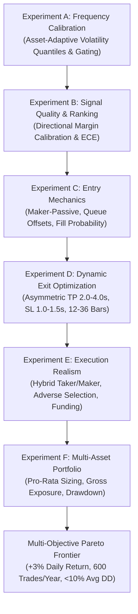

# QUANTUM Phase 5.6.2: Aggressive Frequency, High-Return & Drawdown Optimization Mandate
**Document Identifier:** `docs/research/phase_5_6_2/QUANTUM_PHASE_5_6_2_RESEARCH_MANDATE.md`  
**Publication Date:** 2026-11-03  
**Status:** `ACTIVE_RESEARCH_MANDATE` (Phase 6A/6B Suspended)  
**Authority:** Project Owner Directive (Azis Maulana Suhada)  
**Governance Scope:** Research Execution on Historical Folds 1–4 (Fold 5 Exploratory; Prospective Holdout $\ge 1793491200000\text{ ms}$ Strictly Sealed)

---

## 1. Project Owner Mandate & Executive Summary

By order of the Project Owner, development and deployment of **Phase 6A (Autonomous Paper-Trading Daemon)** and **Phase 6B (C# Avalonia Desktop Control Center)** are **temporarily suspended**. All existing software engineering artifacts in `src/quantum/daemon/` and `desktop/QuantumDesktop/` are preserved intact but frozen from further development.

The entire research effort is redirected back to **Phase 5 (Phase 5.6.2)**.

### Core Strategic Directive
The objective of QUANTUM is **not** to construct a conservative, low-activity strategy that achieves low drawdown merely by rarely trading. QUANTUM must operate as an aggressive, high-frequency autonomous trading system that simultaneously satisfies:

1. **High Trading Frequency:** Approximately **600 completed trades per asset per year** ($\approx 6,000$ trades/year across the 10-asset primary fleet).
2. **Aggressive Equity Growth:** Targets **+3% net portfolio equity return per day** calculated on total mark-to-market portfolio equity after realistic trading costs.
3. **Controlled Drawdown:** Prefers **average underwater drawdown below 10%**, with an immutable hard ceiling of **$\le 30\%$ maximum portfolio drawdown**.
4. **Positive Net Economic Expectancy:** Every executed trade must demonstrate statistical edge over realistic friction (maker/taker fees, slippage, funding).

---

## 2. Research Targets & Mathematical Definitions

### 2.1 Portfolio Return Targets
* **Primary Target:** $+3\%$ net portfolio equity return per day.
* **Return Basis:** Return must be evaluated on **Total Mark-to-Market Portfolio Equity** ($\text{Equity}_t$), inclusive of realized cash, open position unrealized PnL, maker/taker execution fees, slippage penalties, and 8-hour funding cashflows.
* **Prohibited Return Manipulations:**
  - Return on margin or isolated position notional.
  - Leverage-inflated individual trade returns.
  - Arithmetic sum of uncoordinated single-asset returns.
  - Gross PnL prior to execution friction.
* **Mandatory Reporting Metrics:**
  - Daily net returns series $r_{\text{day}, d} = \frac{\text{Equity}_d - \text{Equity}_{d-1}}{\text{Equity}_{d-1}}$
  - Arithmetic mean daily return: $\mu_{\text{daily}} = \frac{1}{D} \sum_{d=1}^D r_{\text{day}, d}$
  - Geometric mean daily return: $g_{\text{daily}} = \left(\prod_{d=1}^D (1 + r_{\text{day}, d})\right)^{1/D} - 1$
  - Median daily return
  - Rolling 7-day, 30-day, and 90-day returns
  - Monthly net return breakdown
  - Annualized compound return: $\text{CAGR} = (1 + g_{\text{daily}})^{365.25} - 1$ (with compounding constraints disclosed)

### 2.2 Drawdown Objectives & Definitions
* **Preferred Target:** Average underwater drawdown $< 10\%$.
* **Hard Maximum Portfolio Drawdown:** $\le 30.0\%$ (Configurations exceeding 30% MDD are rejected automatically).
* **Mandatory Drawdown Metrics:**
  - Peak equity series: $\text{Peak}_t = \max_{0 \le s \le t} \text{Equity}_s$
  - Underwater drawdown series: $\text{DD}_t = \frac{\text{Peak}_t - \text{Equity}_t}{\text{Peak}_t} \times 100\%$
  - Mean underwater drawdown: $\overline{\text{DD}} = \frac{1}{T} \sum_{t=1}^T \text{DD}_t$
  - Median underwater drawdown
  - Average peak-to-trough episode depth across all completed drawdowns
  - Maximum Drawdown (MDD): $\max_t \text{DD}_t$
  - Maximum drawdown duration (bars and days from peak to recovery)
  - Mean recovery time
  - Worst single-day loss
  - Worst rolling 7-day loss

### 2.3 Trading Frequency Mandate
* **Primary Target:** $\approx 600$ completed trades per primary asset per year.
* **Portfolio Aggregate Target:** $\approx 6,000$ completed trades per year across the 10 primary specialists.
* **Measurement Rule:** Frequency must be measured on **completed executed trades**, not raw generated signals.
* **Primary Universe (10 Assets):**
  - `BTCUSDT.P`
  - `ETHUSDT.P`
  - `BNBUSDT.P`
  - `XRPUSDT.P`
  - `ADAUSDT.P`
  - `SOLUSDT.P`
  - `AVAXUSDT.P`
  - `LINKUSDT.P`
  - `DOGEUSDT.P`
  - `LTCUSDT.P`
* **Standalone Exploratory Asset:** `XMRUSDT.P` (reported in a dedicated appendix pursuant to DEC_06).

---

## 3. Preservation of Historical Baselines

The Phase 5.6.2 research framework explicitly preserves and benchmarks against previous experimental phases:

1. **Frozen ML Artifacts:** The 11 Phase 5.3 LightGBM specialist models, feature pipelines, and out-of-fold (`artifacts/phase_5_4/materialized_oof/*.parquet`) predictions remain frozen and unedited.
2. **Phase 5.5 High-Frequency Failure Baseline (Mode 1):**
   - 285,270 total trades ($\approx 25,930$ trades/asset).
   - Unconditional market-order execution with 44.0 bps taker friction.
   - Result: $-99.4\%$ equity destruction because median barrier width (15–31 bps) was smaller than friction.
   - Preserved in `artifacts/phase_5_5/` as the **Negative Failure Baseline**.
3. **Phase 5.6 Low-Frequency Overlap Baseline:**
   - Restrictive overlay grid (103 to 194 trades across 2.4 years, or $\approx 4\text{ to }8$ trades/asset/year).
   - In-sample cherry-picked profit factors; uniform portfolio suffered net losses ($-2.97\%$ to $-3.77\%$).
   - Preserved in `artifacts/phase_5_6/overlay_validation_report.json` as the **Restrictive / Under-Trading Baseline**.
4. **Research Objective for Phase 5.6.2:** Navigate between these two failure modes: increase frequency from tens of trades to $\approx 600$ trades/asset/year while generating positive net expectancy and sub-10% average drawdown.

---

## 4. Phase 5.6.2 Experimental Program

### Experiment A — Frequency Calibration
- Investigate asset-adaptive volatility regimes: replace uniform bps floors with rolling empirical volatility quantiles ($q_{0.20}, q_{0.35}, q_{0.50}$).
- Test adaptive probability margin thresholds ($\max(p_{\text{long}}, p_{\text{short}}) - p_0 \ge \theta_{\text{asset}}$).
- Evaluate inter-trade cooldown periods ($0, 1, 3$ bars) and non-overlapping position holding.
- Target: Verify whether $\approx 600$ trades/asset/year is mathematically achievable without triggering negative gross expectancy.

### Experiment B — Predictive Signal Quality
- Calibrate Phase 5.3 classifier probabilities ($P(\text{Long}), P(\text{Neutral}), P(\text{Short})$) against true empirical outcome rates.
- Evaluate conditional forward returns across directional conviction bins.
- Establish empirical TP-hit probability, SL-hit probability, and timeout probability as functions of probability margin.

### Experiment C — Entry Optimization
- Compare Market Entry (immediate taker) vs. Passive Maker Limit Entry.
- Evaluate volatility-adaptive limit order placement offsets:
  $$P_{\text{limit}} = P_{\text{open}} \mp \delta \cdot \sigma_t \quad (\delta \in \{0.0, 0.1, 0.25\})$$
- Model trade-through vs. touch-only queue fills.
- Enforce order cancellation after $N$ bars for unfilled runaway orders.

### Experiment D — Dynamic Exit Optimization
- Structured parameter grid:
  - Take-Profit ($k_{\text{TP}}$): $2.0\sigma_t, 2.5\sigma_t, 3.0\sigma_t, 4.0\sigma_t$
  - Stop-Loss ($k_{\text{SL}}$): $1.0\sigma_t, 1.2\sigma_t, 1.5\sigma_t$
  - Maximum Holding Horizon ($H$): $12\text{ bars } (60\text{m}), 24\text{ bars } (120\text{m}), 36\text{ bars } (180\text{m})$
- Evaluate trailing stop and break-even stop logic.

### Experiment E — Execution Cost and Realism
- Model realistic fee schedules:
  - Tier 1: Hybrid Maker-Entry / Taker-Stop (4.0 bps entry maker, 40.0 bps SL taker, 4.0 bps TP maker, 40.0 bps horizon taker).
  - Tier 2: Conservative All-Taker (40.0 bps entry taker, 40.0 bps exit taker, 4.0 bps slippage).
  - Tier 3: Passive Maker-Only (8.0 bps round-trip upper bound).
- Incorporate intrabar adverse selection penalty on maker fills.
- Model 8-hour funding cashflows based on canonical historical rates.

### Experiment F — Multi-Asset Portfolio Optimization
- Simulate simultaneous multi-asset portfolio ledger under DEC_05 Option 3 constraints:
  - Aggregate gross exposure cap: $\le 30.0\%$ equity.
  - Single-asset ceiling: $\le 10.0\%$ gross notional.
  - Pro-rata scaling of concurrent signals across available capacity.
  - Realized and unrealized equity compounding.

---

## 5. Multi-Objective Optimization & Acceptance Criteria

Every candidate strategy configuration is evaluated across the complete 9-dimensional multi-objective criterion matrix:

| Metric | Target / Acceptance Threshold | Formula / Source |
| :--- | :---: | :--- |
| **Net Portfolio Daily Return** | **Target: $+3.0\%$ / day** | $\mu_{\text{daily}} \ge +0.03$ |
| **Trade Frequency per Asset** | **$\approx 600$ trades / year** | $\text{Trades} \in [500, 750]$ per asset/year |
| **Portfolio Aggregate Frequency**| **$\approx 6,000$ trades / year** | $\sum_{i=1}^{10} \text{Trades}_i \approx 6,000$ |
| **Average Underwater Drawdown** | **Preferred: $< 10.0\%$** | $\overline{\text{DD}} < 10.0\%$ |
| **Maximum Portfolio Drawdown** | **Hard Cap: $\le 30.0\%$** | $\max_t \text{DD}_t \le 30.0\%$ |
| **Net Expectancy** | **Strictly Positive** | $\mathbb{E}[R_{\text{net}}] > 0.0\text{ bps}$ |
| **Profit Factor** | **$\ge 1.20$** | $\frac{\sum \text{Net Wins}}{\sum |\text{Net Losses}|} \ge 1.20$ |
| **Cost Model** | **Fully Modeled** | Hybrid maker/taker + adverse selection + funding |
| **Out-of-Sample Robustness** | **Positive across Folds 1–4** | Zero fold with negative net equity growth |

---

## 6. Governance & Data Integrity Restrictions

1. **Prospective Holdout Barrier:** The prospective holdout window ($\ge 1793491200000\text{ ms}$, November 1, 2026 UTC) remains **strictly sealed**. No historical replay or research experiment may touch, inspect, or tune against this data.
2. **Fold Separation:** Confirmatory testing is restricted to Folds 1 through 4. Fold 5 remains strictly exploratory.
3. **No Unjustified Retraining:** Pretrained Phase 5.3 models remain frozen. Strategy and overlay optimization operate strictly at the execution and signal gating layer.
4. **No Retroactive Claims:** Phase 5.6 remains officially `NOT_AUTHORIZED`. Gate 4 remains `NOT_AUTHORIZED`. All Phase 5.6.2 outputs are categorized as research findings.

---

## 7. Change Log

| Version | Date | Author | Description of Changes |
| :--- | :---: | :--- | :--- |
| **1.0.0** | 2026-11-03 | Project Owner & Quant Lead | Initial formalization of QUANTUM Phase 5.6.2 Research Mandate. Suspends Phase 6A/6B; establishes +3% daily return target, ~600 trades/asset/year mandate, <10% average DD / <=30% MDD risk targets, and the 6-stage experimental framework. |
